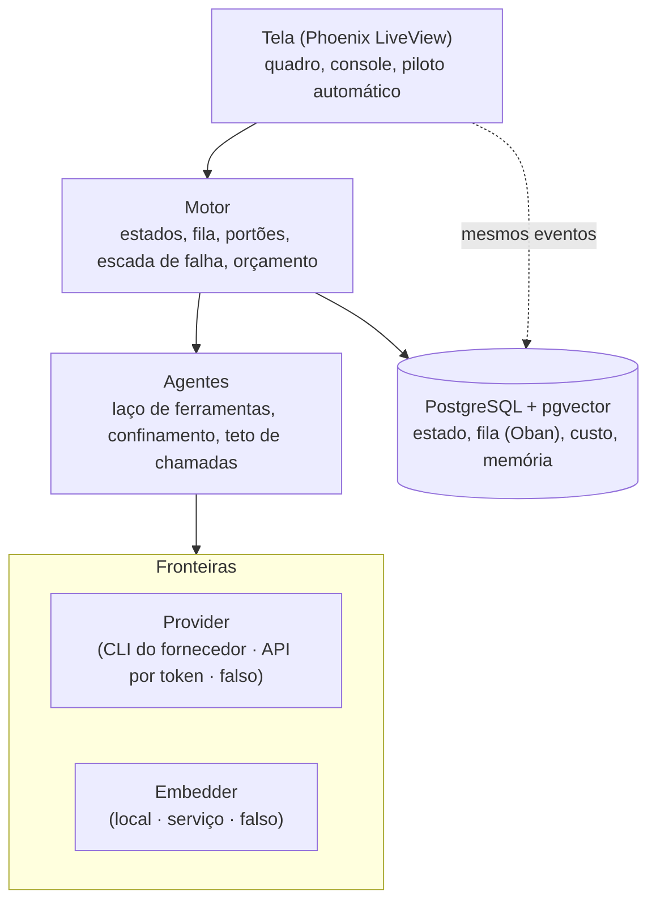
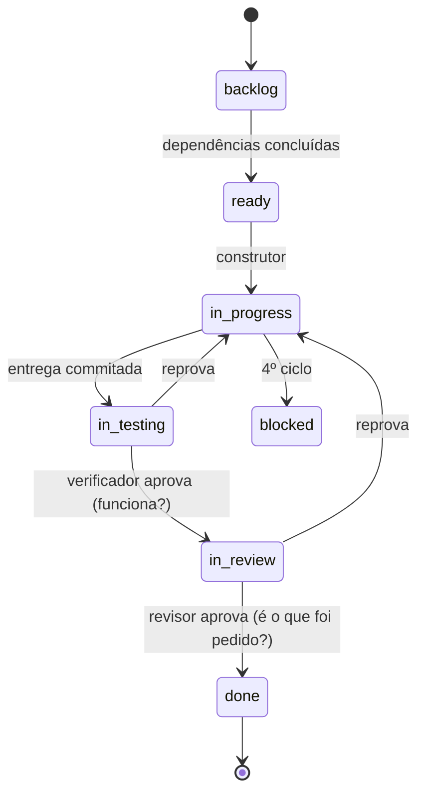

# Arquitetura

## A ideia central

Um sistema multi-agente não falha por escrever mal, e sim por governar mal. As regras de governança
saem do texto do pedido e passam a morar na estrutura do programa, onde deixam de ser opcionais.

| A regra | Como costuma existir | Onde mora aqui |
|---|---|---|
| Não escrever fora do projeto | pedido no texto | a ferramenta de escrita recusa o caminho |
| No máximo três tentativas | lembrete que pode ser ignorado | contador no banco, que o agente não altera |
| Quem constrói não aprova | combinação de papéis | quem revisa não recebe ferramenta de escrita |
| Não estourar o orçamento | recomendação | o sistema não deixa começar o que não cabe |

## As quatro camadas

Cada camada só conhece a de baixo. As fronteiras (em destaque) permitem trocar o fornecedor do
modelo ou a busca sem mexer no motor.



## O caminho de uma tarefa

A unidade de trabalho é a tarefa: pequena, com critérios de aceite que são comandos. Cada passagem
de estado é feita por um agente diferente de quem construiu.



## O que acontece quando uma tarefa falha

Cada reprovação muda a estratégia. Quem conta os ciclos é o sistema, não o agente.

| Ciclo | O que o sistema faz | Por quê |
|---|---|---|
| 1º | Refaz com um modelo mais forte | a reprovação é o gatilho, não um palpite |
| 2º | Troca o agente especializado | duas reprovações seguidas indicam viés da abordagem |
| 3º | Quebra ou reescreve a tarefa | o problema pode ser o tamanho da tarefa |
| 4º | Bloqueia e passa ao humano | insistir custa sem aumentar a chance de acerto |

## Por que Elixir

O sistema não faz contas pesadas: ele espera respostas lentas de um serviço remoto, que podem
falhar. Elixir roda sobre a plataforma Erlang/OTP, feita para manter muitos trabalhos assim ao
mesmo tempo: cada agente é um processo isolado e supervisionado, e a queda de um não afeta os
outros. O custo da escolha é um ecossistema de IA menor que o de Python.

## A pilha

| Ferramenta | Para que serve |
|---|---|
| Elixir 1.19 / Erlang OTP 28 | linguagem e plataforma de processos supervisionados |
| Phoenix 1.8 + LiveView 1.2 | aplicação web e tela ao vivo |
| PostgreSQL 18 + Ecto 3.13 | todo o estado do sistema, numa transação |
| Oban 2.24 | fila durável dentro do banco |
| pgvector 0.8 | busca por semelhança, no mesmo banco |
| Req 0.5 | conversa com a API do fornecedor |
| ExUnit, Credo, Dialyzer | testes, estilo estrito, tipos |

## A verificação, num comando

```
mix factory.ci      # do estágio mais barato ao mais caro; o primeiro que falha interrompe os seguintes
  1. format    formatação
  2. compile   compilação, qualquer aviso reprova
  3. lint      Credo em modo estrito
  4. test      a suíte inteira, sem internet e sem custo
  5. types     Dialyzer
  6. backup    ida e volta do backup, isolada
```
