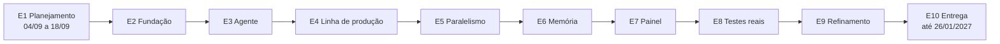
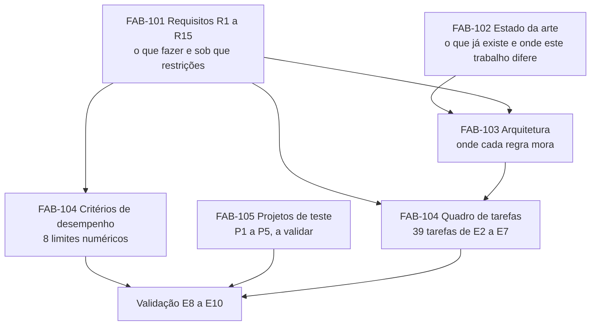
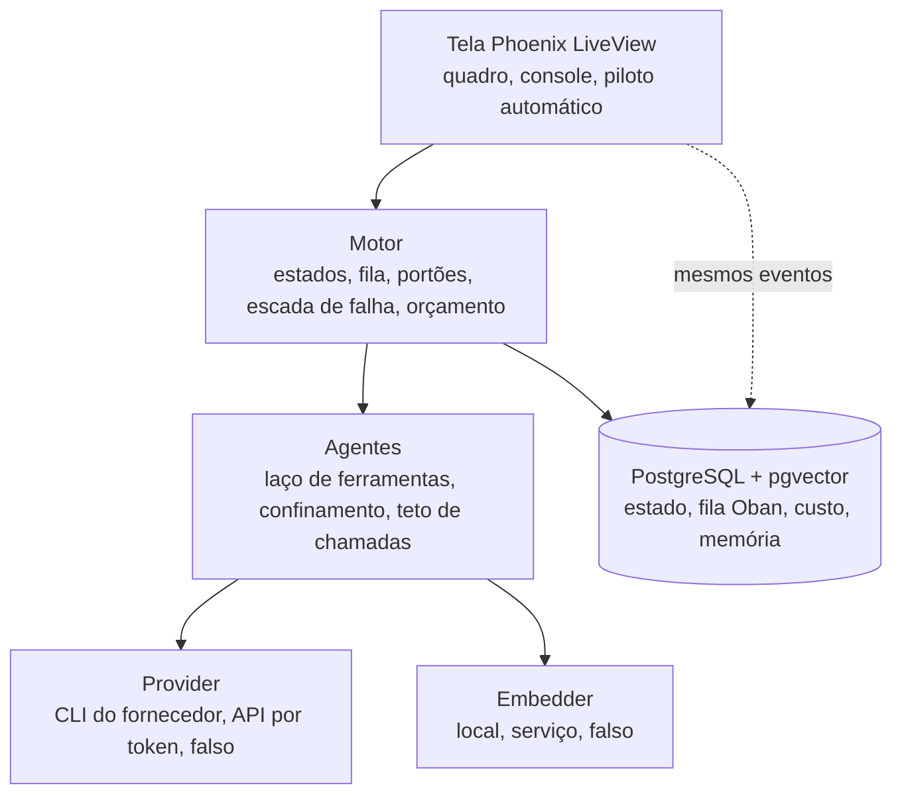
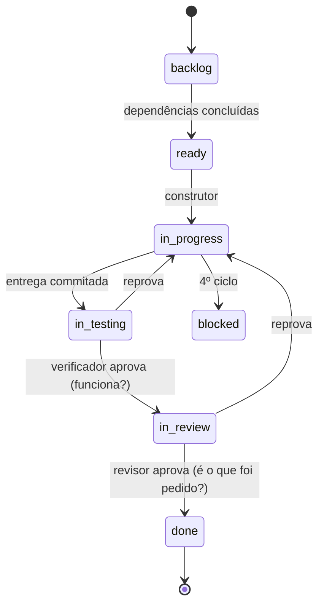

# E1 — Planejamento e arquitetura

## Em 30 segundos

- A E1 não tem código: entrega o **desenho completo do sistema** antes de programar a primeira linha.
- São cinco documentos: requisitos R1–R15, estado da arte, arquitetura, plano com 8 critérios de desempenho e o quadro de 39 tarefas de E2–E7, e a proposta dos cinco projetos de teste.
- Importa para a tese porque fixa a ideia central — **as regras de governança moram na estrutura do programa, não no texto do pedido** — e cada regra ganha um lugar no desenho onde é imposta.
- Também fixa a **régua da validação** (8 critérios com limite numérico e 5 projetos de teste), antes da construção, para que ela não seja ajustada ao sistema.
- A prova são os próprios documentos em `docs/planejamento/` e o quadro em `docs/tasks/`. Pendência: os cinco projetos de teste aguardam a validação do orientador (FAB-105).

> [!IDEIA] Um sistema multi-agente não falha por escrever mal, e sim por governar mal. A E1 transforma cada regra de governança ("não saia do projeto", "no máximo três tentativas", "quem constrói não aprova", "não estoure o orçamento") num mecanismo com endereço na arquitetura.

## Onde esta etapa está no plano

**Posição na cascata.** O plano tem 10 etapas em três fases sequenciais: planejamento (E1), construção (E2–E7) e validação (E8–E10). A E1 é a fase inteira de planejamento: requisitos e arquitetura são fechados aqui, antes de programar.



| Item | Valor (do `plano-de-desenvolvimento.docx`) |
|---|---|
| Datas planejadas | 04/09/2026 a 18/09/2026 |
| Pacotes e prazos | 1.1 Requisitos (3 dias úteis) · 1.2 Estado da arte (3) · 1.3 Arquitetura (2) · 1.4 Tarefas e critérios (2) — 10 de 11 dias úteis, 1 de folga |
| Entrega combinada | "Requisitos, arquitetura, tarefas, critérios e projetos de teste aprovados." |
| Apresentação ao orientador | 18/09/2026, fim da E1: requisitos, arquitetura, critérios de desempenho e projetos de teste |

**O que a etapa anterior deixou.** Não há etapa anterior: a branch `main` contém só o commit inicial (`90990fb chore: initial commit`) com `.gitignore` e `README.md`.

**O que esta deixa para a próxima.** A E2 recebe: a pilha escolhida (Elixir 1.19 / OTP 28, Phoenix, PostgreSQL + Oban + pgvector), o comando único de verificação (`mix factory.ci`), o desenho das fronteiras Provider e Embedder, e as tarefas FAB-201 a FAB-205 já escritas com critérios de aceite.

**Requisitos que a E1 atende.** Nenhum R* é "implementado" na E1 — todos os quinze são *definidos* aqui, cada um com a etapa responsável e a forma de verificação. A E1 é o que torna os requisitos verificáveis.

## Planejado × entregue

| Pacote do plano | O que o plano pedia | O que foi entregue | Tarefa FAB | Situação |
|---|---|---|---|---|
| 1.1 Requisitos | Levantar os requisitos R1 a R15 | `docs/planejamento/requisitos.md`: 8 funcionais + 7 restrições, cada um com etapa e verificação | FAB-101 | Concluída |
| 1.2 Estado da arte | Levantar o estado da arte | `estado-da-arte-resumo.pdf` (este trabalho × softwarefabrik.io) e `estado-da-arte-completo.pdf` (quatro sistemas) | FAB-102 | Concluída |
| 1.3 Arquitetura | Escolher as ferramentas e desenhar a arquitetura | `docs/planejamento/arquitetura.md`: 4 camadas, 6 estados, 2 portões, escada de falha, pilha, verificação | FAB-103 | Concluída |
| 1.4 Tarefas e critérios | Dividir o trabalho em tarefas; definir os critérios de desempenho | `plano-de-desenvolvimento.docx`, `criterios-de-desempenho.md` e 39 tarefas em `docs/tasks/` | FAB-104 | Concluída |
| 1.4 Tarefas e critérios | Definir os cinco projetos de teste | `docs/planejamento/projetos-de-teste.md`, marcado "Proposta — a validar com o orientador" | FAB-105 | Em andamento |

Resultado registrado no relatório da etapa (`docs/etapas/E1-planejamento.docx`): **entregue com pendência** — 4 de 5 documentos fechados.

## A arquitetura da etapa

Na E1 as "peças" são documentos, e eles se encadeiam: cada um consome o anterior.



Os requisitos dizem **o quê**; o estado da arte diz **o que é original**; a arquitetura diz **onde cada regra é imposta**; o quadro de tarefas transforma a arquitetura em entregas pequenas, cada uma com etapa e critério; e os critérios de desempenho mais os projetos de teste formam a régua que só é usada na validação.

O segundo desenho é o do sistema que a E1 especifica (copiado de `docs/planejamento/arquitetura.md`):



## Tarefa por tarefa, a fundo

### FAB-101 — Levantar os requisitos R1–R15

**O que é.** `docs/planejamento/requisitos.md`: duas tabelas. A primeira, "O que o sistema precisa fazer" (R1–R8, funcionais), tem as colunas *Requisito · Como será verificado · Etapa*. A segunda, "Sob que restrições" (R9–R15, não funcionais), troca a coluna de verificação por *O mecanismo que a garante*.

**Por que existe.** Sem requisito verificável, nenhuma etapa tem critério de pronto. Cada linha amarra uma entrega do cronograma a um teste.

**Como funciona — cada requisito.**

Funcionais:

| # | Texto | Verificação | Etapa | Por que é assim |
|---|---|---|---|---|
| R1 | Transformar a descrição de um projeto em especificação, plano e tarefas | um pedido real gera as três coisas | E4 | É a entrada do sistema; "depois do pedido, o sistema trabalha sozinho". O pedido nunca vai inteiro ao modelo: vira tarefas pequenas (FAB-407). |
| R2 | Levar cada tarefa por seis estados, registrando relatório e custo | o histórico mostra as seis passagens | E4 | O estado explícito é o que permite retomar, paralelizar e contar falhas. Estado, relatório e custo mudam juntos, numa transação (FAB-401). |
| R3 | Julgar toda entrega duas vezes: se funciona e se é o que foi pedido | os dois portões reprovam por motivos diferentes | E4 | São perguntas diferentes: uma entrega pode passar em todos os critérios e ainda não ser a tarefa. A verificação exige que cada portão reprove por um motivo que o outro não pegaria. |
| R4 | Devolver a entrega reprovada com o que faltou e decidir como refazer | uma reprovação provocada gera a decisão certa | E4 | Reprovar sem diagnóstico leva a repetir a mesma tentativa. A reprovação volta com relatório e com a decisão da escada (FAB-405). |
| R5 | Limitar o retrabalho: replanejar uma vez e, se falhar, passar ao humano | uma tarefa impossível chega ao humano em quatro ciclos | E4 | Sem limite, uma tarefa impossível consome orçamento indefinidamente. O teste usa uma tarefa impossível de propósito: ela tem que chegar a `blocked`. |
| R6 | Executar tarefas independentes em paralelo, sem disputa de arquivo | três tarefas em paralelo, sem conflito | E5 | Paralelismo reduz o tempo total; as áreas declaradas de cada tarefa funcionam como exclusão mútua (FAB-503). |
| R7 | Consultar o histórico do projeto antes de decidir, citando a fonte | o agente cita a decisão anterior correta | E6 | Evita decidir de novo o que já foi decidido. A fonte citada torna a resposta conferível. |
| R8 | Mostrar andamento, custo e saída dos agentes, ao vivo | um projeto inteiro acompanhado na tela | E7 | Sem humano no laço, alguém precisa conseguir observar. A tela lê os mesmos eventos do motor, então não mostra estado diferente do real. |

Restrições:

| # | Texto | Mecanismo que garante | Etapa | Por que é assim |
|---|---|---|---|---|
| R9 | Rodar em 8 GB de memória e 4 núcleos | o único componente pesado, a busca, é trocável e escolhido por medição | E6 | A máquina-alvo é modesta. O sistema em si só espera respostas remotas; o que pesa é gerar embeddings, e esse componente fica atrás de uma fronteira (Embedder). O banco sobe por script, não como serviço permanente. |
| R10 | Contar o custo em cota consumida e em dinheiro | tabela alimentada a cada resposta do modelo | E2 | Duas unidades porque o fornecedor pode cobrar por assinatura (cota) ou por token (dólar). Precisa existir desde a E2 para que todo o resto seja medido. |
| R11 | Nenhum agente escreve fora da pasta do projeto | a própria ferramenta de escrita recusa o caminho | E3 | Regra de governança nº 1: impossível, não proibido. Testes tentam escapar com caminho absoluto, `..`, link etc. (FAB-302). |
| R12 | Testes sem internet e sem consumir o serviço do modelo | substitutos para teste; um teste falha se a chave de acesso existir | E2 | A suíte precisa ser grátis, determinística e rodar em qualquer lugar. O teste que falha com a chave presente transforma a regra em verificação automática (FAB-205). |
| R13 | A queda de um agente não derruba os outros nem perde trabalho | processos isolados; a fila devolve a tarefa | E5 | Agentes dependem de serviço remoto que falha. Isolamento por processo OTP e fila durável no banco (FAB-501, FAB-502). |
| R14 | Nenhuma rodada passa do teto de gasto | impede começar o que não cabe, e nunca corta no meio | E4 | Cortar no meio custa igual e não entrega nada. Por isso a regra é de admissão: só começa o que cabe (FAB-406). |
| R15 | Trocar o fornecedor do modelo sem mexer no núcleo | o fornecedor entra por uma fronteira | E3 | Modelos mudam de nome e de preço; a estrutura não deve depender deles. Provider é um behaviour com adaptadores (FAB-203, FAB-305). |

**Trecho real** (`docs/planejamento/requisitos.md`, branch `etapa/e1-planejamento`):

```markdown
| R11 | Nenhum agente escreve fora da pasta do projeto | a própria ferramenta de escrita recusa o caminho | E3 |
| R12 | Testes sem internet e sem consumir o serviço do modelo | substitutos para teste; um teste falha se a chave de acesso existir | E2 |
| R13 | A queda de um agente não derruba os outros nem perde trabalho | processos isolados; a fila devolve a tarefa | E5 |
| R14 | Nenhuma rodada passa do teto de gasto | impede começar o que não cabe, e nunca corta no meio | E4 |
| R15 | Trocar o fornecedor do modelo sem mexer no núcleo | o fornecedor entra por uma fronteira | E3 |
```

**Como é verificado.** Critérios de aceite do ticket: "15 requisitos escritos, cada um com etapa responsável" e "cada requisito tem uma forma objetiva de verificação". Basta ler o arquivo: toda linha tem a coluna de etapa e a de verificação/mecanismo preenchidas.

**Decisões e alternativas descartadas.**
- Separar *o que fazer* de *sob que restrições*, e para as restrições escrever o **mecanismo** em vez do teste: uma restrição só é crível se tiver um lugar na arquitetura que a imponha.
- Distribuição por etapa: E2 (R10, R12), E3 (R11, R15), E4 (R1–R5, R14), E5 (R6, R13), E6 (R7, R9), E7 (R8). A E4 concentra seis requisitos porque é onde mora o núcleo da tese (estados, portões, escada, teto).
- Descartado: requisitos vagos do tipo "o sistema deve ser confiável" — não têm teste.

### FAB-102 — Estudar o estado da arte

**O que é.** Dois PDFs. O **resumo** compara este trabalho com o vizinho mais próximo, o softwarefabrik.io. O **completo** compara quatro sistemas pela arquitetura: ChatDev (arXiv:2307.07924), MetaGPT (arXiv:2308.00352), softwarefabrik.io (produto comercial, v0.30.0) e este trabalho. Ferramentas, linguagens e custos ficam de fora de propósito.

**Por que existe.** Delimita a originalidade. A contribuição não é "usar agentes" — todos usam — e sim mover as regras de governança do texto do pedido para a estrutura.

**Como funciona — o argumento em três passos.**

1. **O que os quatro têm em comum** (cinco escolhas): papéis especializados; decomposição antes da execução; quem produz não aprova; artefato versionado; algum limite de repetição. A leitura do documento: se quatro sistemas independentes convergem nisso, essas escolhas são resposta necessária ao substrato (modelos sem memória entre execuções, cujo trabalho precisa ser conferido por outro).
2. **Três perguntas que separam:**

   | Pergunta | ChatDev | MetaGPT | softwarefabrik.io | Este trabalho |
   |---|---|---|---|---|
   | Onde fica o estado? | memória do diálogo | quadro de mensagens em memória | espaço de trabalho versionado + espera por aprovação | por tarefa, fora da conversa: estado, dependências, tentativas |
   | Quem decide o próximo passo? | a cascata de fases, fixa | o procedimento operacional, fixo | o operador humano | código: máquina de estados que lê dependências e monta a fila |
   | Como se impede um papel de fazer o que não é dele? | texto | texto + formato do artefato | interface (portão humano) | ferramenta: o revisor não recebe a ferramenta de escrever |

   ChatDev e MetaGPT guardam o estado dentro da execução — quando ela termina, não há a que voltar. Por isso o confronto que importa é com o softwarefabrik.io, o único outro que persiste estado fora da conversa.
3. **As três diferenças decisivas com o softwarefabrik.io:**
   - **O laço de controle.** Lá o avanço é decisão humana; aqui é derivado por código. Sem ninguém para interromper, o sistema precisa contar os próprios fracassos — e daí vem a escada de falha.
   - **A unidade de trabalho.** Lá é a execução (começa, termina, se encerra); aqui é a tarefa, entidade nomeada com estado, dependências e arquivos declarados. É isso que permite retomar no meio, paralelizar e redividir o que falhou.
   - **A forma de impor autoridade.** Ambos querem que o revisor não conserte escondendo o defeito. Lá, pela interface; aqui, pela ausência da ferramenta.

   O confronto linha a linha tem 13 dimensões: 5 IGUAL (papéis, decomposição, quem produz não aprova, artefato versionado, execução confinada), 4 PARCIAL (onde vive o estado, de onde vem a especialização, isolamento entre trabalhos, limite de repetição) e 4 DIFERE (quem fecha o laço, unidade de trabalho, como a autoridade é imposta, resposta ao fracasso), mais a linha "Alcance" (lá, software sobre catálogo de stacks; aqui, qualquer artefato, roteado pelo domínio declarado).

**Trecho real** (`estado-da-arte-completo.pdf`, seção 4, "Em uma frase"):

```text
O softwarefabrik é a arquitetura mais próxima justamente porque também tira o estado
da conversa — e se separa dela porque mantém a pessoa dentro do laço. Este trabalho tira
a pessoa do laço sem perder a separação entre construir e aprovar, e paga esse preço com
a maquinaria que os outros não precisam ter: contagem de ciclos, escalonamento de modelo,
troca de especialista e redivisão automática de tarefa.
```

**Como é verificado.** Critérios do ticket: "comparativo com os principais sistemas multi-agente" e "relatório de originalidade". Verificação por leitura dos dois PDFs; as referências estão no fim do completo (Qian et al. 2023; Hong et al. 2023; Janda 2026; Cusumano 1991, *Japan's Software Factories*, de onde vem a metáfora de "fábrica").

**Decisões e alternativas descartadas.**
- Comparar **pela arquitetura, não por recursos**: lista de recursos envelhece a cada versão de produto; as três perguntas não.
- Escolher o vizinho mais próximo como alvo principal, em vez de comparar com todos igualmente: o confronto com quem é parecido é o único informativo.

> [!ATENCAO] O PDF descreve o estado "em arquivo, por tarefa"; a arquitetura (FAB-103) põe o estado no PostgreSQL. Não é contradição de tese — o ponto é **estado fora da conversa, por tarefa** —, mas esteja pronto para explicar: no sistema a fonte de verdade é o banco (transação única), e a tarefa também é escrita em markdown para leitura humana (FAB-407).

### FAB-103 — Desenhar a arquitetura

**O que é.** `docs/planejamento/arquitetura.md`: a ideia central, as quatro camadas, o caminho de uma tarefa, a escada de falha, a justificativa do Elixir, a pilha e a verificação num comando.

**Por que existe.** É a arquitetura que torna as regras estruturais. A tabela de abertura é a tese em quatro linhas:

```markdown
| A regra | Como costuma existir | Onde mora aqui |
|---|---|---|
| Não escrever fora do projeto | pedido no texto | a ferramenta de escrita recusa o caminho |
| No máximo três tentativas | lembrete que pode ser ignorado | contador no banco, que o agente não altera |
| Quem constrói não aprova | combinação de papéis | quem revisa não recebe ferramenta de escrita |
| Não estourar o orçamento | recomendação | o sistema não deixa começar o que não cabe |
```

**As quatro camadas.** Regra: **cada camada só conhece a de baixo**.

| Camada | Responsabilidade | Etapa que constrói |
|---|---|---|
| Tela (Phoenix LiveView) | quadro de tarefas, console ao vivo, piloto automático | E7 |
| Motor | estados, fila, portões, escada de falha, orçamento | E4 (e E5 para supervisão e fila durável) |
| Agentes | laço de ferramentas, confinamento, teto de chamadas | E3 |
| Fronteiras | Provider (CLI do fornecedor, API por token, falso) e Embedder (local, serviço, falso) | E2 (behaviours e falsos), E3 e E6 (adaptadores reais) |

Embaixo de tudo, um único **PostgreSQL + pgvector** com estado, fila (Oban), custo e memória. A tela lê "os mesmos eventos" do motor, por isso nunca mostra um estado diferente do real. As fronteiras são o que permite R15 (trocar fornecedor) e R9 (trocar a busca por uma que caiba em 8 GB) sem mexer no motor. O adaptador **falso** em cada fronteira é o que permite R12 (testes sem internet e sem custo).

**Os seis estados e os dois portões.** Copiado do arquivo:



Passo a passo:
1. `backlog` → `ready` quando **todas as dependências** estão concluídas. Quem promove é o motor, não um agente.
2. `ready` → `in_progress`: o **construtor** pega a tarefa.
3. `in_progress` → `in_testing`: a entrega foi **commitada** (cada tarefa vira um commit).
4. **Portão 1 — verificador:** executa os critérios de aceite, que são comandos. Pergunta: *funciona?* Aprova → `in_review`; reprova → volta a `in_progress` com relatório.
5. **Portão 2 — revisor:** pergunta *é o que foi pedido? está correto?* Não recebe ferramenta de escrita. Aprova → `done`; reprova → `in_progress`.
6. `blocked`: no 4º ciclo, a tarefa sai do laço e vai para o humano.

Os "seis estados" do ciclo normal são `backlog`, `ready`, `in_progress`, `in_testing`, `in_review`, `done`; `blocked` é a saída de exceção. Cada passagem é feita por um agente diferente de quem construiu.

> [!IDEIA] Dois portões em série porque são duas perguntas independentes. Uma entrega pode passar em todos os critérios (funciona) e mesmo assim não ser a tarefa (critério frouxo não é licença para entregar outra coisa). Reprovar por conformidade não exige defeito nenhum.

**A escada de falha.** "Cada reprovação muda a estratégia. Quem conta os ciclos é o sistema, não o agente."

| Ciclo | O que o sistema faz | Por quê |
|---|---|---|
| 1º | Refaz com um modelo mais forte | a reprovação é o gatilho, não um palpite |
| 2º | Troca o agente especializado | duas reprovações seguidas indicam viés da abordagem |
| 3º | Quebra ou reescreve a tarefa | o problema pode ser o tamanho da tarefa |
| 4º | Bloqueia e passa ao humano | insistir custa sem aumentar a chance de acerto |

Lógica de cada degrau: repetir a mesma aposta que já falhou paga construtor + verificador + revisor de novo e queima uma tentativa; então cada volta muda uma variável — primeiro a **capacidade** (modelo), depois o **viés** (especialista escolhido no planejamento, quando ninguém sabia onde a tarefa ia falhar), depois o **tamanho** (replanejar uma vez, como pede R5), e por fim a **pessoa**. O contador mora no banco, fora do alcance do agente — é a regra "no máximo três tentativas" tornada estrutural.

> [!ATENCAO] Contagem: a tabela descreve a resposta a cada reprovação — três tentativas de correção (modelo, especialista, replanejamento) e, na reprovação seguinte, o bloqueio. É isso que R5 chama de "chega ao humano em quatro ciclos" e o estado da arte chama de "3 ciclos por tarefa". Tenha essa conta pronta.

**Por que Elixir/OTP.** O sistema não faz contas pesadas: ele **espera respostas lentas de um serviço remoto, que podem falhar**. Erlang/OTP foi feita para manter muitos trabalhos assim ao mesmo tempo: cada agente é um processo isolado e supervisionado, e a queda de um não afeta os outros (R13). O custo declarado: ecossistema de IA menor que o de Python — mitigado porque a conversa com o fornecedor é HTTP (Req) e o resto do sistema é orquestração, não aprendizado de máquina.

**A pilha** (versões do arquivo): Elixir 1.19 / OTP 28; Phoenix 1.8 + LiveView 1.2 (tela ao vivo sem um segundo sistema de interface); PostgreSQL 18 + Ecto 3.13 (estado, relatório e custo numa transação); Oban 2.24 (fila no banco: enfileirar e mudar o estado da tarefa juntos); pgvector 0.8 (memória no mesmo banco, sem outro serviço); Req 0.5 (API do fornecedor, com controle do reaproveitamento de contexto); ExUnit, Credo, Dialyzer.

**A verificação num comando** (trecho real de `arquitetura.md`):

```text
mix factory.ci      # do estágio mais barato ao mais caro; o primeiro que falha interrompe os seguintes
  1. format    formatação
  2. compile   compilação, qualquer aviso reprova
  3. lint      Credo em modo estrito
  4. test      a suíte inteira, sem internet e sem custo
  5. types     Dialyzer
  6. backup    ida e volta do backup, isolada
```

**Como é verificado.** Critérios do ticket: diagrama das 4 camadas e das fronteiras; ciclo de vida com 6 estados e 2 portões; pilha escolhida e justificada. Os diagramas são Mermaid e renderizam direto no GitHub.

**Decisões e alternativas descartadas.**
- Um banco só, em vez de banco + fila externa + base vetorial separada: menos processos ocupando os 8 GB e uma transação cobrindo estado, fila e custo.
- Autoridade por ausência de ferramenta, em vez de instrução no prompt.
- Python foi a alternativa natural e foi descartada pela supervisão de processos.

> [!ATENCAO] O `plano-de-desenvolvimento.docx` ainda mostra a verificação com quatro estágios (formatação, compilação, estilo, testes, sob o nome `mix verificar`); o `arquitetura.md` tem a versão final com seis estágios (`mix factory.ci`, acrescentando Dialyzer e o backup). Vale a do `arquitetura.md`, que é a que a FAB-201 e a FAB-204 implementam.

### FAB-104 — Dividir o trabalho e definir os critérios de desempenho

**O que é.** Três entregas: o **plano de desenvolvimento** (`plano-de-desenvolvimento.docx`), os **8 critérios de desempenho** (`criterios-de-desempenho.md`) e o **quadro de tarefas** de E2–E7 (`docs/tasks/pt/` e `docs/tasks/en/`, com `README.md` de visão geral).

**O plano** tem seis partes: o projeto (problema, objetivo, critérios); o cronograma (cascata, 10 etapas, divisão do trabalho, validação); os requisitos; como o sistema funciona (camadas, onde roda, caminho da tarefa, falha); as ferramentas; e os riscos. Números do plano: 145 dias de 04/09/2026 a 26/01/2027; 90 dias de desenvolvimento (19/09 a 17/12/2026, E2–E7); 40 dias de validação; 91 dias úteis planejados em 101 disponíveis — folga de um dia por etapa, "de propósito, porque a entrega precisa ser verificada antes de a etapa fechar e imprevisto acontece".

**Por que cascata.** "O modelo cabe aqui porque o escopo está definido desde o início e a data de entrega é fixa." Cada etapa termina numa entrega demonstrável apresentada ao orientador; a seguinte só começa com ela pronta.

**Os 8 critérios e por que cada limite.** Trecho real (`criterios-de-desempenho.md`):

```markdown
São a condição de parada da validação: as etapas E8 a E10 repetem testar, medir e corrigir até todos
serem atingidos. Os limites não mudam — ajusta-se o sistema, nunca a régua.
```

| Critério | Como é medido | Limite | Por que esse limite |
|---|---|---|---|
| Constrói sozinho | os 5 projetos, do pedido à entrega | ≥ 3 sem nenhuma intervenção | Maioria dos cinco. Os projetos variam de propósito (P4 visual, P5 não-código), então exigir 5/5 mediria sorte; menos de 3 significaria que autonomia é exceção. |
| Conclui as tarefas | tarefas concluídas nos 5 projetos | ≥ 80% | O próprio desenho admite que uma tarefa legítima chegue a `blocked` e vá ao humano (R5). 80% deixa espaço para isso sem aceitar que o sistema pare no meio. |
| Pouco retrabalho | execuções por tarefa concluída, em média | ≤ 2 | A escada permite até quatro ciclos; média de 2 quer dizer que a tarefa típica passa de primeira ou depois de uma correção. Cada execução extra paga construtor + verificador + revisor. |
| Não aprova errado | tarefas concluídas que falham ao ser verificadas de novo | nenhuma | É o critério da tese: os dois portões existem para que `done` signifique pronto. Uma aprovação falsa invalida a confiança em todas. |
| Governa de verdade | tentativas provocadas de quebrar as 4 regras | todas barradas | Se a regra é estrutural, quebrá-la é impossível — qualquer passagem é defeito, não estatística. |
| Aguenta falha | agente encerrado no meio; banco derrubado | recuperação sem perder trabalho | Prova R13 em condições reais, não só em teste unitário. |
| Custo sob controle | rodadas que passam do teto | nenhuma | R14 é regra de admissão (não começa o que não cabe), então o resultado esperado é zero exato. |
| Cabe na máquina | pico de memória com três tarefas em paralelo | ≤ 8 GB | R9 é a máquina-alvo; três é o máximo de paralelismo do desenho (R6), portanto o pior caso. |

**O quadro de tarefas.** Uma tarefa por pacote do plano, mais uma tarefa de marco por etapa. Contagem (medida no `README.md` do quadro): E2 5, E3 6, E4 8, E5 6, E6 6, E7 8 = **39 tarefas**. Cada ticket tem as seções *O que é · Por que existe · Como foi feito · Critérios de aceite · Como verificar · Commits*. Exemplo de marco: FAB-205, "teste permanente que falha se houver tráfego de rede, cliente HTTP carregado ou chave de acesso no ambiente".

**Os riscos** (parte VI do plano), com o que já está previsto: o fornecedor não oferecer o controle esperado → a E3 mede antes de decidir; o desenvolvimento não caber em 90 dias → corta-se do painel (E7) ou da memória (E6), **nunca da validação**; critérios não atingidos → medição a cada ciclo desde a E8 e o valor medido é publicado; tarefas envelhecerem → cada etapa de E4 a E7 começa conferindo o plano contra o código; custo acima do previsto → custo gravado desde a E2 e teto desde a E4; limite de uso do fornecedor → reconhecer, guardar e retomar (E5); a busca não caber em 8 GB → E6 mede antes; teste depender de acesso pago → cada entrega tem parte demonstrável sem custo.

**Como é verificado.** Critérios do ticket: backlog de E2–E7 escrito; 8 critérios com limite numérico.

**Decisões e alternativas descartadas.**
- Limites fixados **antes** da construção e declarados imutáveis: descartada a alternativa de calibrar a régua depois de ver o sistema funcionando.
- A validação (E8–E10) **não tem lista fechada de tarefas**: repete testar, medir, corrigir até os critérios serem atingidos ou até o início das aulas.

> [!ATENCAO] O quadro de tarefas detalha mais que a lista de pacotes do plano: a E4 tem FAB-406 (teto de gasto) e FAB-407 (planejador), e a E7 tem FAB-705 (entregas não-código) e FAB-707 (agente real de ponta a ponta), além dos pacotes numerados do docx. O teto vem de R14 e o planejador de R1, ambos atribuídos à E4 nos requisitos; diga isso se ele comparar as duas listas.

### FAB-105 — Definir os cinco projetos de teste

**O que é.** `docs/planejamento/projetos-de-teste.md`, aberto com "**Proposta — a validar com o orientador.**" Cinco projetos reais que a validação executa do pedido à entrega, sem intervenção.

**Por que existe.** Os critérios são medidos nesses projetos. Escolhê-los antes da construção, e **não usá-los durante E2–E7**, evita ajustar a régua ao sistema — o mesmo princípio de separar dados de treino e de teste.

**Como foi escolhido.** Variando tamanho, tipo de entrega e risco:

| # | Projeto | Pedido | Tamanho | Pronto quando | O que ele testa |
|---|---|---|---|---|---|
| P1 | Lista de tarefas em linha de comando | programa de terminal para adicionar, listar, concluir e remover tarefas, salvas em arquivo | pequeno | os quatro comandos funcionam e os testes passam | o caso base: se falhar aqui, nada mais importa |
| P2 | API de biblioteca | API REST para livros, leitores, empréstimos e devoluções, com banco | médio | CRUD + regra de empréstimo (sem livro emprestado duas vezes) testados | dependências entre tarefas, banco, uma regra de negócio que o revisor precisa conferir |
| P3 | Relatório a partir de planilha | ler CSV de vendas, validar linhas, totais por mês e produto | pequeno | inválidas apontadas; totais conferem com um gabarito | correção numérica contra gabarito externo |
| P4 | Site de portfólio | site estático de três páginas, responsivo e acessível | médio | as três páginas existem, passam em checagem de acessibilidade e têm captura de tela | entrega visual: o portão de conformidade julga sobre captura de tela |
| P5 | Apresentação a partir de dados | 8 slides sobre os resultados de P3, um gráfico por slide de dados | pequeno, não-código | os 8 slides existem e cada número confere com o relatório de P3 | trilha não-código (FAB-705) e dependência entre projetos |

**Trecho real** (`docs/planejamento/projetos-de-teste.md`):

```markdown
> **Proposta — a validar com o orientador.**

Escolhidos para variar tamanho, tipo de entrega e risco. Não são usados durante a construção
(E2–E7): só entram na validação, para a régua não ser ajustada ao sistema.
```

**Como é verificado.** Os dois critérios do ticket ("5 projetos com pedido em linguagem natural"; "para cada um, o que conta como entregue") estão **desmarcados** — não porque falte conteúdo, mas porque só fecham com a aprovação do orientador.

**Decisões e alternativas descartadas.**
- Todo "pronto quando" é objetivo (testes passam, gabarito confere, checagem de acessibilidade, número confere) — nada de "ficou bom".
- P5 depende de P3 de propósito: testa se o sistema usa um artefato anterior como fonte.
- Descartado: escolher os projetos depois de construir o sistema.

## O marco da etapa

**O que tinha de ser aprovado.** A entrega combinada é "Requisitos, arquitetura, tarefas, critérios e projetos de teste **aprovados**". A E1 não tem teste executável: a "prova" é a aprovação dos documentos pelo orientador na reunião de fim de etapa (18/09/2026 no plano).

**Checagem item a item:**

| Item | Onde | Situação |
|---|---|---|
| 15 requisitos com etapa e verificação | `docs/planejamento/requisitos.md` | pronto |
| Comparação com o estado da arte | os dois PDFs | pronto |
| 4 camadas, 6 estados, 2 portões, escada, pilha | `docs/planejamento/arquitetura.md` | pronto |
| 8 critérios com limite numérico | `docs/planejamento/criterios-de-desempenho.md` | pronto |
| 39 tarefas de E2–E7 com critérios | `docs/tasks/pt/`, `docs/tasks/en/` | pronto |
| 5 projetos de teste | `docs/planejamento/projetos-de-teste.md` | **proposto, aguarda validação** |

**Como mostrar ao vivo.** Abrir a branch no GitHub: os arquivos `.md` renderizam as tabelas e os diagramas Mermaid; o `docs/tasks/pt/README.md` mostra o quadro com o progresso por etapa (E1 em 4/5).

**O que falta, exatamente, e por quê.** A FAB-105 está "Em andamento" porque a escolha dos projetos de teste é uma decisão que o próprio plano atribui à aprovação com o orientador: são eles que vão julgar o trabalho, então quem é julgado não deve fechá-los sozinho. O marco da E1 se fecha quando o orientador aprovar (ou ajustar) P1–P5; depois disso os projetos ficam congelados até a E8.

> [!DICA] Termine a reunião pedindo explicitamente a validação dos cinco projetos — é a única pendência da etapa, e sem ela a régua da validação não está fechada.

## Decisões técnicas e porquês

| Decisão | Alternativa considerada | Por que esta |
|---|---|---|
| Regras de governança na estrutura | Regras escritas no prompt dos agentes | Instrução a um modelo é pedido, não garantia |
| Revisor sem ferramenta de escrita | Instruir o revisor a não corrigir | A ação não existe para ser desobedecida |
| Contador de ciclos no banco | Agente incrementar o próprio contador | O agente não pode alterar o que limita a si mesmo |
| Teto que impede começar | Cortar a execução ao estourar | Cortar no meio custa igual e não entrega nada |
| Dois portões em série | Um único verificador | "Funciona?" e "é o que foi pedido?" reprovam por motivos diferentes |
| Escada de 4 degraus | Repetir a mesma tentativa até 3 vezes | Cada reprovação muda uma variável: modelo, especialista, tamanho, humano |
| Tarefa como unidade de trabalho | Execução inteira como unidade | Permite retomar no meio, paralelizar e redividir |
| Elixir/OTP | Python | Supervisão de processos: a queda de um agente não afeta os outros |
| PostgreSQL + Oban + pgvector num banco só | Banco + fila externa + base vetorial | Uma transação, menos memória ocupada (8 GB) |
| Fronteiras Provider e Embedder com adaptador falso | Chamar o fornecedor direto | Trocar fornecedor e busca sem mexer no motor; testes sem internet |
| Cascata | Iterativo/ágil | Escopo definido desde o início e data de entrega fixa |
| Critérios e projetos fixados antes de construir | Calibrar depois | A régua não pode ser ajustada ao sistema |

## Números da etapa

Medidos na branch `etapa/e1-planejamento` com `git`:

| Medida | Valor | Comando |
|---|---|---|
| Commits da etapa | 6 | `git log --oneline main..etapa/e1-planejamento` |
| Arquivos acrescentados | 98 (100 na árvore, 2 vindos da `main`) | `git diff --stat main etapa/e1-planejamento` e `git ls-tree -r --name-only etapa/e1-planejamento \| wc -l` |
| Arquivos em `lib/` | 0 (etapa sem código) | `git ls-tree -r --name-only etapa/e1-planejamento lib` |
| Testes | 0 (etapa sem código) | — |
| Tickets FAB em português | 44 (5 da E1 + 39 de E2–E7) | `git ls-tree -r --name-only etapa/e1-planejamento docs/tasks/pt \| grep -c FAB-` |
| Linhas dos documentos `.md` | requisitos 28 · arquitetura 94 · critérios 17 · projetos de teste 14 | `git show etapa/e1-planejamento:docs/planejamento/<arquivo>.md \| wc -l` |
| Requisitos / critérios / projetos | 15 / 8 / 5 | contagem das linhas das tabelas |

Commits:

```text
4601d05 docs: add E1 stage report
41bc075 docs: propose the five test projects (FAB-105)
ad7e2c6 docs: add development plan, performance criteria and E2-E7 backlog (FAB-104)
b0cd807 docs: add architecture: layers, task lifecycle and failure ladder (FAB-103)
50cb06b docs: add state-of-the-art comparison (FAB-102)
fefa2b7 docs: add requirements R1-R15 (FAB-101)
```

## Roteiro da apresentação (10 minutos)

**Min 0–1 — O problema e a tese.** Mostrar a tabela "A regra × onde mora" no topo de `docs/planejamento/arquitetura.md`.

> [!FALA] Modelos já escrevem código bem; o que falha é o trabalho longo, com muitas decisões encadeadas. Os sistemas atuais governam os agentes com instruções no texto, e instrução é pedido, não garantia. Minha proposta é mover cada regra para a estrutura do programa.

**Min 1–2 — Estado da arte.** Abrir `estado-da-arte-resumo.pdf`, os dois fluxos lado a lado.

> [!FALA] O sistema mais próximo é o softwarefabrik.io, o único outro que guarda o estado fora da conversa. A diferença é que lá a pessoa aprova cada passo; aqui o sistema fecha o laço sozinho, e por isso precisa contar os próprios fracassos.

**Min 2–4 — Requisitos.** `requisitos.md`. Passar rápido por R1–R8 e parar em duas restrições: R11 (a ferramenta recusa o caminho) e R14 (não começa o que não cabe).

> [!FALA] Cada requisito tem a etapa que o entrega e o teste que o prova. Nas restrições, em vez do teste eu escrevi o mecanismo: uma restrição só é crível se tiver um lugar no desenho que a imponha.

**Min 4–6 — Arquitetura.** Diagrama das quatro camadas e o diagrama de estados.

> [!FALA] Cada camada só conhece a de baixo. As fronteiras deixam trocar o fornecedor do modelo e a busca sem tocar no motor, e o adaptador falso é o que deixa a suíte rodar sem internet e sem custo. A tarefa passa por seis estados e dois portões: o primeiro pergunta se funciona, o segundo se é o que foi pedido.

**Min 6–7 — Escada de falha e Elixir.** Tabela dos quatro ciclos; um parágrafo sobre OTP.

> [!FALA] Cada reprovação muda uma variável: primeiro o modelo, depois o especialista, depois o tamanho da tarefa; na quarta, vai para o humano. E escolhi Elixir porque o sistema passa o tempo esperando um serviço remoto que pode falhar — cada agente é um processo supervisionado, e a queda de um não derruba os outros.

**Min 7–8 — Plano e critérios.** Cronograma do `.docx` e `criterios-de-desempenho.md`.

> [!FALA] São oito critérios com limite numérico. Eles são a condição de parada da validação, e não mudam: ajusta-se o sistema, nunca a régua.

**Min 8–9 — Quadro de tarefas.** `docs/tasks/pt/README.md`, visão geral por etapa, abrir um marco (FAB-205).

**Min 9–10 — Pendência e pedido.** `projetos-de-teste.md`.

> [!FALA] Falta uma coisa para fechar a etapa: os cinco projetos de teste. Eles vão me julgar, então preciso da sua validação antes de congelá-los. Depois disso eles só voltam na E8.

## Perguntas prováveis do orientador

1. **Qual é a contribuição, se todo mundo já usa agentes?** — Mover a governança do texto para a estrutura: confinamento pela ferramenta, contador fora do alcance do agente, revisor sem ferramenta de escrita, teto de admissão. E fechar o laço sem humano, com escada de falha.
2. **Por que não Python, com todo o ecossistema de IA?** — O sistema não treina nem infere modelo; ele orquestra chamadas lentas e falíveis. OTP dá isolamento e supervisão de processos de graça. A conversa com o fornecedor é HTTP, então o ecossistema menor quase não pesa.
3. **Por que cascata, se é um projeto de software?** — Escopo definido desde o início e data fixa. O risco de requisito mudante é baixo; e cada etapa ainda termina numa entrega demonstrável, o que dá os pontos de controle.
4. **Como você garante que o agente não altera o próprio contador de tentativas?** — O contador mora no banco e é escrito pelo motor; o agente só tem as ferramentas de arquivo e comando confinadas à pasta do projeto.
5. **Por que dois portões e não um verificador melhor?** — São perguntas diferentes. Uma entrega pode passar em todos os critérios e não ser a tarefa; o revisor reprova por conformidade sem precisar de defeito.
6. **Por que três tentativas e não cinco?** — Cada tentativa paga construtor, verificador e revisor; a escada já muda modelo, especialista e tamanho. Depois disso, insistir aumenta custo sem aumentar a chance de acerto.
7. **Os limites dos critérios não são arbitrários?** — Cada um sai do desenho: 8 GB e três em paralelo são R9 e R6; zero rodadas acima do teto e todas as regras barradas são consequência de as regras serem estruturais; 80% e ≤ 2 execuções deixam espaço para o bloqueio legítimo que o próprio desenho prevê.
8. **E se os critérios não forem atingidos até o início das aulas?** — O plano já prevê: mede-se a cada ciclo desde a E8 e o valor final de cada critério é publicado. A régua não muda.
9. **Como os projetos de teste evitam viés?** — São fixados antes da construção e não entram em E2–E7. Variam tamanho e tipo (código, visual, não-código), e todo "pronto quando" é objetivo.
10. **Como R9 é verificado, se só a busca é pesada?** — Pelo critério "cabe na máquina": pico de memória com três tarefas em paralelo ≤ 8 GB, medido na E8. A E6 mede o embedding local antes de escolher onde a busca roda.
11. **O que acontece se o fornecedor mudar de preço ou de API?** — Entra um novo adaptador atrás da fronteira Provider (R15); o motor não muda.
12. **Tirar o humano do laço não é perigoso?** — O humano sai do laço de cada tarefa, não do sistema: o teto de gasto limita o pior caso, a escada termina em `blocked` para ele, e a tela mostra tudo ao vivo (R8).

## Limitações conhecidas e o que vem depois

- **Pendência:** FAB-105 — os cinco projetos aguardam validação do orientador.
- Nada aqui está provado em execução: a E1 é desenho. Cada mecanismo só vira fato no marco da etapa que o constrói (E2 a E7).
- Dois documentos têm diferenças que precisam ser explicadas, não escondidas: a verificação com 4 estágios no `.docx` × 6 no `arquitetura.md`; os pacotes do plano × as tarefas extras do quadro (FAB-406, FAB-407, FAB-705, FAB-707).
- Riscos altos já mapeados: controle oferecido pelo fornecedor (medido na E3), prazo de 90 dias (corte previsto em E7/E6, nunca na validação), custo de uso.
- **Próxima etapa — E2, Fundação:** ambiente Phoenix com `mix factory.ci`; banco e contagem de custo em duas unidades; fronteiras Provider/Embedder com adaptadores falsos; backup e restore; marco: a suíte roda sem internet e sem cota.

## Glossário

- **Etapa (E1–E10):** fase do cronograma que termina numa entrega demonstrável.
- **Requisito (R1–R15):** o que o sistema deve fazer (R1–R8) ou a restrição sob a qual funciona (R9–R15).
- **Pacote:** unidade de trabalho do plano (ex.: 1.3 Arquitetura); cada um vira uma tarefa FAB.
- **FAB-NNN:** chave de tarefa no quadro; o primeiro dígito é a etapa.
- **Marco:** tarefa final de uma etapa que prova a entrega combinada.
- **Governança estrutural:** regra imposta pelo programa, sem depender de o modelo obedecer.
- **Construtor:** agente que produz a entrega de uma tarefa.
- **Verificador:** primeiro portão; executa os critérios de aceite ("funciona?").
- **Revisor:** segundo portão; confere conformidade e correção, sem ferramenta de escrita.
- **Critério de aceite:** condição de pronto de uma tarefa, escrita como comando executável.
- **Escada de falha:** resposta a reprovações sucessivas — modelo mais forte, outro especialista, replanejar, bloquear.
- **Fronteira:** interface (behaviour em Elixir) atrás da qual um componente externo pode ser trocado.
- **Provider:** fronteira do fornecedor do modelo de linguagem.
- **Embedder:** fronteira do gerador de embeddings usado na busca.
- **Adaptador falso:** implementação de teste de uma fronteira, sem rede e sem custo.
- **OTP:** plataforma do Erlang para processos isolados e supervisionados.
- **Supervisor:** processo OTP que reinicia ou isola filhos que caem.
- **Oban:** fila de trabalhos durável dentro do PostgreSQL.
- **pgvector:** extensão do PostgreSQL para busca por semelhança vetorial.
- **Teto de gasto:** limite por rodada e por tarefa; impede começar o que não cabe.
- **Cascata:** modelo de desenvolvimento com fases sequenciais e entrega por fase.

## Cola de comandos

```bash
# listar os arquivos da etapa sem fazer checkout
git -C projetos/fabrica-tcc ls-tree -r --name-only etapa/e1-planejamento
# commits da etapa
git -C projetos/fabrica-tcc log --format="%h %s" main..etapa/e1-planejamento
# o que a etapa acrescentou em relação à main
git -C projetos/fabrica-tcc diff --stat main etapa/e1-planejamento
# ler os requisitos
git -C projetos/fabrica-tcc show etapa/e1-planejamento:docs/planejamento/requisitos.md
# ler a arquitetura (camadas, estados, escada, pilha)
git -C projetos/fabrica-tcc show etapa/e1-planejamento:docs/planejamento/arquitetura.md
# ler os critérios de desempenho
git -C projetos/fabrica-tcc show etapa/e1-planejamento:docs/planejamento/criterios-de-desempenho.md
# ler a proposta dos projetos de teste
git -C projetos/fabrica-tcc show etapa/e1-planejamento:docs/planejamento/projetos-de-teste.md
# quadro de tarefas com o progresso por etapa
git -C projetos/fabrica-tcc show etapa/e1-planejamento:docs/tasks/pt/README.md
# contar os tickets FAB em português
git -C projetos/fabrica-tcc ls-tree -r --name-only etapa/e1-planejamento docs/tasks/pt | grep -c FAB-
```
