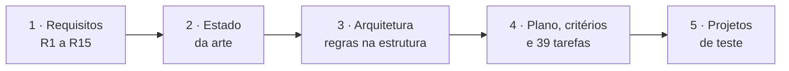
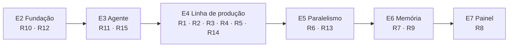
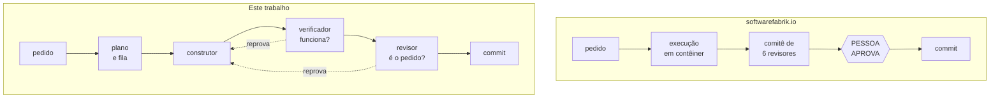
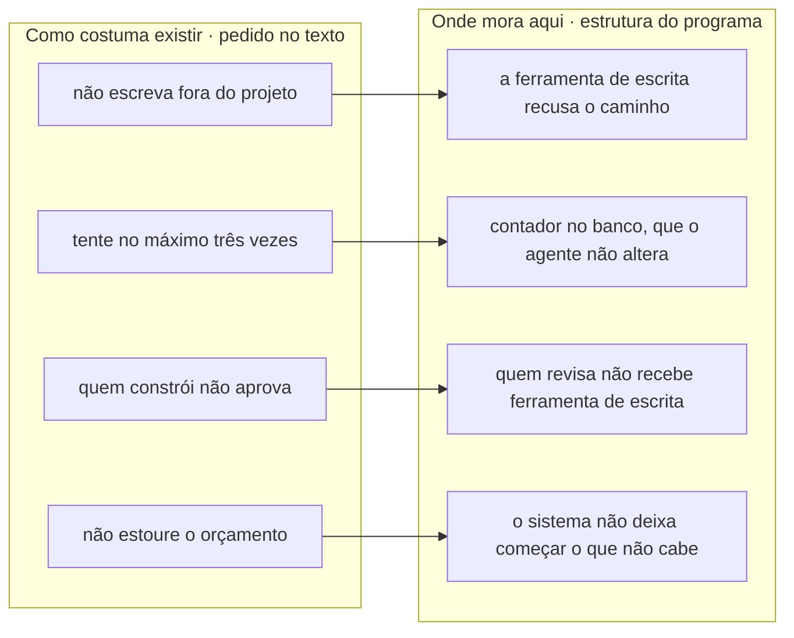
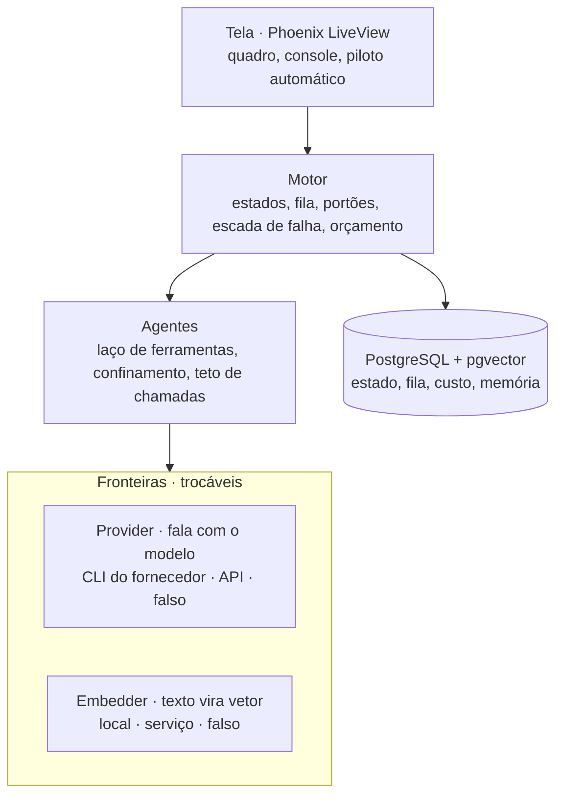
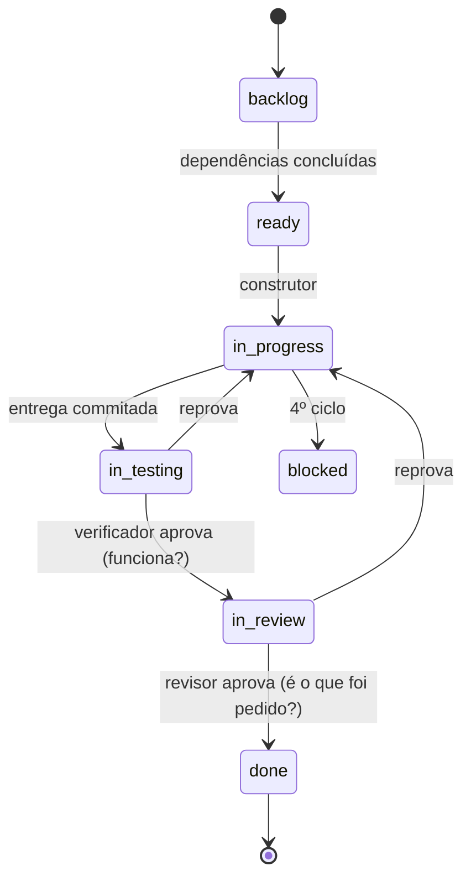
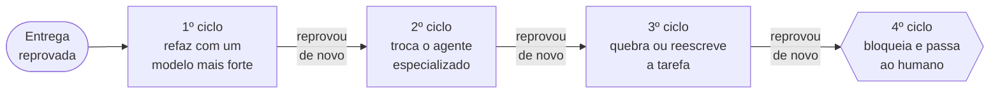
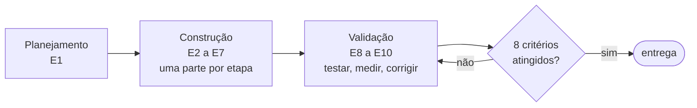
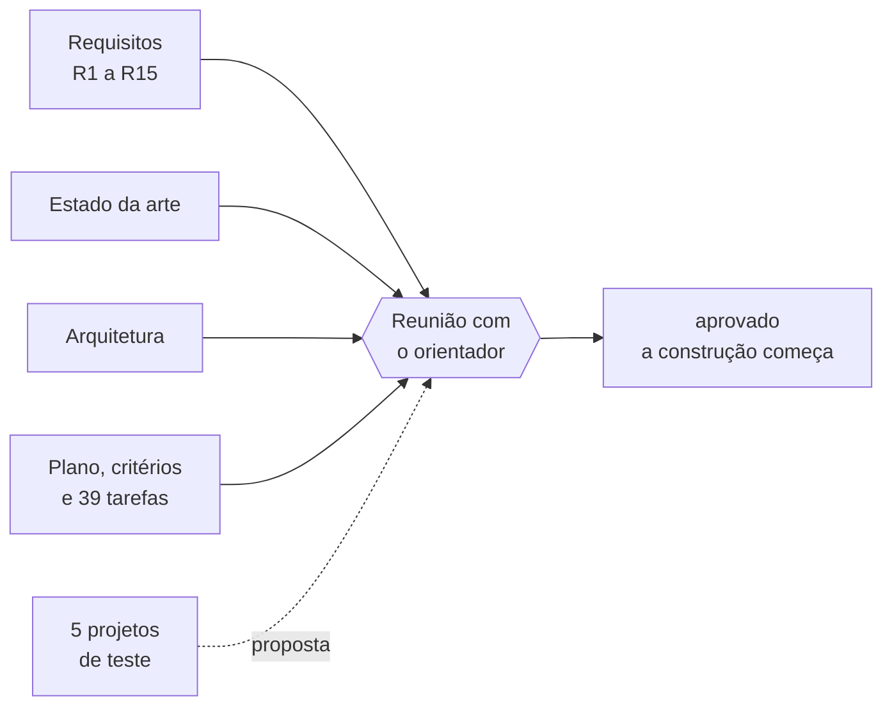

# E1 — Planejamento e arquitetura

## Em 30 segundos

- A E1 não tem código: ela desenha o sistema **inteiro** antes da primeira linha de programa.
- São cinco peças: **requisitos R1–R15**, **estado da arte**, **arquitetura**, **plano com critérios e tarefas** e **projetos de teste**.
- A ideia central do trabalho nasce aqui: **as regras que governam os agentes moram na estrutura do programa, não no texto do pedido**.
- A entrega combinada no plano era: *"requisitos, arquitetura, tarefas, critérios e projetos de teste aprovados"*.
- Quatro das cinco peças estão fechadas. Os cinco projetos de teste são uma **proposta** que aguarda a validação do orientador.



> [!FALA] "Antes de programar, eu precisava decidir o que o sistema faz, onde cada regra vai morar e como vou saber, no fim, se ele funciona. A E1 é isso: a planta de todas as outras etapas."

## A ideia: que problema a E1 resolve

Modelos de linguagem já escrevem código competente. O que falha é o **trabalho longo**, com muitas decisões encadeadas — e é aí que entram os sistemas com vários agentes. O problema é **como eles são governados**:

| Problema | Se não resolver agora… | O que a E1 produz |
|---|---|---|
| Os sistemas atuais coordenam os agentes com **instruções no texto** ("não saia da pasta", "no máximo três tentativas") | instrução a um modelo é **pedido, não garantia**: pode ser ignorada | uma **arquitetura** em que cada regra tem um lugar no programa onde é imposta |
| Outros sistemas multi-agente **já constroem software** | a contribuição do trabalho fica vaga | uma **comparação arquitetural** com o sistema mais próximo |
| Um sistema grande, com muitas partes | "pronto" vira opinião | **15 requisitos**, cada um com a etapa responsável e a forma de verificar |
| A validação mede o sistema **no fim** | a régua acaba ajustada ao resultado | **8 critérios numéricos** e **5 projetos de teste**, fixados **antes** de construir |

> [!IDEIA] Um sistema multi-agente não falha por escrever mal, e sim por **governar mal**. A E1 pega cada regra de governança e dá a ela um **endereço** na arquitetura — um lugar onde ela é imposta, e não pedida.

## Conceitos em 1 minuto

Antes de entrar nas peças, os termos que aparecem no resto do roteiro:

| Termo | O que é, em uma frase |
|---|---|
| **Agente** | um modelo de linguagem que, além de responder, **usa ferramentas** (ler e escrever arquivos, rodar comandos) em laço até terminar uma tarefa. |
| **Sistema multi-agente** | vários agentes com **papéis** distintos — planejar, construir, verificar, revisar — coordenados por um sistema. |
| **Governança** | as regras que limitam cada agente: **onde** pode escrever, **quantas vezes** tenta, **quem** aprova e **quanto** pode gastar. |
| **Regra estrutural** | regra imposta pelo programa: a ação proibida **não existe** para o agente, então não há o que desobedecer. |
| **Portão** | ponto de checagem que a entrega precisa passar para avançar. Aqui são dois: "funciona?" e "é o que foi pedido?". |
| **Requisito × restrição** | requisito diz **o que** o sistema faz (R1–R8); restrição diz **sob que condições** ele precisa funcionar (R9–R15). |
| **Modelo em cascata** | fases em sequência; cada etapa termina numa entrega que precisa estar pronta para a seguinte começar. |
| **Critério de desempenho** | limite numérico que a validação precisa atingir. Fixado antes, **não muda**: ajusta-se o sistema, nunca a régua. |
| **Elixir / OTP** | a linguagem escolhida; OTP é a parte que mantém muitos processos leves, **isolados e supervisionados** ao mesmo tempo. |

## Peça 1 — Requisitos R1–R15 (FAB-101)

### A ideia
Escrever, antes de programar, **o que** o sistema precisa fazer e **sob que restrições** — e, para cada item, **qual etapa o entrega** e **como se prova**.

### Por que
Sem requisitos verificáveis, nenhuma etapa teria critério de pronto. Com eles, cada apresentação ao orientador tem uma lista do que precisa aparecer provado.

### Como funciona — visão geral
São duas listas. A primeira diz o que o sistema faz; a segunda, as restrições.

| # | O que o sistema faz | Etapa |
|---|---|---|
| R1 | Transformar a descrição de um projeto em especificação, plano e tarefas | E4 |
| R2 | Levar cada tarefa por seis estados, registrando relatório e custo | E4 |
| R3 | Julgar toda entrega duas vezes: se funciona e se é o que foi pedido | E4 |
| R4 | Devolver a entrega reprovada com o que faltou e decidir como refazer | E4 |
| R5 | Limitar o retrabalho: replanejar uma vez e, se falhar, passar ao humano | E4 |
| R6 | Executar tarefas independentes em paralelo, sem disputa de arquivo | E5 |
| R7 | Consultar o histórico do projeto antes de decidir, citando a fonte | E6 |
| R8 | Mostrar andamento, custo e saída dos agentes, ao vivo | E7 |

| # | Restrição | O mecanismo que a garante | Etapa |
|---|---|---|---|
| R9 | Rodar em 8 GB de memória e 4 núcleos | o único componente pesado, a busca, é trocável e escolhido por medição | E6 |
| R10 | Contar o custo em cota consumida e em dinheiro | tabela alimentada a cada resposta do modelo | E2 |
| R11 | Nenhum agente escreve fora da pasta do projeto | a própria ferramenta de escrita recusa o caminho | E3 |
| R12 | Testes sem internet e sem consumir o serviço do modelo | substitutos para teste; um teste falha se a chave de acesso existir | E2 |
| R13 | A queda de um agente não derruba os outros nem perde trabalho | processos isolados; a fila devolve a tarefa | E5 |
| R14 | Nenhuma rodada passa do teto de gasto | impede começar o que não cabe, e nunca corta no meio | E4 |
| R15 | Trocar o fornecedor do modelo sem mexer no núcleo | o fornecedor entra por uma fronteira | E3 |

> [!IDEIA] Repare na coluna "mecanismo": nas restrições, em vez de só dizer o teste, está escrito **o que no desenho impõe a regra**. Uma restrição só é crível se tiver um lugar que a garanta.

### Os requisitos têm dono
Cada requisito é atendido por uma etapa da construção. É isso que transforma a lista num plano:



### Onde está
`docs/planejamento/requisitos.md` — duas tabelas, 28 linhas.

## Peça 2 — Estado da arte (FAB-102)

### A ideia
Comparar este trabalho com os sistemas multi-agente que **já constroem software**, olhando a **arquitetura** — e não a lista de recursos — para deixar claro onde está a contribuição.

### Os quatro sistemas
- **ChatDev** (artigo de 2023): uma cascata de fases; dentro de cada uma, dois agentes conversam até fechar a subtarefa.
- **MetaGPT** (artigo de 2023): um quadro de avisos; cada papel publica o que produziu e lê o que lhe interessa.
- **softwarefabrik.io** (produto comercial): o **vizinho mais próximo** — o único outro que guarda o estado fora da conversa.
- **Este trabalho.**

### O que os quatro têm em comum
Papéis especializados no lugar de um agente único; o pedido é decomposto antes de executar; **quem produz não aprova**; o resultado é versionado; existe algum limite de repetição. Reconhecer isso vem antes de qualquer diferença.

### A comparação que importa



As três diferenças que decidem tudo:

| | softwarefabrik.io | Este trabalho |
|---|---|---|
| **Quem fecha o laço** | a pessoa: nada avança sem aprovação | código: uma máquina de estados lê dependências e estados e monta a fila |
| **Unidade de trabalho** | a execução inteira, que começa e termina | a **tarefa**, com estado próprio, que sobrevive à sessão |
| **Como a autoridade é imposta** | pela interface: a pessoa atrás do portão | pela **ferramenta**: o revisor não recebe a ferramenta de escrever |

> [!IDEIA] A contribuição **não é usar agentes**. É tirar a pessoa do laço **sem perder** a separação entre construir e aprovar. O preço disso é uma maquinaria que os outros não precisam ter: contar os ciclos, subir de modelo, trocar de especialista e redividir a tarefa sozinho.

ChatDev e MetaGPT guardam o estado **dentro** da execução (no diálogo, ou num quadro em memória): quando ela termina, não há a que voltar. Por isso o confronto realmente informativo é com o softwarefabrik.io.

### Onde está
`docs/planejamento/estado-da-arte-resumo.pdf` (2 páginas, a comparação direta) e `estado-da-arte-completo.pdf` (4 páginas, os quatro sistemas).

## Peça 3 — Arquitetura (FAB-103)

### A ideia
Desenhar o sistema de modo que **cada regra de governança tenha um lugar no programa onde é imposta**.

### As regras na estrutura



> [!FALA] "O revisor não deixa de corrigir o código porque foi instruído a não corrigir. Ele não corrige porque a ferramenta de escrever não existe para ele."

### As quatro camadas
Cada camada só conhece a de baixo. As **fronteiras** permitem trocar o fornecedor do modelo ou a busca sem mexer no motor.



- **Tela:** o que a pessoa vê, ao vivo (E7).
- **Motor:** os estados da tarefa, a fila, os portões, a escada de falha e o orçamento (E4–E5).
- **Agentes:** o laço de ferramentas, confinado à pasta do projeto (E3).
- **Fronteiras:** duas "tomadas" — o **Provider**, que conversa com o modelo de IA, e o **Embedder**, que transforma texto em vetor para a busca da memória (E6). Atrás de cada uma pode estar um fornecedor real ou um **substituto falso**, usado nos testes (E2).
- **Banco:** um único PostgreSQL guarda estado, fila, custo e memória — numa transação, e ocupando pouca memória (R9).

### O caminho de uma tarefa
A **tarefa** é a unidade de trabalho: pequena, com critérios de aceite que são comandos. Ela passa por seis estados e dois portões, e cada passagem é feita por um agente **diferente** de quem construiu.



> [!IDEIA] **Por que dois portões?** Uma entrega pode passar em todos os testes e **não ser a tarefa**. O verificador pergunta "funciona?"; o revisor, "é o que foi pedido?". São perguntas diferentes, que reprovam por motivos diferentes.

### A escada de falha
Repetir a mesma tentativa raramente resolve. Cada reprovação muda **uma variável** da estratégia — e quem conta os ciclos é o sistema, não o agente.



| Ciclo | O que o sistema faz | Por quê |
|---|---|---|
| 1º | refaz com um modelo mais forte | a reprovação é o gatilho, não um palpite |
| 2º | troca o agente especializado | duas reprovações seguidas indicam viés da abordagem |
| 3º | quebra ou reescreve a tarefa | o problema pode ser o tamanho da tarefa |
| 4º | bloqueia e passa ao humano | insistir custa sem aumentar a chance de acerto |

### Por que Elixir
O sistema não faz contas pesadas: ele **espera** respostas lentas de um serviço remoto, que podem falhar. Elixir roda sobre a plataforma Erlang/OTP, feita para manter muitos trabalhos assim ao mesmo tempo: cada agente é um processo isolado e supervisionado, e a queda de um não afeta os outros (R13). O custo da escolha é um ecossistema de IA menor que o de Python — mas a conversa com o fornecedor é HTTP simples.

| Ferramenta | Para que serve |
|---|---|
| Elixir 1.19 / Erlang OTP 28 | linguagem e plataforma de processos supervisionados |
| Phoenix 1.8 + LiveView 1.2 | aplicação web e tela ao vivo |
| PostgreSQL 18 + Ecto 3.13 | todo o estado do sistema, numa transação |
| Oban 2.24 | fila durável dentro do banco |
| pgvector 0.8 | busca por semelhança, no mesmo banco |
| Req 0.5 | conversa com a API do fornecedor |
| ExUnit, Credo, Dialyzer | testes, estilo estrito, tipos |

### Onde está
`docs/planejamento/arquitetura.md` — os diagramas são Mermaid e aparecem desenhados no próprio GitHub.

## Peça 4 — Plano, tarefas e critérios (FAB-104)

### A ideia
Transformar o desenho num **plano executável**: etapas com entrega demonstrável, tarefas pequenas com critérios que são comandos, e uma **régua numérica fixa** para a validação.

### O plano em cascata
145 dias (04/09/2026 a 26/01/2027), 10 etapas, três fases:



- **Por que cascata?** O escopo está definido desde o início e a data de entrega é fixa. E cada etapa ainda termina numa entrega demonstrável, apresentada ao orientador.
- Os prazos estão em dias úteis, com **folga de propósito** em cada etapa: a entrega precisa ser verificada antes de fechar.
- A construção (E2–E7) foi dividida em **39 tarefas**, uma por pacote do plano, cada uma com critérios de aceite executáveis — estão em `docs/tasks/`, em português e inglês.

### Os 8 critérios de desempenho
São a **condição de parada** da validação: as etapas E8 a E10 repetem testar, medir e corrigir até todos serem atingidos.

| Critério | Como é medido | Atingido quando |
|---|---|---|
| Constrói sozinho | os cinco projetos de teste, do pedido à entrega | pelo menos 3 sem nenhuma intervenção |
| Conclui as tarefas | tarefas concluídas nos cinco projetos | 80% ou mais |
| Pouco retrabalho | execuções por tarefa concluída, em média | até 2 |
| Não aprova errado | tarefas concluídas que falham ao ser verificadas de novo | nenhuma |
| Governa de verdade | tentativas provocadas de quebrar as quatro regras | todas barradas |
| Aguenta falha | agente encerrado no meio da tarefa; banco derrubado | recuperação sem perder trabalho |
| Custo sob controle | rodadas que passam do teto de gasto | nenhuma |
| Cabe na máquina | pico de memória com três tarefas em paralelo | até 8 GB |

> [!IDEIA] "Ajusta-se o sistema, nunca a régua." Os limites são escritos **antes** da construção, para que não possam ser calibrados depois para o sistema passar.

## Peça 5 — Os cinco projetos de teste (FAB-105)

### A ideia
Escolher, antes de construir, os **projetos reais** em que o sistema será julgado.

| # | Projeto | Tamanho | Pronto quando |
|---|---|---|---|
| P1 | Lista de tarefas em linha de comando | pequeno | os quatro comandos funcionam e os testes passam |
| P2 | API de biblioteca (livros, leitores, empréstimos) | médio | cadastro e regra de empréstimo testados |
| P3 | Relatório a partir de planilha de vendas | pequeno | linhas inválidas apontadas; totais conferem com um gabarito |
| P4 | Site de portfólio, três páginas | médio | páginas existem, passam na checagem de acessibilidade, têm captura de tela |
| P5 | Apresentação de 8 slides a partir de P3 | pequeno (não-código) | cada número confere com o relatório de P3 |

- Variam **tamanho** e **tipo de entrega**: código, banco, dados, visual e um artefato que não é código.
- **Não são usados durante a construção.** Só entram na validação — se fossem usados antes, o sistema seria ajustado a eles.

> [!ATENCAO] Esta é a **única pendência** da etapa: o documento está marcado como "Proposta — a validar com o orientador". São esses projetos que vão julgar o trabalho; por isso quem é julgado não deve fechá-los sozinho.

## O marco da etapa

### O que tinha de ser entregue
*"Requisitos, arquitetura, tarefas, critérios e projetos de teste aprovados."* A E1 não tem código, então a prova **não é um teste automático**: é a aprovação dos documentos na reunião de fim de etapa.



### O que se confere, item a item

| Item | Onde | Situação |
|---|---|---|
| 15 requisitos com etapa e verificação | `docs/planejamento/requisitos.md` | pronto |
| Comparação com o estado da arte | os dois PDFs em `docs/planejamento/` | pronto |
| Camadas, estados, portões, escada, pilha | `docs/planejamento/arquitetura.md` | pronto |
| Plano, 8 critérios e 39 tarefas | `plano-de-desenvolvimento.docx`, `criterios-de-desempenho.md`, `docs/tasks/` | pronto |
| 5 projetos de teste | `docs/planejamento/projetos-de-teste.md` | **proposta, aguarda validação** |

### Como mostrar ao vivo
Abrir a branch `etapa/e1-planejamento` no GitHub: os arquivos `.md` mostram as tabelas e os diagramas já desenhados; `docs/tasks/pt/README.md` mostra o quadro com o progresso de cada etapa.

> [!DICA] Termine a reunião pedindo **explicitamente** a validação dos cinco projetos — sem ela, a régua da validação não está fechada.

## Planejado × entregue

| Pacote do plano | O plano pedia | Entregue | Situação |
|---|---|---|---|
| 1.1 Requisitos | levantar os requisitos R1–R15 | 8 funcionais + 7 restrições, cada um com etapa e verificação | ✅ |
| 1.2 Estado da arte | levantar o estado da arte | comparação com o vizinho mais próximo + visão dos quatro sistemas | ✅ |
| 1.3 Arquitetura | escolher as ferramentas e desenhar a arquitetura | 4 camadas, 6 estados, 2 portões, escada de falha, pilha | ✅ |
| 1.4 Tarefas e critérios | dividir o trabalho; definir os critérios | plano, 8 critérios e 39 tarefas de E2–E7 | ✅ |
| 1.4 Projetos de teste | definir os cinco projetos de teste | cinco projetos propostos | 🟡 aguarda validação |

Resultado: **entregue com pendência** — 4 de 5 documentos fechados.

## Números da etapa

| Medida | Valor |
|---|---|
| Tarefas | 4 de 5 concluídas (FAB-105 em andamento) |
| Commits na etapa | 6 (cinco documentos + o relatório da etapa) |
| Requisitos / critérios / projetos de teste | 15 / 8 / 5 |
| Tarefas escritas para a construção | 39 (E2 a E7) |
| Código em `lib/` | nenhum — etapa de planejamento |

Medido com `git log --oneline main..etapa/e1-planejamento` (antes da integração na `main`) e contando as linhas das tabelas dos documentos.

## Decisões técnicas e porquês

| Decisão | Alternativa | Por que esta |
|---|---|---|
| Regras de governança na estrutura | regras escritas no pedido aos agentes | instrução a um modelo é pedido, não garantia |
| Revisor sem ferramenta de escrita | instruir o revisor a não corrigir | a ação não existe para ser desobedecida |
| Contador de ciclos no banco | o agente contar as próprias tentativas | o agente não pode alterar o que limita a si mesmo |
| Teto que impede começar | cortar a execução ao estourar | cortar no meio custa igual e não entrega nada |
| Dois portões em série | um único verificador | "funciona?" e "é o pedido?" reprovam por motivos diferentes |
| Escada de 4 degraus | repetir a mesma tentativa | cada reprovação muda uma variável |
| Tarefa como unidade de trabalho | a execução inteira | permite retomar no meio, paralelizar e redividir |
| Elixir/OTP | Python | processos isolados e supervisionados; a queda de um não afeta os outros |
| Um banco só (PostgreSQL + Oban + pgvector) | banco + fila externa + base vetorial | uma transação e menos memória ocupada (8 GB) |
| Fronteiras com substituto falso | chamar o fornecedor direto | trocar fornecedor sem mexer no motor; testes sem internet |
| Cascata | iterativo | escopo definido desde o início e data fixa |
| Critérios e projetos fixados antes | calibrar depois | a régua não pode ser ajustada ao sistema |

## Roteiro da apresentação (10 minutos)

| Tempo | O que falar | O que mostrar |
|---|---|---|
| 0:00–1:00 | O problema: agentes escrevem bem, mas são governados por instruções no texto — e instrução é pedido | capa do documento da E1 (Word) e a página "O problema" |
| 1:00–2:30 | Estado da arte: o vizinho mais próximo mantém a pessoa aprovando; aqui, o código fecha o laço | os dois fluxos lado a lado (Peça 2) |
| 2:30–4:00 | Requisitos: duas listas, cada item com dono; parar em R11 e R14 | a figura dos requisitos e a de "os requisitos têm dono" |
| 4:00–6:30 | Arquitetura: as regras na estrutura, as camadas, os dois portões, a escada de falha | as quatro páginas de arquitetura |
| 6:30–7:00 | Por que Elixir | a pilha |
| 7:00–8:30 | Plano e critérios: cascata, 39 tarefas, 8 critérios que não mudam | a figura da cascata e a tabela de critérios |
| 8:30–9:30 | Os cinco projetos de teste | a Peça 5 |
| 9:30–10:00 | Pedido de validação e próxima etapa | "Requisitos, pendências e próxima etapa" |

> [!FALA] Abertura: "A E1 é a planta do sistema. Cada regra de governança ganhou um lugar no programa onde ela é imposta — e a régua com que o sistema vai ser julgado foi escrita antes de ele existir."

> [!FALA] Fechamento: "Falta uma coisa para fechar a etapa: os cinco projetos de teste. São eles que vão me julgar, então preciso da sua validação antes de congelá-los. Depois, a E2 monta a fundação: banco, custo, fronteiras e verificação."

## Perguntas prováveis do orientador

1. **Qual é a contribuição, se todo mundo já usa agentes?** Mover a governança do texto para a estrutura — confinamento pela ferramenta, contador fora do alcance do agente, revisor sem ferramenta de escrita, teto de admissão — e fechar o laço sem uma pessoa aprovando cada passo.
2. **Por que não Python?** O sistema não treina nem roda modelos: ele orquestra chamadas lentas e falíveis. OTP dá isolamento e supervisão de processos; a conversa com o fornecedor é HTTP, então o ecossistema menor quase não pesa.
3. **Por que cascata num projeto de software?** Escopo definido e data fixa. Cada etapa termina numa entrega demonstrável, o que dá os pontos de controle.
4. **Como o agente não altera o próprio contador?** O contador mora no banco e é escrito pelo motor; o agente só tem ferramentas de arquivo e comando, confinadas à pasta do projeto.
5. **Por que dois portões e não um verificador melhor?** São perguntas diferentes: uma entrega pode passar em todos os critérios e não ser a tarefa.
6. **Por que três tentativas?** Cada tentativa paga construtor, verificador e revisor, e a escada já muda modelo, especialista e tamanho. Depois disso, insistir aumenta o custo sem aumentar a chance de acerto.
7. **Os limites dos critérios não são arbitrários?** Saem do desenho: 8 GB e três em paralelo vêm de R9 e R6; zero rodadas acima do teto e todas as regras barradas são consequência de as regras serem estruturais.
8. **E se os critérios não forem atingidos a tempo?** Mede-se a cada ciclo desde a E8 e publica-se o valor final de cada um. A régua não muda.
9. **Como os projetos de teste evitam viés?** São fixados antes da construção, não entram em E2–E7, variam tamanho e tipo, e todo "pronto quando" é objetivo.
10. **Tirar o humano do laço não é perigoso?** Ele sai do laço de cada tarefa, não do sistema: o teto de gasto limita o pior caso, a escada termina nele, e a tela mostra tudo ao vivo (R8).

## Limitações conhecidas e o que vem depois

- **Pendência:** os cinco projetos de teste aguardam a validação do orientador (FAB-105).
- Nada aqui está provado em execução: a E1 é desenho. Cada mecanismo só vira fato no marco da etapa que o constrói (E2 a E7).
- Os detalhes de cada mecanismo (nomes de módulos, tabelas, comandos) são decididos na etapa que o constrói; a E1 fixa o quê e onde, não o código.

## Cola de comandos

```bash
git ls-tree -r --name-only etapa/e1-planejamento                     # os arquivos da etapa
git log --oneline etapa/e1-planejamento                              # os commits da etapa
git show etapa/e1-planejamento:docs/planejamento/requisitos.md       # R1 a R15
git show etapa/e1-planejamento:docs/planejamento/arquitetura.md      # camadas, estados, escada, pilha
git show etapa/e1-planejamento:docs/planejamento/criterios-de-desempenho.md   # os 8 critérios
git show etapa/e1-planejamento:docs/planejamento/projetos-de-teste.md         # P1 a P5
git show etapa/e1-planejamento:docs/tasks/pt/README.md               # o quadro de tarefas
```
