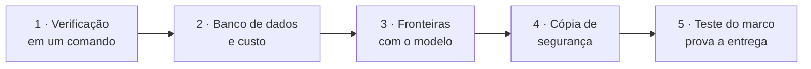
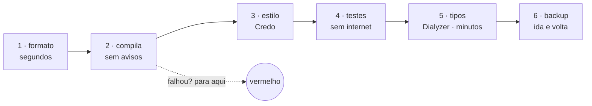
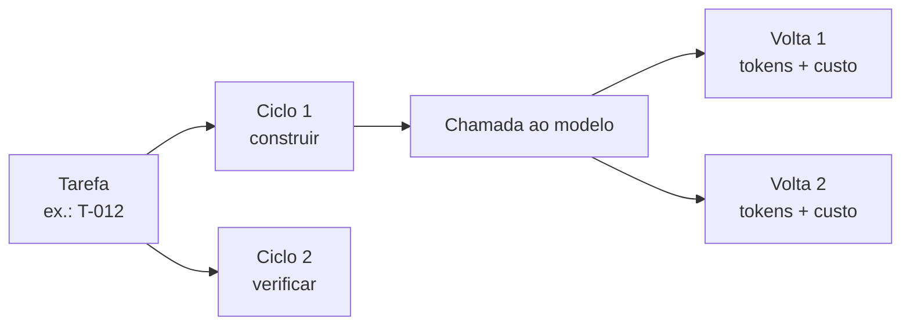
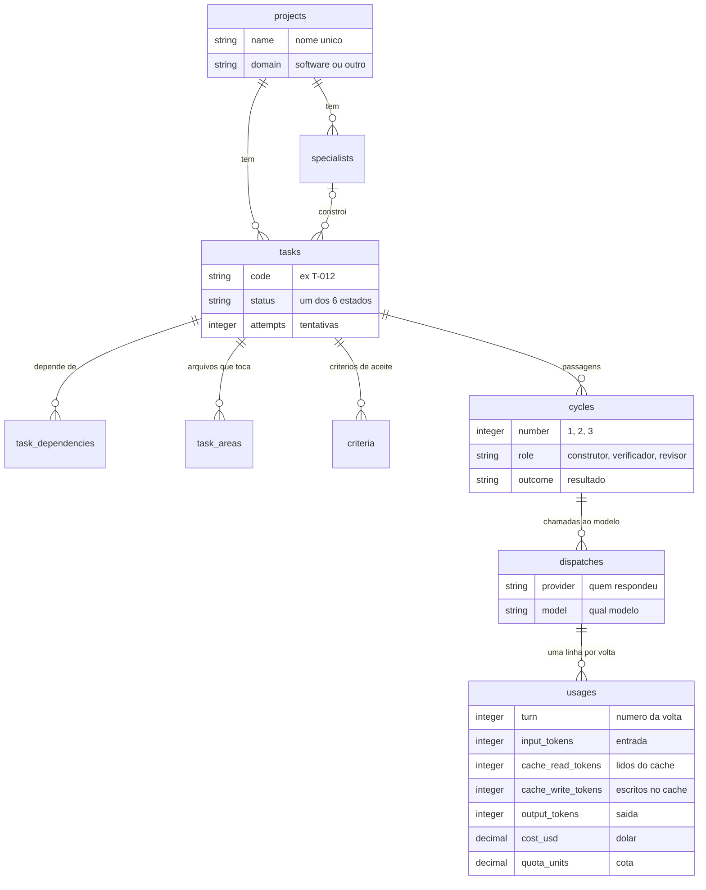
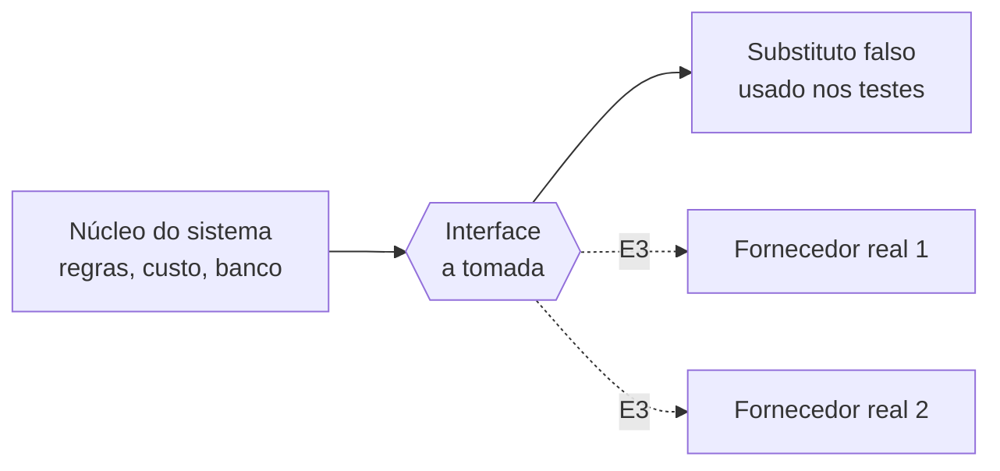
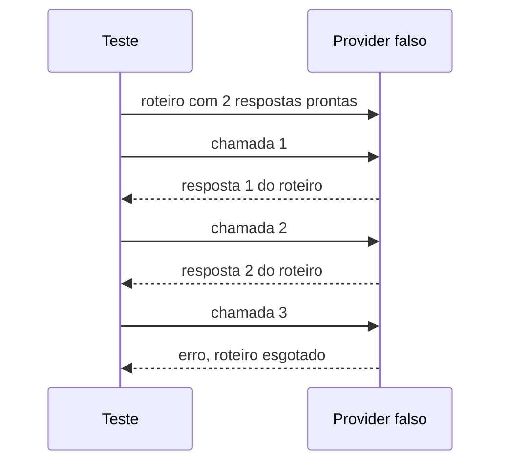
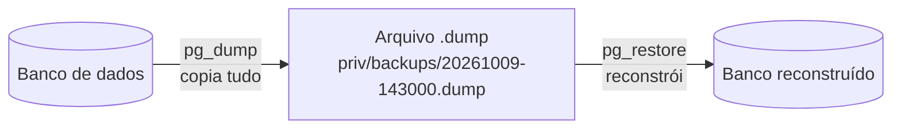
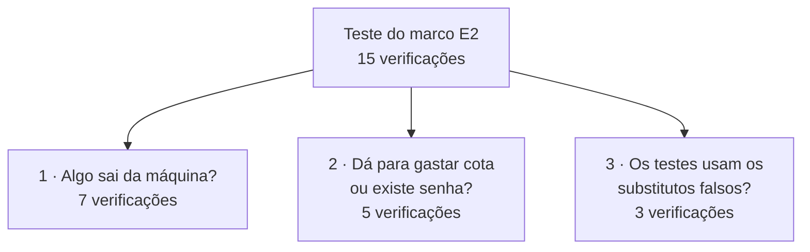

# E2 — Fundação do sistema

## Em 30 segundos

- A E2 monta o **chão** onde todo o resto do sistema vai ser construído.
- São cinco peças: **verificação em um comando**, **banco de dados com contagem de custo**, **fronteiras com o modelo de IA** (com substitutos para teste), **cópia de segurança** e um **teste que prova a entrega**.
- A entrega combinada no plano era: *"os testes rodam sem internet e sem consumir o serviço do modelo"*.
- Isso está garantido por um teste automático que roda em toda verificação — se alguém quebrar a regra, ele falha.



> [!FALA] "Antes de construir os agentes, eu precisava de onde guardar o estado, de como contar o custo e de como testar tudo sem gastar nada nem depender da internet. A E2 é isso."

## A ideia: que problema a E2 resolve

O sistema final vai conversar o tempo todo com um **modelo de IA de um fornecedor externo**. Isso traz três problemas que precisam estar resolvidos **antes** de escrever qualquer agente:

| Problema | Se não resolver agora… | O que a E2 constrói |
|---|---|---|
| Cada chamada ao modelo **custa** (dinheiro ou cota da assinatura) | não dá para saber quanto cada tarefa custou nem impor teto de gasto depois (E4) | uma tabela que grava o custo de **cada** chamada |
| O modelo está **na internet** e responde coisas diferentes a cada vez | os testes ficam lentos, caros e imprevisíveis | **substitutos falsos** que respondem sempre igual, sem rede |
| Todo o estado do sistema vai morar **num banco de dados** | uma falha de disco ou erro apaga o trabalho | **backup e restauração** testados |

E uma quarta coisa, transversal: **qualidade verificável**. Em vez de "lembrar de rodar os testes", existe **um comando** que roda todas as checagens em ordem.

> [!IDEIA] A E2 transforma "boas práticas" em **coisas que um teste impõe**. Se a regra for quebrada, a verificação fica vermelha — não depende de ninguém lembrar.

## Conceitos em 1 minuto

Antes de entrar nas peças, os termos que aparecem no resto do roteiro:

| Termo | O que é, em uma frase |
|---|---|
| **Elixir / OTP** | linguagem funcional que roda na máquina virtual do Erlang; OTP é a biblioteca que gerencia processos leves e isolados (importante a partir da E5). |
| **Phoenix** | o framework web do Elixir; aqui ele é o "esqueleto" do projeto e, na E7, serve a tela. |
| **PostgreSQL** | o banco de dados relacional onde fica todo o estado do sistema. |
| **Migração** | um script versionado que cria ou altera tabelas; rodar as migrações em ordem reconstrói o banco do zero. |
| **Ecto** | a biblioteca do Elixir que conversa com o banco (equivalente a um ORM). |
| **Token** | o pedaço de texto que o modelo de IA cobra; o custo de uma chamada é contado em tokens de entrada e de saída. |
| **Cota** | o limite de uso da assinatura do fornecedor; sob assinatura, o que acaba primeiro é a cota, não o dinheiro. |
| **Behaviour** | o jeito do Elixir de declarar uma **interface**: uma lista de funções que um módulo promete implementar (como uma `interface` em Java). |
| **Substituto falso (fake)** | uma implementação de verdade da interface, mas simples, previsível e sem rede, usada só nos testes. |
| **Embedding / Embedder** | *embedding* é transformar um texto numa lista de números (um vetor) para buscar textos "parecidos"; o *embedder* é quem faz essa conversão. Usado na memória do projeto (E6). |
| **`pg_dump` / `pg_restore`** | as duas ferramentas oficiais do PostgreSQL: a primeira **copia** o banco inteiro para um arquivo; a segunda **reconstrói** o banco a partir desse arquivo. |
| **Teste de marco** | um arquivo de teste automático cujo único objetivo é **provar a entrega combinada da etapa**. |
| **Credo / Dialyzer** | analisadores de código: Credo confere estilo; Dialyzer confere tipos sem executar o programa. |

## Peça 1 — Verificação em um comando (FAB-201)

### A ideia
Ter **um único comando** que diz se o projeto está saudável: `mix factory.ci`. (Em Elixir, `mix` é a ferramenta de linha de comando do projeto, como `npm` ou `make`.)

### Por que
O critério de "pronto" de cada tarefa precisa ser objetivo e igual para todos. Se a verificação é um comando, qualquer pessoa (ou o próprio sistema, mais tarde) consegue rodá-la e obter a mesma resposta.

### Como funciona — visão geral
São **seis checagens**, da mais barata para a mais cara. **A primeira que falhar interrompe as seguintes** — não faz sentido esperar minutos pela checagem de tipos se o código nem compila.



| Estágio | O que pega |
|---|---|
| formato | código fora do padrão de formatação |
| compila | qualquer aviso do compilador conta como erro |
| estilo | complexidade e convenções (modo estrito) |
| testes | a suíte inteira, **sem internet e sem custo** |
| tipos | incoerências de tipo, sem executar o código |
| backup | copia e restaura o banco de teste de verdade |

### Como foi implementado
- A lista de estágios fica num arquivo de configuração, `_management/ci.json` — assim outras partes do sistema leem a mesma lista.
- O comando lê esse arquivo, roda cada estágio em ordem e para no primeiro erro, imprimindo uma tabela com o resultado e o tempo de cada um.
- Existe um modo rápido (`--fast`) que pula só o Dialyzer e o mostra como **"pulado"** (não some — omitir daria a falsa impressão de que tudo passou).

```json
{ "name": "tests", "command": "mix test", "fast": true,
  "description": "the whole suite, offline and without quota" }
```

### Como se prova
Os testes do próprio comando (`test/mix/ci_test.exs`) usam um executor falso e conferem: os estágios rodam na ordem; se o 2º falha, o 3º em diante **nunca é chamado**; o modo rápido mostra o Dialyzer como pulado.

## Peça 2 — Banco de dados e contagem de custo (FAB-202)

### A ideia
Guardar **todo** o estado do sistema num banco relacional e **gravar o custo de cada conversa com o modelo**, para que o custo de qualquer tarefa seja uma soma, não um palpite.

### Por que
- O requisito **R10** pede contar o custo em cota e em dinheiro.
- O banco impede estados inválidos (por exemplo, uma tarefa com status inventado) — a regra fica num lugar só.
- Sem o custo gravado em detalhe, o teto de gasto da E4 seria impossível.

### Como funciona — visão geral
Cada nível do trabalho guarda um nível de detalhe. Uma **tarefa** passa por **ciclos** (construir, verificar, revisar); cada ciclo faz **chamadas** ao modelo; cada chamada tem uma ou mais **voltas** (uma ida e vinda ao modelo). **O custo é gravado por volta.**



> [!IDEIA] Somando as voltas, sai o custo de uma chamada; somando chamadas, o de um ciclo; somando ciclos, o da tarefa. Nenhum número é estimado "por fora".

### O esquema do banco (as 9 tabelas)



O que vale destacar:
- **Status só aceita os estados válidos** (os seis do ciclo de vida, mais "bloqueada" e "cancelada"). Um status inventado é recusado **pelo banco**.
- **Regras no próprio banco:** uma tarefa não pode depender de si mesma; tentativas nunca são negativas; não existem duas linhas para a mesma volta.
- **Cada retrabalho é um ciclo novo**, nunca sobrescreve o anterior — o custo de cada tentativa fica separado.

### A contagem de custo
Para cada volta, o sistema calcula duas coisas:

**Dólar** — multiplica os tokens pelo preço do modelo (tabela de preços no código, com a data em que foi conferida). O *cache* é o reaproveitamento de um início de prompt que se repete: **ler** do cache custa 10% do preço normal; **escrever** no cache custa mais caro (125% ou 200%, conforme o tempo de vida).

```
custo = entrada × preço  +  lidos do cache × 0,1 × preço  +  escritos no cache × 1,25 × preço  +  saída × preço de saída
```

**Cota** — uma unidade própria do sistema: **1 unidade = mil tokens de entrada do modelo mais barato**; modelos mais caros pesam proporcionalmente (5× para o mais caro).

> [!DICA] Exemplo real dos testes: com o modelo mais caro, poucos tokens **escritos** no cache custaram mais que milhões de tokens **lidos**. É por isso que o custo é gravado com a divisão completa, e não só o total.

Se um modelo não tem preço cadastrado, o cálculo devolve **erro** — nunca "zero", que sumiria silenciosamente do total.

### Como foi implementado
- Quatro **migrações** criam as tabelas; cada tabela tem um módulo Ecto correspondente com as validações.
- Dois módulos de custo: um com a **tabela de preços e a aritmética** de uma volta, outro que **converte** o consumo informado pelo modelo numa linha da tabela `usages`.

### Como se prova
- `test/factory/schema_test.exs` (banco real): status inventado é recusado; auto-dependência é recusada pelo banco; apagar uma tarefa apaga seus ciclos e consumos; a soma das voltas bate.
- `test/factory/cost/pricing_test.exs`: 1 milhão de tokens do modelo caro = US$ 5; leitura de cache = 0,1×; modelo sem preço = erro; cota do modelo barato com mil tokens = 1,0 unidade.

## Peça 3 — Fronteiras com o modelo e substitutos de teste (FAB-203)

### A ideia
O núcleo do sistema **não conhece o fornecedor do modelo**. Ele conhece só uma **tomada** (uma interface). Atrás da tomada pode estar o fornecedor real… ou um **substituto falso**, nos testes.



### Por que
- **R12:** os testes não podem usar internet nem gastar cota — então precisam de algo que responda **no lugar** do modelo.
- **R15:** trocar de fornecedor não pode mexer no núcleo. Com a interface, trocar de fornecedor = trocar o que está atrás da tomada.

### As duas interfaces

**Provider — quem conversa com o modelo de IA.** Uma função principal: "envie esta conversa e devolva a resposta". Uma chamada = **uma volta**; quem decide repetir ou parar é o sistema (E3), não o fornecedor. Erros voltam como valores ("cota acabou", "recusou") para o sistema reagir a cada um.

**Embedder — quem transforma texto em números.**

> [!IDEIA] **O que é um embedder e por que ele aparece já na E2?** Na E6 o sistema vai ter **memória**: antes de decidir, o agente procura no histórico do projeto decisões parecidas. Para buscar "por significado" (e não só por palavra igual), cada texto é convertido num **vetor de números** — textos de sentido parecido viram vetores próximos. Quem faz essa conversão é o *embedder*. A interface é criada **agora** para o núcleo já nascer dependendo do contrato, e não de um modelo específico.

E por que **falso** na E2? Um embedder de verdade é um modelo de IA: ou ocupa gigabytes de memória rodando local, ou é um serviço pago na internet. Nada disso cabe num teste rápido. O falso gera um vetor a partir de um **hash** do texto: o mesmo texto dá sempre o mesmo vetor, textos diferentes dão vetores diferentes, e nada sai da máquina. Ele **não** entende significado — e não precisa: na E2 testa-se a **mecânica**; a qualidade da busca é medida na E6 com um embedder real.

### Os substitutos falsos, na prática



- O **Provider falso** responde a partir de um **roteiro** que o teste escreve. Acabou o roteiro, devolve erro — nunca inventa resposta e nunca trava. Ele também anota o que recebeu, para o teste conferir o que o sistema enviou.
- O **Embedder falso** gera vetores determinísticos por hash, com 384 posições.
- **Os falsos são o padrão** no ambiente de teste: um teste esquecido nunca cai num fornecedor real por acidente.

> [!ATENCAO] **Falso não é mock.** Um *mock* confere "a função X foi chamada com o argumento Y" e quebra a cada refatoração. O falso é uma **implementação completa** da interface: o teste confere o **resultado** (o que foi gravado, que estado mudou). E como o falso declara que implementa a interface, o compilador garante que ele segue o mesmo contrato do real.

### Como se prova
`test/factory/provider/fake_test.exs` e `test/factory/embedder/fake_test.exs`: o roteiro é seguido em ordem; roteiro esgotado dá erro duas vezes seguidas sem travar; dois testes em paralelo não se misturam; o mesmo texto dá o mesmo vetor e 100 textos diferentes dão 100 vetores diferentes.

## Peça 4 — Cópia de segurança do banco (FAB-204)

### A ideia
Como **todo** o estado mora no banco, é preciso conseguir copiá-lo e reconstruí-lo — e provar que a cópia funciona.

### Como funciona um backup no PostgreSQL
O PostgreSQL vem com duas ferramentas de linha de comando:



- **`pg_dump`** lê o banco inteiro (tabelas, dados, tipos) e grava num arquivo.
- **`pg_restore`** lê esse arquivo e recria tudo. Com a opção de **limpar antes**, ele apaga o que existe e reconstrói — por isso pode ser repetido quantas vezes for preciso.

### Como foi implementado
- Dois comandos: `mix factory.backup` (grava `priv/backups/AAAAMMDD-HHMMSS.dump`, com data e hora para nunca sobrescrever) e `mix factory.restore --latest` (restaura o mais recente).
- O caminho das ferramentas vem da **configuração**, nunca de "o que estiver instalado": uma versão errada do `pg_dump` gera um arquivo que só falha na hora de restaurar.
- O sucesso é decidido pelo **código de saída** da ferramenta, não pelo texto que ela imprime.

### Por que esse teste roda separado
Restaurar **apaga e recria as tabelas**. Se rodasse junto com os outros testes (que rodam em paralelo), apagaria os dados deles no meio da execução. Por isso ele é o **6º estágio**, sozinho.

### Como se prova
`test/mix/backup_test.exs`: grava uma tarefa, faz o backup, **apaga tudo e confere que sumiu**, restaura e confere que a tarefa voltou idêntica (código, título, status, tentativas). Depois restaura **de novo**, para provar que é repetível.

## Peça 5 — O teste do marco (FAB-205)

### Afinal, o que é `test/factory/milestone_e2_test.exs`?

> [!IDEIA] É um **arquivo de testes automáticos** — como qualquer outro do projeto — com uma missão só: **provar a entrega combinada da E2**. "Milestone" é "marco" em inglês. Ele roda dentro do `mix factory.ci` em **toda** verificação, não só no dia da apresentação. Se um dia alguém adicionar algo que acesse a internet ou leia uma senha, **ele fica vermelho**.

### O que ele verifica — três perguntas



**1 · Nada sai da máquina (sem internet)**
- Toda requisição HTTP do sistema passa por um "porteiro" que, nos testes, **explode em vez de enviar**. O teste chega a **tentar** chamar o endereço real do fornecedor — e confere que a chamada explodiu.
- Nenhuma outra biblioteca de HTTP está carregada; nenhum código do sistema abre conexão de rede "por baixo".
- O próprio detector é testado (um detector que nunca acusa nada é igual a um detector quebrado).

**2 · Não dá para gastar cota nem existe senha**
- Nenhum código do sistema lê variáveis de ambiente (onde ficariam senhas) nem cita o nome da chave de acesso.
- Nenhum arquivo contém algo com formato de chave.
- As variáveis de chave **não existem** no ambiente dos testes: o sistema não conseguiria gastar cota nem se tentasse.

**3 · Os substitutos falsos são os que estão em uso**
- O Provider e o Embedder configurados nos testes são os falsos.
- Nenhuma biblioteca de modelo de IA local está carregada (elas ocupariam memória e só entram na E6, se escolhidas).

### Como demonstrar ao vivo

```bash
mix test test/factory/milestone_e2_test.exs
```

Saída esperada: `2 doctests, 15 tests, 0 failures`.

> [!FALA] "Este arquivo é a prova da entrega. Ele tenta chamar a API real e a chamada explode; confere que não existe chave de acesso; e confere que os substitutos estão em uso. Ele roda em toda verificação — se alguém abrir caminho para a internet, ele quebra."

> [!ATENCAO] Se perguntarem pelo módulo que fala com a API paga (citado nos tickets das próximas etapas): ele **ainda não existe na E2**. Aqui a regra é ainda mais rígida — **nenhum** módulo lê variável de ambiente. Na E3 ela passa a ser "exatamente um módulo, o do fornecedor".

## Planejado × entregue

| Pacote do plano | O plano pedia | Entregue | Situação |
|---|---|---|---|
| 2.1 Ambiente | projeto com verificação de qualidade | projeto + `mix factory.ci` com 6 estágios | ✅ |
| 2.2 Banco e custo | banco de dados e contagem de custo | 9 tabelas + custo em dólar e cota por volta | ✅ |
| 2.3 Fronteiras | fronteiras do modelo e da busca, com substitutos | interfaces Provider e Embedder + dois falsos | ✅ |
| 2.4 Cópia de segurança | cópia de segurança do banco | backup/restauração com ida e volta testada | ✅ |
| Entrega | testes sem internet e sem consumir o modelo | teste do marco com 15 verificações | ✅ |

Requisitos: **R10** (custo em cota e dinheiro) e **R12** (testes sem internet e sem cota) atendidos. **R15** (trocar de fornecedor) tem a **fronteira pronta** aqui; a prova com fornecedores reais é da E3.

## Números da etapa

| Medida | Valor |
|---|---|
| Tarefas | 5 de 5 concluídas |
| Commits na etapa | 10 |
| Testes automáticos | 152 |
| Módulos | 37 |
| Linhas de código (lib/) | 2.634 |
| Tabelas no banco | 9 |

> [!DICA] O número de testes que o terminal mostra pode ser um pouco diferente de 152: alguns testes são gerados em laço, há 2 testes de documentação, e os 11 de backup rodam à parte. Se perguntarem, explique isso.

## Decisões técnicas e porquês

| Decisão | Alternativa | Por que esta |
|---|---|---|
| Elixir/OTP | Python | o sistema espera respostas lentas e falíveis de um serviço remoto; OTP isola e supervisiona cada trabalho (base da E5) |
| Estado no PostgreSQL | arquivos de texto | transação, regras no banco e consultas de custo |
| Custo por volta | só o total da tarefa | o total esconde onde o custo está (ex.: escrita de cache) |
| Duas unidades (dólar e cota) | só dólar | sob assinatura o limite é a cota |
| Interfaces + falsos | mocks | o falso segue o contrato real e testa o resultado |
| Verificação para no 1º erro | rodar tudo sempre | falhar cedo economiza tempo |
| Backup isolado | junto com os testes | restaurar apaga as tabelas dos outros testes |

## Roteiro da apresentação (10 minutos)

| Tempo | O que falar | O que mostrar |
|---|---|---|
| 0:00–1:00 | O problema: o sistema vai falar com um modelo pago, na internet; antes dos agentes, preciso de estado, custo e testes sem rede | capa do documento da E2 (Word), proposta × resultado |
| 1:00–2:00 | As cinco peças da fundação | o diagrama "Em 30 segundos" desta página |
| 2:00–4:00 | Banco e custo: tarefa → ciclo → chamada → volta; custo gravado por volta, em dólar e cota | o diagrama das 9 tabelas e a fórmula |
| 4:00–5:30 | Fronteiras: a "tomada"; Provider e Embedder; por que falsos (sem rede, sem custo, previsíveis) | o diagrama da tomada e o do roteiro do falso |
| 5:30–6:30 | Backup: `pg_dump` copia, `pg_restore` reconstrói; por que roda separado | o diagrama do backup |
| 6:30–8:30 | **Demonstração** do marco | terminal: `mix test test/factory/milestone_e2_test.exs` |
| 8:30–9:30 | Números e o quadro de tarefas | `docs/tasks/pt/README.md` na branch |
| 9:30–10:00 | Próxima etapa: o agente real e as ferramentas (E3) | — |

> [!FALA] Abertura: "A E2 é a fundação. A entrega combinada era que os testes rodassem sem internet e sem consumir o modelo — e isso hoje é garantido por um teste que roda em toda verificação."

> [!FALA] Fechamento: "Com essa base, a E3 pluga o agente real: ferramentas confinadas, o laço supervisionado e os fornecedores reais atrás da mesma tomada — gravando o custo nestas tabelas."

> [!DICA] Antes da reunião, rode `mix factory.ci` completo uma vez na branch `etapa/e2-fundacao`: a primeira execução do Dialyzer demora alguns minutos. Na reunião, `mix factory.ci --fast` é suficiente.

## Perguntas prováveis do orientador

1. **Por que Elixir e não Python?** O sistema não faz contas pesadas: ele espera respostas lentas de um serviço remoto que pode falhar. A plataforma do Elixir foi feita para muitos trabalhos assim ao mesmo tempo, cada um isolado. O custo é um ecossistema de IA menor — mas eu falo com o modelo por HTTP simples, então não preciso dele.
2. **O que é esse embedder e por que já na E2?** É quem transforma texto em vetor para a memória buscar por significado (E6). A interface nasce agora para o núcleo depender do contrato, não de um modelo. Na E2 ele é falso porque o real exige muita memória ou um serviço pago.
3. **Por que substitutos falsos e não mocks?** O falso implementa a interface de verdade e o teste confere o resultado; o mock só confere chamadas e quebra a cada refatoração.
4. **Como você sabe que os testes não usam a internet?** O teste do marco tenta chamar a API real e confere que a chamada explode; confere que não há outro cliente de rede carregado e que nenhum código abre conexão por baixo.
5. **E se o fornecedor mudar?** Escreve-se outro adaptador para a mesma interface e troca-se uma linha de configuração. O núcleo não muda. A prova com fornecedores reais é a E3.
6. **O custo em dólar é exato?** É uma estimativa contábil com tabela de preços datada. Por isso também guardo os tokens crus: dá para recalcular.
7. **O que é essa unidade de cota?** Convenção do sistema (mil tokens de entrada do modelo mais barato) para comparar rodadas entre si.
8. **Por que gravar cada volta e não só o total?** Porque o total esconde onde o custo está; por volta, dá para somar por ciclo, tarefa ou rodada.
9. **Como sabe que o backup funciona?** O teste grava, copia, apaga, confere que sumiu, restaura e compara — duas vezes seguidas.
10. **Por que a verificação para no primeiro erro?** Para não gastar minutos em checagens caras quando uma barata já falhou; o relatório diz onde parou.

## Limitações conhecidas e o que vem depois

- Só existe o fornecedor **falso**; os reais entram na E3.
- As tabelas de custo estão prontas, mas quem grava nelas é o agente real (E3).
- Os seis estados existem no banco; as **regras de transição** entre eles são da E4.
- O embedder falso não entende significado; a qualidade da busca é medida na E6.
- O backup depende das ferramentas do PostgreSQL instaladas localmente.

## Cola de comandos

```bash
mix factory.ci                                   # as 6 checagens, para no primeiro erro
mix factory.ci --fast                            # pula a checagem de tipos (aparece como "pulado")
mix test test/factory/milestone_e2_test.exs      # o teste do marco da E2
mix test test/factory/schema_test.exs            # regras do banco
mix test test/factory/cost/pricing_test.exs      # contas de dólar e cota
mix test.backup                                  # cópia e restauração, isolada
mix factory.backup                               # grava um backup em priv/backups/
mix factory.restore --latest                     # restaura o backup mais recente
pg_isready -h 127.0.0.1 -p 5432                  # o PostgreSQL está no ar?
```
