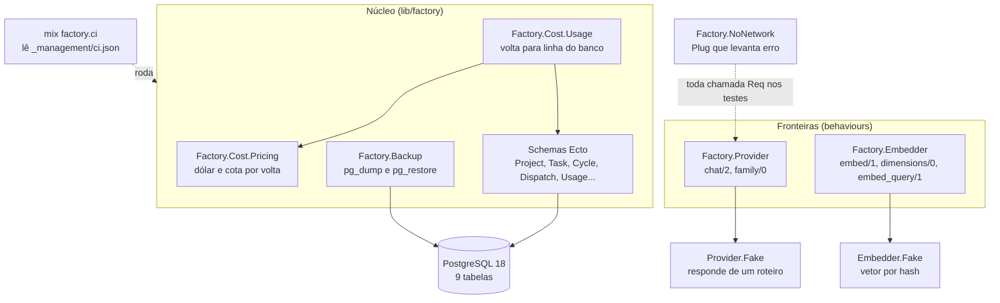
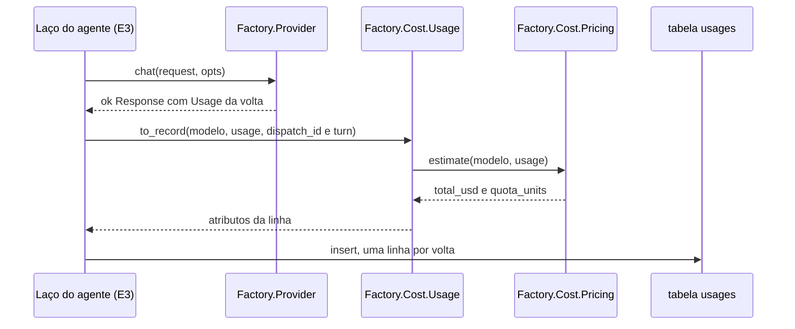
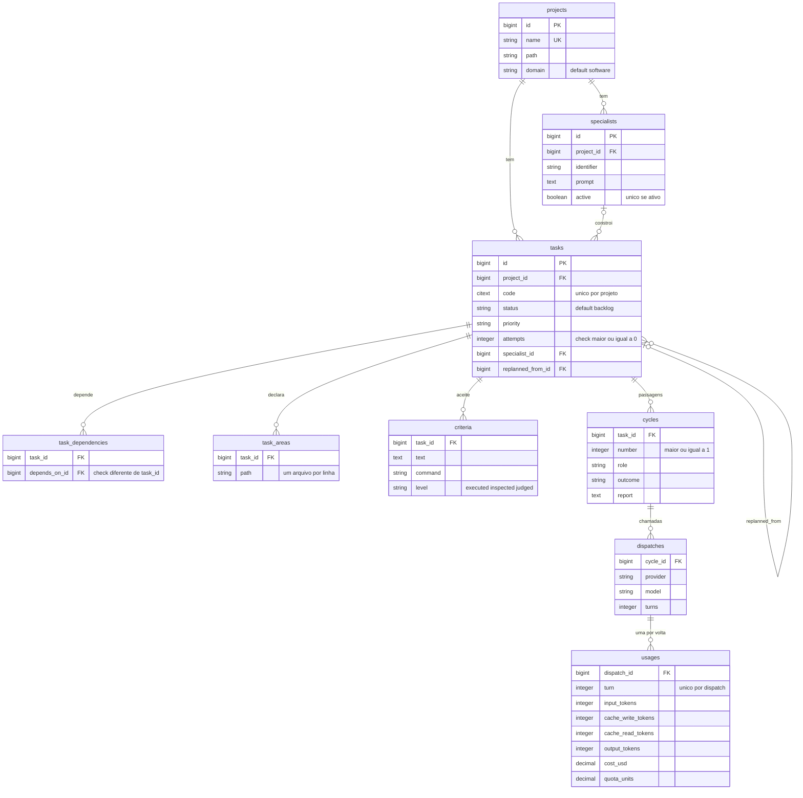

# E2 — Fundação do sistema

## Em 30 segundos

- A E2 levanta o chão do sistema: projeto Phoenix/Elixir, banco PostgreSQL com o esquema de tarefas e custo, duas fronteiras (`Factory.Provider` e `Factory.Embedder`) com substitutos falsos, backup/restauração e uma verificação completa em um comando (`mix factory.ci`).
- Para a tese ela importa porque é aqui que a governança começa a "morar na estrutura": estado inválido não entra no banco, custo é gravado por volta, e o fornecedor do modelo fica atrás de um contrato.
- O custo é contado em duas unidades desde já (cota da assinatura e dólar estimado), atendendo R10.
- Toda a suíte roda sem internet, sem cota e sem chave de API, atendendo R12.
- A prova é um teste permanente, `test/factory/milestone_e2_test.exs`, que roda em toda verificação e quebra se alguém abrir caminho para a rede ou para uma credencial.

> [!IDEIA] Testar a governança não pode custar dinheiro nem depender do fornecedor. A E2 transforma isso de "boa prática" em algo que um teste impõe.

## Onde esta etapa está no plano

- **Posição na cascata:** é a 2ª de 10 etapas e a primeira de construção (E2 a E7). Antes dela, a E1 fechou requisitos, arquitetura e tarefas; depois dela vem a E3 (o agente e as ferramentas).
- **Datas planejadas:** 19/09 a 03/10/2026 (plano de desenvolvimento, seção de etapas).
- **Pacotes e prazos (dias úteis):** 2.1 Ambiente (2) · 2.2 Banco e custo (3) · 2.3 Fronteiras (3) · 2.4 Cópia de segurança (1). Total de 9 dias em 10 disponíveis, com 1 de folga.
- **Entrega combinada:** "Os testes rodam sem internet e sem consumir o serviço do modelo."
- **O que a E1 deixou pronto:** requisitos R1–R15, a arquitetura em quatro camadas com as fronteiras Provider/Embedder, os seis estados da tarefa e a pilha (Elixir 1.19 / OTP 28, Phoenix 1.8, PostgreSQL 18, Ecto 3.13).
- **O que a E2 deixa para a E3:** o contrato `Factory.Provider.chat/2` (a E3 pluga nele os adaptadores reais: CLI do fornecedor e API por token), as tabelas `cycles`/`dispatches`/`usages` onde o agente real vai gravar o custo de cada volta, e a função `Factory.Cost.Usage.to_record/3` que converte o consumo de uma volta em linha do banco.

Requisitos atendidos (texto de `docs/planejamento/requisitos.md`):

| # | Requisito | Mecanismo previsto | Na E2 |
|---|---|---|---|
| R10 | Contar o custo em cota consumida e em dinheiro | tabela alimentada a cada resposta do modelo | tabela `usages` + `Factory.Cost.Pricing` |
| R12 | Testes sem internet e sem consumir o serviço do modelo | substitutos para teste; um teste falha se a chave de acesso existir | falsos + `Factory.NoNetwork` + teste do marco |
| R15 | Trocar o fornecedor do modelo sem mexer no núcleo | o fornecedor entra por uma fronteira | a fronteira é criada aqui; a prova com dois adaptadores reais é da E3 |

> [!ATENCAO] R15 está planejado para a E3. Na E2 existe a fronteira e um único adaptador (o falso). Diga "a fronteira está pronta; a troca real de fornecedor se prova na E3".

## Planejado × entregue

| Pacote | O que o plano pedia | O que foi entregue | Tarefa | Situação |
|---|---|---|---|---|
| 2.1 Ambiente | montar o ambiente e o projeto com verificação de qualidade | projeto Phoenix; `mix factory.ci` com 6 estágios declarados em `_management/ci.json` | FAB-201 | concluída |
| 2.2 Banco e custo | criar o banco de dados e a contagem de custo | 4 migrações, 9 tabelas, 9 schemas Ecto; `Factory.Cost.Pricing` (dólar e cota) e `Factory.Cost.Usage` | FAB-202 | concluída |
| 2.3 Fronteiras | fronteiras do modelo e da busca, com substitutos para teste | behaviours `Factory.Provider` e `Factory.Embedder`; `Provider.Fake` (roteiro) e `Embedder.Fake` (vetor por hash) | FAB-203 | concluída |
| 2.4 Cópia de segurança | cópia de segurança do banco | `mix factory.backup`, `mix factory.restore [--latest]`, teste de ida e volta em estágio isolado | FAB-204 | concluída |
| Marco | os testes rodam sem internet e sem consumir o serviço do modelo | `test/factory/milestone_e2_test.exs`, 15 testes permanentes | FAB-205 | concluída |

## A arquitetura da etapa



O desenho segue a arquitetura da E1: o núcleo só conhece contratos. Tudo que é caro ou externo (o modelo de linguagem, o modelo de embeddings) fica atrás de um behaviour, e no ambiente de teste a implementação configurada é sempre o falso. O banco é a verdade do estado: regras simples (estado válido, dependência não reflexiva, uma linha por volta) estão no próprio esquema, não em `if`s espalhados. A verificação inteira é um comando declarado em arquivo, e o marco é um teste que roda dentro dessa verificação.

Fluxo do custo de uma volta (o que a E3 vai usar):



## Tarefa por tarefa, a fundo

### FAB-201 — Montar o ambiente e a verificação em um comando

**O que é.** O projeto Phoenix (`Factory.Application`, `Factory.Repo`, `FactoryWeb.*`) e o comando `mix factory.ci`, que roda a bateria de verificação declarada em `_management/ci.json`.

**Por que existe.** R12 pede verificação automática e reproduzível. O critério de "pronto" do próprio sistema vira um arquivo versionado, não uma lista lembrada de cabeça. As tarefas futuras copiam o comando de teste desse arquivo.

**Como funciona.**
1. `Factory.CI.stages(opts \\ [])` lê o JSON e devolve `{:ok, [stage]}`, cada estágio com `name`, `command`, `fast` e `description`. Arquivo ausente vira `{:error, {:ci_json_missing, path}}`, não exceção.
2. `Factory.CI.run(stages, opts)` percorre os estágios com `Enum.reduce_while/3` e **para no primeiro que falhar**. Recebe a função que executa o estágio em `:runner`: a regra fica testável sem rodar nenhum comando real (injeção de dependência).
3. Com `fast: true`, estágios marcados `"fast": false` voltam como `:skipped` **na posição deles** (aparecem no relatório como SKIPPED, não somem).
4. `Factory.CI.run_stage/1` é a única parte que fala com o sistema operacional (`System.cmd/3`). No Windows, `mix` é um `.bat`, então a chamada passa por `cmd /c`.
5. `Mix.Tasks.Factory.Ci` é só a casca: imprime, resume e sai com código 1 em caso de falha (`exit({:shutdown, 1})`).

**Os 6 estágios, na ordem, e o que cada um pega:**

| # | Estágio | Comando | O que pega | Custo |
|---|---|---|---|---|
| 1 | format | `mix format --check-formatted` | código fora do padrão de formatação | segundos |
| 2 | compile | `mix compile --warnings-as-errors` | qualquer aviso do compilador (variável não usada, função indefinida) reprova | segundos |
| 3 | lint | `mix credo --strict` | estilo e complexidade, modo estrito sem exclusões | segundos |
| 4 | tests | `mix test` | a suíte inteira, sem internet e sem cota (inclui o marco) | dezenas de segundos |
| 5 | types | `mix dialyzer` | inconsistência de tipos contra os `@spec`; 1ª execução monta o PLT e leva minutos | o mais caro; único `fast: false` |
| 6 | backup | `mix test.backup` | ida e volta real de `pg_dump`/`pg_restore` | precisa rodar sozinho |

**Por que essa ordem.** Do mais barato ao mais caro: quem falha cedo economiza o resto. Não adianta rodar 150 testes se o código nem compila sem aviso. O Dialyzer é o mais lento, por isso é o único fora do modo rápido. O backup fica no fim e isolado porque o `pg_restore --clean` derruba e recria tabelas do banco de teste (ver FAB-204).

Trecho real — `lib/factory/ci.ex`:

```elixir
  def run(stages, opts \\ []) do
    runner = Keyword.get(opts, :runner, &run_stage/1)
    fast? = Keyword.get(opts, :fast, false)

    {results, outcome} =
      Enum.reduce_while(stages, {[], :ok}, fn stage, {acc, _} ->
        step(stage, acc, skip?(stage, fast?), runner)
      end)

    {outcome, Enum.reverse(results)}
  end

  defp skip?(stage, fast?), do: fast? and not stage.fast

  defp step(stage, acc, true, _runner) do
    {:cont, {[skipped(stage) | acc], :ok}}
  end

  defp step(stage, acc, false, runner) do
    result = measure(stage, runner)
    continuation = if result.outcome == :ok, do: :cont, else: :halt
```

**Como é testado.** `test/mix/ci_test.exs` (13 testes), com um `runner` falso que manda uma mensagem `{:ran, nome}` ao processo do teste:
- os estágios rodam na ordem declarada;
- se `compile` falha, `called() == ["format", "compile"]` — os seguintes **nunca foram chamados**, e o relatório tem só 2 resultados;
- o código de saída do estágio quebrado é preservado (`code == 42`);
- no modo rápido, `types` não roda mas aparece como `:skipped`;
- o `ci.json` real declara exatamente `~w[format compile lint tests types backup]` com os comandos reais, e só `types` fica fora do modo rápido.

**Decisões.** Estágios em JSON (e não só no `mix.exs`) para que outras partes do sistema leiam o mesmo arquivo; runner injetado em vez de mocks; estágio pulado reportado em vez de omitido (omitir dá falsa sensação de "tudo passou"). Existe também o alias `mix verify` (format, compile, credo, test) como checagem local rápida.

### FAB-202 — Criar o banco de dados e a contagem de custo

**O que é.** Quatro migrações em `priv/repo/migrations/` criam 9 tabelas, cada uma com um schema Ecto. E dois módulos de custo: `Factory.Cost.Pricing` (tabela de preços e aritmética de uma volta) e `Factory.Cost.Usage` (ponte entre o consumo reportado e a linha do banco).

**Por que existe.** R10: o custo tem de ser medido e consultável. Gravando uma linha por volta do modelo, o custo de qualquer ciclo, tarefa ou rodada é uma consulta (soma), não uma estimativa.

**O esquema (tabelas reais e colunas-chave das migrações):**



Pontos que valem dizer:
- **Hierarquia de custo:** `tasks → cycles → dispatches → usages`. Ciclo = uma passagem da tarefa por um papel (construtor, verificador, revisor); despacho = uma chamada ao fornecedor dentro do ciclo; usage = uma volta (ida e vinda ao modelo). `on_delete: :delete_all` em cascata: apagar a tarefa leva tudo junto.
- **Ciclo nunca é sobrescrito:** índice único `(task_id, number, role)`; cada retrabalho é uma linha nova, então o custo de cada ciclo fica separável.
- **Estado inválido não entra:** `status` é `Ecto.Enum` com os seis estados (`backlog, ready, in_progress, in_testing, in_review, done`) mais dois terminais (`blocked, cancelled`).
- **`code` é `citext`** (extensão criada na 1ª migração): "t-001" e "T-001" são a mesma tarefa.
- **Regras no banco:** `attempts >= 0`, dependência não reflexiva (`task_id <> depends_on_id`), `turn >= 1`, tokens não negativos.
- **Especialistas versionados:** mudar o prompt insere linha nova e desativa a anterior; índice único parcial `where: "active"`.
- **Áreas são arquivos, nunca diretórios:** é o mutex do paralelismo (E5); com diretórios a interseção viraria comparação de prefixo e daria falso negativo.
- **Critério coerente com o grau de prova:** `:executed` exige `command`; com `command`, o nível tem de ser `:executed`.

Trecho real — `priv/repo/migrations/20260828120004_create_execution.exs`:

```elixir
    # One row per turn, keeping the input / cache read / cache write split.
    create table(:usages) do
      add :dispatch_id, references(:dispatches, on_delete: :delete_all), null: false
      add :turn, :integer, null: false
      add :input_tokens, :integer, null: false, default: 0
      add :cache_write_tokens, :integer, null: false, default: 0
      add :cache_read_tokens, :integer, null: false, default: 0
      add :output_tokens, :integer, null: false, default: 0
      add :cost_usd, :decimal, precision: 12, scale: 6, null: false, default: 0
      add :quota_units, :decimal, precision: 12, scale: 6, null: false, default: 0
      add :duration_ms, :integer

      timestamps(type: :utc_datetime_usec)
    end

    create unique_index(:usages, [:dispatch_id, :turn])
```

**A contagem de custo — fórmula real.** Tabela em `Factory.Cost.Pricing` (preços conferidos em 2026-08-28, exposto por `checked_on/0`), em US$ por milhão de tokens:

| modelo | entrada | saída | peso de cota |
|---|---|---|---|
| `opus-5` | 5 | 25 | 5,0 |
| `sonnet-5` | 2 | 10 | 2,0 |
| `haiku-4.5` | 1 | 5 | 1,0 |

Dólar de uma volta (`estimate/2`), com P_in e P_out do modelo:

```
US$ = input × P_in / 10^6
    + cache_read × (0,1 × P_in) / 10^6
    + cache_write × (m_ttl × P_in) / 10^6      m_ttl = 1,25 (TTL 5 min) ou 2,0 (TTL 1 h)
    + output × P_out / 10^6
```

Cota de uma volta (`quota_units/2`), unidade própria do sistema: **1 unidade = mil tokens de entrada do Haiku**; outros modelos pesam na proporção do preço de entrada:

```
cota = (input + cache_write + 0,1 × cache_read + output) / 1000 × peso_do_modelo
```

Trecho real — `lib/factory/cost/pricing.ex`:

```elixir
      %{input: input, output: output} ->
        full_input = per_million(usage.input_tokens, input)
        read = per_million(usage.cache_read_tokens, input * @read_multiplier)
        write = per_million(usage.cache_write_tokens, input * write_multiplier(usage))
        output_usd = per_million(usage.output_tokens, output)

        {:ok,
         %{
           full_input_usd: round_value(full_input),
           cache_read_usd: round_value(read),
           cache_write_usd: round_value(write),
           output_usd: round_value(output_usd),
           total_usd: round_value(full_input + read + write + output_usd),
           quota_units: quota_units(model, usage)
         }}
```

Exemplo do teste (Opus, TTL 1 h): 400 mil de entrada, 2 milhões lidos do cache, 400 mil escritos, 400 mil de saída → 2,0 + 0,2 + 4,0 + 10,0 = **US$ 16,20**. Repare: a escrita de cache, com poucos tokens, pesa mais que toda a leitura — por isso o resumo (`summarize/1`) devolve a quebra e a fatia `cache_write_share_of_input`, não só o total.

Decisões embutidas:
- **Modelo sem preço é erro, não zero:** `{:error, :unpriced_model}`. Um zero silencioso sumiria do total. `summarize/1` diz *quais* modelos faltam.
- **Apelidos:** os ids longos do CLI (`claude-opus-5-5`, `claude-haiku-4-5-20251001`) e os curtos (`opus`) caem na mesma linha da tabela.
- **Duas unidades porque há dois regimes:** sob assinatura o limite real é a cota; sob API por token é dinheiro. O dólar é estimativa contábil, não fatura.
- **Três "Usage" de propósito:** `Factory.Provider.Usage` (o que o adaptador devolve, não sabe de banco), `Factory.Tasks.Usage` (schema, uma linha por volta) e `Factory.Cost.Usage` (converte e soma). Preço só é calculado em `Factory.Cost`.

**Como é testado.** `test/factory/schema_test.exs` (27 testes, com banco real via sandbox): status inválido rejeitado; os 8 estados aceitos; código fora de `T-NNN` rejeitado, sufixo de replanejamento (`T-017a`) aceito; `citext` impede o mesmo código em outra caixa; auto-dependência rejeitada **pelo banco** com mensagem nomeada; dois especialistas ativos rejeitados; volta 0 e tokens negativos rejeitados; a soma das voltas de um despacho bate (300 de entrada, 2700 lidos); apagar a tarefa apaga ciclos, despachos e consumos. `test/factory/cost/pricing_test.exs` (34 ocorrências de `test "`): 1M de tokens Opus = US$ 5; leitura 0,1×; escrita 1,25× e 2,0×; Haiku 5× mais barato; soma das quatro partes = total; modelo desconhecido dá erro; cota do Haiku com 1.000 de entrada = 1,0; Opus pesa 5×; 10.000 lidos = 1,0 unidade; modelo sem peso não zera a cota.

### FAB-203 — Criar as fronteiras do modelo e da busca, com substitutos de teste

**O que é.** Dois behaviours do Elixir (contratos com callbacks verificados pelo compilador) e um adaptador falso para cada um.

**Por que existe.** R12 e (preparando) R15: toda a governança fica do lado de cá da fronteira e é testada sem rede nem custo; trocar de fornecedor é trocar o adaptador.

**`Factory.Provider` — callbacks:**
- `chat(request :: Request.t(), opts :: keyword())` → `{:ok, Response.t()}` | `{:error, {:with_usage, motivo, Usage.t()}}` | `{:error, term()}`. **Uma única volta, síncrona.** Repetir, contar voltas e decidir parar é do laço do agente (E3), não do adaptador. Erro é valor, não exceção, porque o laço precisa distinguir cota de recusa de falha de rede. `:with_usage` existe para não perder o custo de uma sessão que gastou tokens antes de falhar.
- `family()` (opcional) → `:full_agent` (o adaptador roda o próprio laço de ferramentas, como o CLI) ou `:model_endpoint` (o sistema executa as ferramentas). Quem não declara cai em `:model_endpoint`, o caminho estrito: falha para o lado seguro.
- Estruturas: `Request` (modelo, papel, `prefix` em blocos com `cache_breakpoint`, mensagens, ferramentas, `max_turns`), `Response` (blocos, `stop_reason` em `:end_turn | :tool_use | :max_tokens | :max_turns | :refusal`, `usage`) e `Usage` (os quatro tipos de token, duração e `cache_ttl`).
- `Factory.Provider.configured/0` lê `config :factory, :provider` e, sem configuração, devolve `Factory.Provider.Fake`.

**`Factory.Embedder` — callbacks:**
- `embed(texts :: [String.t()])` → `{:ok, [[float()]]}` — sempre em lote (a ingestão embute o histórico inteiro de uma vez), ordem de saída = ordem de entrada.
- `dimensions()` → `pos_integer()`.
- `embed_query(texts)` (opcional) — alguns modelos usam prefixo diferente para consulta e documento; quem não implementa cai em `embed/1` via `Factory.Embedder.embed_query/2`.

**Os falsos:**
- `Factory.Provider.Fake` responde a partir de um **roteiro** declarado pelo teste (lista de `Response`, entregue em ordem), guardado num processo `Agent` próprio de cada teste (a "agulha", `needle`), então testes `async` não compartilham estado. Roteiro esgotado → `{:error, :script_exhausted}`: nunca trava e nunca inventa. Sem agulha → `{:error, :no_script}`. Grava o que recebeu (`seen/1`, `seen_options/1`) para o teste conferir o que o sistema montou. `response/1` gera uma resposta plausível com consumo que exercita a divisão de cache.
- `Factory.Embedder.Fake` gera vetores por hash (`:erlang.phash2`): mesmo texto → mesmo vetor; textos diferentes → vetores diferentes; normalizado (norma 1); 384 dimensões por padrão (o tamanho de modelos sentence-transformer pequenos), configurável. Não tem semântica: textos parecidos **não** geram vetores próximos.

Trecho real — `lib/factory/provider/fake.ex`:

```elixir
  @impl Factory.Provider
  def chat(%Request{} = request, opts) do
    case Keyword.fetch(opts, :needle) do
      {:ok, needle} -> next(needle, request, opts)
      :error -> {:error, :no_script}
    end
  end

  defp next(needle, request, opts) do
    Agent.get_and_update(needle, fn state ->
      state = %{
        state
        | seen: [request | state.seen],
          seen_options: [opts | state.seen_options]
      }

      case state.script do
        [%Response{} = next | rest] -> {{:ok, next}, %{state | script: rest}}
        [] -> {{:error, :script_exhausted}, state}
      end
    end)
  end
```

**Por que os falsos são o padrão em teste.** O default de `configured/0` é o falso: um teste esquecido nunca cai num adaptador real por acidente. E o falso não tem caminho até a rede nem até credenciais — há testes que leem o código-fonte do falso e reprovam se ele citar `Req`, `Finch`, `Mint`, `HTTPoison`, `:httpc`, `System.get_env`, `ANTHROPIC` ou `API_KEY`.

**Falso × mock.** Um mock (biblioteca que intercepta chamadas e confere "foi chamado com X") testa *como* o código chama a dependência e quebra a cada refatoração. O falso é uma implementação completa e determinística do mesmo contrato: o teste roteiriza as respostas e confere o *resultado* (o que foi gravado, que estado mudou). Ele implementa `@behaviour Factory.Provider`, então o compilador garante que segue o contrato real.

**Como é testado.** `test/factory/provider/fake_test.exs` (17): ordem do roteiro; esgotado devolve `:script_exhausted` duas vezes seguidas sem travar; duas agulhas não interferem; grava requests e opções; `stop_reason` segue o roteiro; implementa o behaviour; o detector de referência a HTTP reconhece `Req.get!` e **não** confunde com `%Request{}`. `test/factory/embedder/fake_test.exs` (26): determinismo, distinção (inclusive "task done" × "tasks done"), 100 textos → 100 vetores distintos, 384 posições, norma 1 com tolerância 1e-9, erros nomeados (`:text_not_a_string`, `:expected_list`), dimensão configurável (768). `test/factory/embedder_test.exs` (4): `embed_query` usa o callback quando existe e cai em `embed/1` quando não.

**Decisões.** Behaviour em vez de protocolo (o adaptador é escolhido por configuração, não pelo tipo do dado); uma volta por chamada (o laço é governança e fica no sistema); erro como valor.

### FAB-204 — Cópia de segurança do banco

**O que é.** `mix factory.backup [--dest arquivo]` grava um dump; `mix factory.restore <arquivo> | --latest` restaura. Lógica em `Factory.Backup`.

**Por que existe.** Todo o estado do sistema vive no banco; não perder trabalho exige cópia restaurável — e testada, porque backup que nunca foi restaurado é só um arquivo que parece válido.

**Como funciona.**
- `dump(opts)` chama `pg_dump --host --port --username --no-password --format=custom --file=<destino> <banco>`. Sem destino, o nome é `priv/backups/AAAAMMDD-HHMMSS.dump` (carimbo evita sobrescrever o anterior).
- `restore(file, opts)` chama `pg_restore ... --clean --if-exists --dbname=<banco> <arquivo>`. `--clean --if-exists` torna a restauração repetível.
- `executable/1` monta o caminho a partir de `config :factory, :pg_bin` (padrão `C:/pgsql/18/bin`, sobrescrito por `FACTORY_PG_BIN`), **nunca do PATH**: cliente de versão errada gera dump que falha só na hora de restaurar.
- Quem decide sucesso é o **código de saída**, nunca o texto do stderr (o `pg_dump` escreve avisos mesmo quando dá certo).
- Depois da restauração, `disconnect_all/0` derruba as conexões: `--clean` recria tipos (como o `citext`) com novos OIDs, e o Postgrex guarda OIDs em cache por conexão — sem reconectar, a próxima consulta dá `cache lookup failed for type`. Se não conseguir derrubar, registra um aviso explícito.
- Erros nomeados: `{:dump_missing, file}`, `{:executable_missing, programa, _}`, `{:command_failed, código, saída}`.

Trecho real — `lib/factory/backup.ex`:

```elixir
  def restore(file, opts \\ []) do
    if File.exists?(file) do
      conn = connection(opts)

      args =
        connection_args(conn) ++
          ["--clean", "--if-exists", "--dbname=#{conn[:database]}", file]

      case run(executable("pg_restore"), args) do
        {:ok, _output} ->
          warn(disconnect_all())
          {:ok, file}

        {:error, reason} ->
          {:error, reason}
      end
    else
      {:error, {:dump_missing, file}}
    end
  end
```

**Por que a ida e volta é um estágio isolado.** O `pg_restore --clean` derruba e recria as tabelas do banco de teste compartilhado. Rodando junto com a suíte `async`, quebraria os testes concorrentes (e o cache de OIDs das conexões deles). Então: `test/test_helper.exs` faz `ExUnit.start(exclude: [:needs_pg_dump])`, e o alias `mix test.backup` roda só `test --only needs_pg_dump`. Na `mix factory.ci` ele é o 6º estágio, sozinho.

**Como é testado.** `test/mix/backup_test.exs` (11, `async: false`, banco real):
- os dados são gravados com `Sandbox.unboxed_run` — dentro do sandbox normal tudo fica numa transação não commitada que o processo externo `pg_dump` não veria, e a ida e volta não provaria nada;
- ciclo completo: grava projeto + tarefa `T-200` (status `:in_testing`, `attempts: 2`), faz dump, apaga tudo, **confere que sumiu de verdade**, restaura e confere código, título, status e tentativas iguais;
- restaurar duas vezes seguidas funciona;
- sob o sandbox, a restauração **tem de** registrar o aviso "connections were NOT dropped" (o teste captura o log e reinicia o Repo à mão);
- dump inexistente e executável inexistente dão erro nomeado; listagem do mais novo para o mais antigo; caminho do executável vem da configuração.

### FAB-205 — MARCO E2: a suíte roda sem internet e sem cota

Detalhado na seção "O marco da etapa" abaixo. Peças: `test/factory/milestone_e2_test.exs` (15 testes + 2 doctests de `Factory.Source`), `test/support/no_network.ex` (o Plug que levanta erro), `test/support/source.ex` (remove docstrings e comentários antes das varreduras) e a linha de `config/test.exs`:

```elixir
config :req, default_options: [plug: Factory.NoNetwork]
```

**Decisão.** Plug global na configuração em vez de `Req.Test.stub/2`, porque stubs pertencem ao processo que os criou e a suíte roda `async: true` — um processo sem stub sairia para a rede.

## O marco da etapa

**O que prova.** Que nada sai da máquina durante a suíte, que a suíte não consegue gastar cota e que não há chave de API em lugar nenhum. É um teste de **impossibilidade**, por isso é permanente: roda no estágio `tests` de toda `mix factory.ci`. Um marco provado uma vez e esquecido vira falso na primeira dependência nova.

**Linha a linha** (`test/factory/milestone_e2_test.exs`):

*Bloco 1 — "no network: nothing LEAVES the machine"*
1. `Req runs with a double for the whole suite` — `Req` está carregado e `Application.get_env(:req, :default_options)[:plug] == Factory.NoNetwork`. Sem isso, um adaptador mal configurado faria chamada real.
2. `the global double RAISES instead of answering` — `Req.get!(url: "https://api.anthropic.com/v1/messages")` levanta `RuntimeError` com "tried to LEAVE during the test suite". Prova pelo comportamento, não só pela configuração.
3. `no foreign HTTP client is loadable` — `HTTPoison` e `Tesla` não estão nem disponíveis.
4. `no foreign HTTP client application is running` — nenhuma das apps `:hackney, :gun, :ibrowse, :httpoison, :tesla` está iniciada.
5. `no production source references Req` — nenhum arquivo de `lib/**/*.ex` cita `Req` (regex de palavra inteira, para não confundir com `Request`).
6. `no production source opens a socket by hand` — ninguém usa `:gen_tcp`, `:httpc` ou `:inets` (o atalho que fugiria do Plug).
7. `the reference detector works and does not pass on empty input` — o próprio detector acerta `Req.post!(url)`, não acusa `%Request{}`, e a lista de fontes não está vazia (um teste que varre zero arquivos passaria sempre).

*Bloco 2 — "no quota and no API key"*
8. `no module reads environment variables` — nenhum código de `lib/` chama `System.get_env`.
9. `no module cites ANTHROPIC_API_KEY in code`.
10. `no production source contains a literal secret` — nenhum arquivo contém `sk-ant-` (formato de chave) nem `Bearer ` — aqui no arquivo **inteiro**, documentação inclusive.
11. `credential variables are not set in the suite's environment` — `ANTHROPIC_API_KEY` e `OPENAI_API_KEY` são `nil`. A suíte não consegue nem tentar gastar cota.
12. `the docstring filter works and does not pass on empty input` — o filtro `Factory.Source.strip/1` mantém `System.get_env("API_KEY")` em código e remove a mesma palavra quando está só num `@moduledoc`. Necessário porque a documentação que *explica* a regra usa as mesmas palavras do código que a *quebraria*.

*Bloco 3 — "the suite's adapters are the doubles"*
13. `the configured provider is Fake`.
14. `the configured embedder is Fake`.
15. `no embedding model library is loaded` — `Bumblebee`, `Nx`, `EXLA`, `Axon` indisponíveis (perfil de 8 GB; o modelo local só entra com `FACTORY_EMBEDDER_LOCAL=1`, controlado em `local_embedder_deps/0` do `mix.exs`).

Mais os 2 doctests de `Factory.Source` (via `doctest Factory.Source`).

**Como isso prova "sem rede, sem cota, sem chave":** rede — a única biblioteca HTTP do projeto está presa num Plug que explode, nenhuma outra está carregada, e nenhum código abre socket; cota — gastar cota exige um adaptador real (o configurado é o falso) e uma credencial (que não existe no ambiente nem no código); chave — varredura de leitura de variável, de nome de variável e de formato de chave.

**Como rodar ao vivo:**

```
mix test test/factory/milestone_e2_test.exs
```

Saída esperada (formato do ExUnit; o tempo varia):

```
.................
Finished in 0.x seconds (0.x s async, 0.00s sync)
2 doctests, 15 tests, 0 failures
```

**Demonstração de que ele morde (opcional, ao vivo, sem commitar):** em `iex -S mix` no ambiente de teste não dá; o jeito mais simples é mostrar o teste 2: ele *faz* um `Req.get!` para a API real e a saída é a exceção. Se quiser forçar uma falha, rode com a chave definida — `ANTHROPIC_API_KEY=x mix test test/factory/milestone_e2_test.exs` (Git Bash) — e o teste 11 falha com "ANTHROPIC_API_KEY is set. The suite must not even be able to spend quota."

**Se falhar:**
- teste 11 falhou → há uma variável de credencial no seu terminal; abra um terminal limpo.
- erro de conexão com o banco → PostgreSQL não está em `127.0.0.1:5432` (`pg_isready -h 127.0.0.1 -p 5432`).
- teste 3/4/15 falhou → alguma dependência nova trouxe cliente HTTP ou biblioteca de modelo; o marco está fazendo seu trabalho.

> [!ATENCAO] O ticket FAB-205 (`docs/tasks/pt/`) e o relatório `docs/etapas/E2-fundacao.docx` descrevem os itens 3 e 4 na forma que o teste terá a partir da E3 ("só os três adaptadores de rede citam Req"; "exatamente um módulo, `MessagesAPI`, lê variáveis de ambiente"). Na branch da E2 esses adaptadores ainda não existem, e o teste é **mais estrito**: *nenhum* arquivo de `lib/` cita `Req` e *nenhum* lê variável de ambiente. Se o orientador ler o ticket e perguntar pelo `MessagesAPI`, responda: "ele entra na E3; nesta etapa a regra é zero, e na E3 ela relaxa para exatamente um módulo". O relatório também marca R15 como atendido; na E2 o correto é "fronteira pronta, prova na E3".

## Decisões técnicas e porquês

| Decisão | Alternativa considerada | Por que esta |
|---|---|---|
| Elixir/OTP | Python (ecossistema de IA maior) | o sistema espera respostas lentas e falíveis de um serviço remoto; OTP dá processos isolados e supervisionados (base da E5). O custo é um ecossistema de IA menor |
| Estado no PostgreSQL | arquivos markdown como estado | transação, restrições e consulta de custo; arquivo não impede estado inválido |
| `status` como `Ecto.Enum` + checks no banco | validar em código espalhado | estado inventado não chega ao banco; a regra vive num lugar só |
| Uma linha por volta em `usages` | só o total por tarefa | o total esconde a divisão entrada/leitura/escrita de cache, que é onde o custo se explica |
| Duas unidades (cota e dólar) | só dólar | sob assinatura o limite é cota; sob API é dinheiro |
| Modelo sem preço = erro | contar zero | zero silencioso some do total |
| Behaviours + falsos | mocks por biblioteca | o falso cumpre o contrato real, é determinístico e testa resultado, não chamadas |
| Falso como default de `configured/0` | exigir configuração explícita | teste esquecido nunca cai num adaptador real |
| `chat/2` = uma volta | adaptador com laço próprio | contar voltas e parar é governança; fica do lado do sistema |
| Plug global `Factory.NoNetwork` | `Req.Test.stub/2` | stub é por processo; a suíte é `async` |
| Req (HTTP simples) como dependência | SDK do fornecedor | o núcleo decide pontos de cache e TTL por requisição, o que um SDK esconderia (uso real na E3) |
| Verificação em `ci.json` | só aliases no `mix.exs` | arquivo único, lido pelo sistema e copiado pelas tarefas |
| Ordem do mais barato ao mais caro, para no 1º erro | rodar tudo e reportar no fim | falha cedo economiza tempo; o relatório diz onde parou |
| Backup em estágio isolado | dentro da suíte comum | `pg_restore --clean` recria tabelas e quebraria testes concorrentes |
| `pg_bin` da configuração | binário do PATH | cliente de versão errada gera dump que só falha na restauração |
| Áreas como arquivos | diretórios | interseção exata; prefixo dá falso negativo |

## Números da etapa

Medidos na branch `etapa/e2-fundacao`, sem checkout:

| Medida | Valor | Comando |
|---|---|---|
| Arquivos `.ex` em `lib/` | 33 | `git ls-tree -r --name-only etapa/e2-fundacao lib \| grep -c '\.ex$'` |
| Módulos (`defmodule`) em `lib/` | 37 (inclui os aninhados `Provider.Block/Usage/Request/Response`) | `git grep -h -E '^\s*defmodule ' etapa/e2-fundacao -- lib \| wc -l` |
| Linhas em `lib/` | 2.634 | `git grep -h -c '' etapa/e2-fundacao -- 'lib/**/*.ex' 'lib/*.ex'`, somado |
| `test "` nos arquivos de teste | 152 | `git grep -h -E '^\s*test "' etapa/e2-fundacao -- test \| wc -l` |
| Commits da etapa | 11 (10 de entrega + 1 do relatório) | `git rev-list --count etapa/e1-planejamento..etapa/e2-fundacao` |
| Migrações / tabelas | 4 / 9 | leitura de `priv/repo/migrations/` |

Testes por arquivo: pricing 34 · schema 27 · embedder/fake 26 · provider/fake 17 · milestone 15 · ci 13 · backup 11 · embedder 4 · web 5.

> [!ATENCAO] 152 é a contagem textual. Ao rodar, o ExUnit pode mostrar um número um pouco diferente: um `test` dentro de um `for` em `pricing_test.exs` gera 3 testes, há 2 doctests, e os 11 de backup ficam excluídos do `mix test` comum (rodam em `mix test.backup`). Se perguntarem, explique isso em vez de defender um número fixo.

## Roteiro da apresentação (10 minutos)

**Min 0–1 — Abertura.** Slide/relatório da E2. Proposta do plano e entrega.
> [!FALA] "A E2 é a fundação: banco, contagem de custo, as fronteiras com o modelo e a verificação. A entrega combinada era: os testes rodam sem internet e sem consumir o serviço do modelo — e isso hoje é garantido por um teste que roda sempre."

**Min 1–2 — Onde está.** Diagrama de camadas de `docs/planejamento/arquitetura.md`; destaque Fronteiras e PostgreSQL. Cite R10 e R12.

**Min 2–4 — Banco e custo.** Mostre o erDiagram desta página e `priv/repo/migrations/20260828120004_create_execution.exs`. Explique tarefa → ciclo → despacho → volta.
> [!FALA] "Cada volta do modelo é uma linha, com entrada, leitura de cache, escrita de cache e saída separadas. O custo de um ciclo é uma soma, não um palpite. E conto em duas unidades: dólar estimado e cota, porque sob assinatura o que acaba é a cota."
Mostre a fórmula em `lib/factory/cost/pricing.ex` e o exemplo de US$ 16,20.

**Min 4–5:30 — Fronteiras.** Abra `lib/factory/provider.ex` (callback `chat/2`) e `lib/factory/provider/fake.ex`.
> [!FALA] "O núcleo não conhece o fornecedor, só este contrato. No teste, quem responde é um falso que segue um roteiro; quando o roteiro acaba ele devolve erro, nunca inventa. Na E3 entram os adaptadores reais atrás do mesmo contrato."

**Min 5:30–6:30 — Backup.** `lib/factory/backup.ex`: `pg_dump` custom, `pg_restore --clean --if-exists`, binário da configuração. Explique por que é estágio isolado.

**Min 6:30–8:30 — Demonstração.** Terminal no repositório:
1. `mix test test/factory/milestone_e2_test.exs` → "2 doctests, 15 tests, 0 failures".
2. Abra o teste e mostre o `Req.get!` para `api.anthropic.com` que levanta erro.
3. `mix factory.ci --fast` (ou o completo, se o PLT do Dialyzer já estiver pronto) → tabela de estágios "ok".
> [!FALA] "Este teste tenta chamar a API de verdade e a chamada explode. Se alguém adicionar um cliente HTTP, ler uma chave ou trocar o adaptador padrão, a suíte quebra."

**Min 8:30–9:30 — Números e decisões.** 33 arquivos, 37 módulos, 2.634 linhas, 152 testes, 11 commits. Uma decisão: falsos em vez de mocks.

**Min 9:30–10 — Próximo passo.**
> [!FALA] "A E3 pluga o agente real nessa fundação: ferramentas confinadas, o laço supervisionado e os adaptadores do fornecedor — e o marco dela é um agente real resolvendo uma tarefa com o custo gravado nestas tabelas."

> [!DICA] Rode `mix factory.ci` completo uma vez ANTES da reunião: a primeira execução do Dialyzer monta o PLT e leva minutos. Na reunião use `--fast` se tiver pouco tempo, e diga que `types` aparece como SKIPPED de propósito.

## Perguntas prováveis do orientador

1. **Por que Elixir e não Python?** O sistema não faz contas pesadas; ele espera respostas lentas e falíveis de um serviço remoto. Erlang/OTP foi feito para muitos trabalhos assim ao mesmo tempo, cada um num processo isolado e supervisionado — a queda de um não derruba os outros (base da E5). O custo é um ecossistema de IA menor, compensado porque falo com o modelo por HTTP simples.

2. **Por que falsos e não mocks?** O mock confere *como* o código chamou a dependência e quebra a cada refatoração. O falso implementa o mesmo behaviour, é determinístico e o teste confere o *resultado*. O compilador garante que ele segue o contrato real.

3. **Como você sabe que os testes não acessam a rede?** Três camadas no teste do marco: toda requisição `Req` vai para um Plug que levanta erro (e o teste prova isso fazendo uma chamada real); nenhum outro cliente HTTP está carregado ou rodando; e uma varredura do código garante que ninguém cita `Req` nem abre socket à mão (`:gen_tcp`, `:httpc`).

4. **E se o fornecedor do modelo mudar?** Escreve-se um novo adaptador que implementa `Factory.Provider.chat/2` e troca-se uma linha de configuração. Governança, custo e banco não mudam. A prova com dois adaptadores reais é o marco da E3 (R15).

5. **O custo em dólar é exato?** Não, é estimativa contábil com tabela datada (`checked_on/0` = 2026-08-28). Por isso gravo também a cota e os tokens crus: se o preço mudar, recalculo a partir dos tokens.

6. **O que é essa "unidade de cota"? É do fornecedor?** Não, é convenção do sistema: 1 unidade = mil tokens de entrada do Haiku; outros modelos pesam pela razão do preço de entrada (Sonnet 2×, Opus 5×), leitura de cache 0,1×. Serve para comparar rodadas entre si, não para prever o limite exato do fornecedor.

7. **Por que uma linha por volta e não o total da tarefa?** O total esconde onde o dinheiro foi. Exemplo do teste: poucos tokens de escrita de cache pagam mais que toda a leitura. Com linhas por volta dá para ver isso e somar por ciclo, tarefa ou rodada.

8. **E se um modelo novo aparecer sem preço?** `estimate/2` devolve `{:error, :unpriced_model}` e `summarize/1` lista quais faltam. Contar zero esconderia o custo.

9. **Por que o backup não roda junto com os outros testes?** O `pg_restore --clean` apaga e recria as tabelas do banco de teste; com a suíte rodando em paralelo, quebraria os outros testes. Ele roda sozinho como 6º estágio (`mix test.backup`).

10. **Como sei que o backup restaura de verdade?** O teste grava uma tarefa, faz o dump, apaga, confere que sumiu e restaura, comparando código, título, status e tentativas. E restaura duas vezes seguidas para provar que é repetível.

11. **Por que a ordem dos estágios do `factory.ci`?** Do mais barato ao mais caro, parando no primeiro erro: não faz sentido rodar a suíte se o código nem compila sem aviso, nem esperar o Dialyzer se um teste já falhou. O teste do CI prova que, se `compile` falha, os seguintes nem são chamados.

12. **O ticket do marco fala em `MessagesAPI`. Onde está?** Entra na E3. Na E2 a regra é mais estrita: nenhum módulo lê variável de ambiente nem cita `Req`. Na E3 ela passa a ser "exatamente um módulo".

## Limitações conhecidas e o que vem depois

- **Só existe o adaptador falso.** O Provider real (CLI do fornecedor e API por token) e a medição do controle do CLI são a FAB-305 (E3).
- **Nada grava `usages` ainda em produção:** a tabela e `Factory.Cost.Usage.to_record/3` estão prontas, mas quem grava é o laço do agente (E3, FAB-304/306).
- **Os seis estados existem no esquema, mas as transições não:** a máquina de estados transacional é a FAB-401 (E4). Hoje o banco só impede estados inventados.
- **O falso de embedding não tem semântica:** serve para testar a mecânica; a qualidade da busca é medida na E6 com um embedder real.
- **Dependências declaradas antes do uso:** `Req` e `Oban` já estão no `mix.exs` (com comentários citando `MessagesAPI` e `Tasks.Transition`, que chegam na E3/E4); nenhum código de `lib/` os usa ainda.
- **Dólar é estimativa** e a tabela de preços precisa ser reconferida quando os preços mudarem.
- **Backup depende do PostgreSQL local** em `C:/pgsql/18/bin` ou `FACTORY_PG_BIN`; sem ele, `mix test.backup` falha (o `test_helper.exs` avisa no início da suíte).

## Glossário

- **Behaviour:** contrato do Elixir — lista de callbacks que um módulo promete implementar; o compilador avisa se faltar.
- **Callback:** função exigida por um behaviour (ex.: `chat/2`).
- **Adaptador:** módulo que implementa um behaviour para um fornecedor concreto.
- **Falso (fake):** adaptador determinístico, sem rede e sem custo, usado nos testes.
- **Mock:** substituto que confere as chamadas recebidas; não usado aqui.
- **Volta (turn):** uma ida e vinda ao modelo; uma linha em `usages`.
- **Despacho (dispatch):** uma chamada ao fornecedor dentro de um ciclo, com várias voltas.
- **Ciclo:** uma passagem da tarefa por um papel (construtor, verificador, revisor).
- **Cache de prompt:** reaproveitamento do prefixo estável do prompt; leitura custa 0,1× a entrada, escrita 1,25× (5 min) ou 2,0× (1 h).
- **TTL:** tempo de vida da entrada de cache.
- **Unidade de cota:** convenção do sistema, mil tokens de entrada do Haiku.
- **Migração:** script versionado que cria/altera tabelas.
- **Ecto / changeset:** biblioteca de banco do Elixir / validação de dados antes de gravar.
- **`Ecto.Enum`:** campo que só aceita uma lista fechada de valores.
- **citext:** tipo de texto do PostgreSQL que ignora maiúsculas/minúsculas.
- **Sandbox (Ecto):** cada teste roda numa transação desfeita no fim, isolando os testes.
- **Plug:** componente HTTP do Elixir; aqui, o que intercepta e recusa toda requisição.
- **Req:** cliente HTTP usado pelo sistema.
- **Credo:** analisador de estilo; **Dialyzer:** analisador estático de tipos; **PLT:** cache de tipos que o Dialyzer monta na 1ª vez.
- **`pg_dump` formato custom:** dump binário do PostgreSQL que o `pg_restore` consome.
- **OID:** identificador interno de tipo no PostgreSQL, guardado em cache pelas conexões.
- **Embedding:** vetor numérico que representa um texto, usado na busca por semelhança (E6).

## Cola de comandos

```bash
mix setup                                        # dependências, banco e assets
mix factory.ci                                   # os 6 estágios, para no primeiro que falhar
mix factory.ci --fast                            # pula o Dialyzer (aparece como SKIPPED)
mix verify                                       # checagem local rápida: format, compile, credo, test
mix test                                         # a suíte inteira, sem rede e sem cota (backup excluído)
mix test test/factory/milestone_e2_test.exs      # o marco da E2
mix test test/factory/schema_test.exs            # regras do esquema do banco
mix test test/factory/cost/pricing_test.exs      # aritmética de dólar e cota
mix test test/factory/provider/fake_test.exs     # o falso do fornecedor
mix test test/factory/embedder/fake_test.exs     # o falso do embedding
mix test test/mix/ci_test.exs                    # regras da bateria (ordem, parada, modo rápido)
mix test.backup                                  # ida e volta do backup, isolada
mix factory.backup                               # grava priv/backups/AAAAMMDD-HHMMSS.dump
mix factory.restore --latest                     # restaura o dump mais recente
pg_isready -h 127.0.0.1 -p 5432                  # confere se o PostgreSQL está de pé
git log --format="%h %s" etapa/e1-planejamento..etapa/e2-fundacao   # commits da etapa
```
