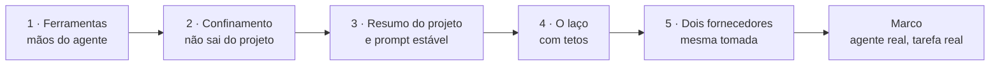
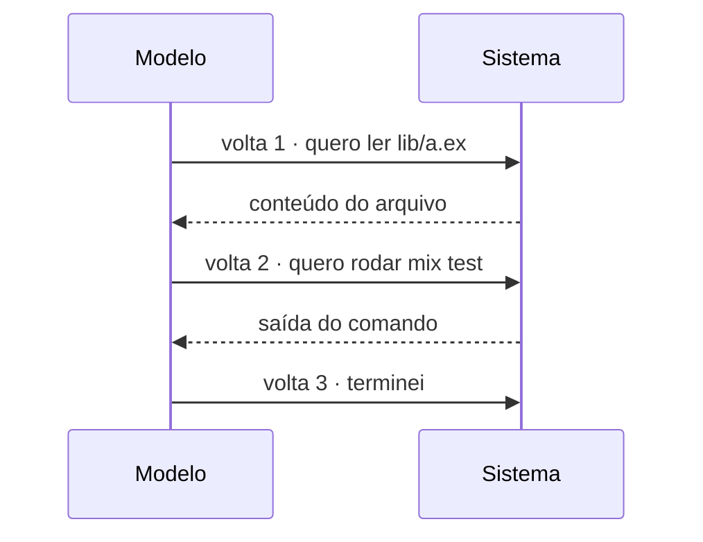
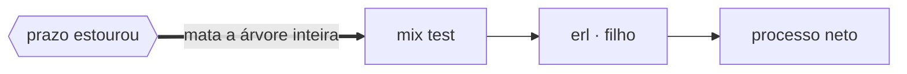
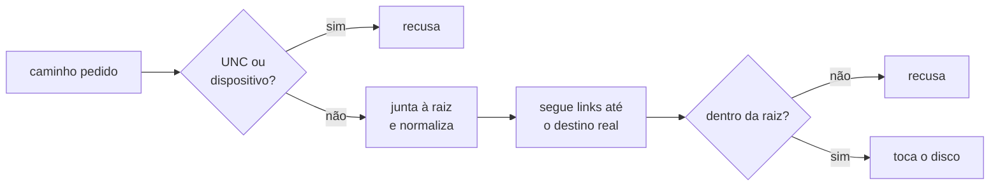
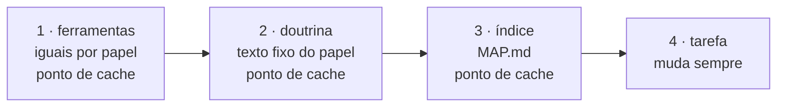
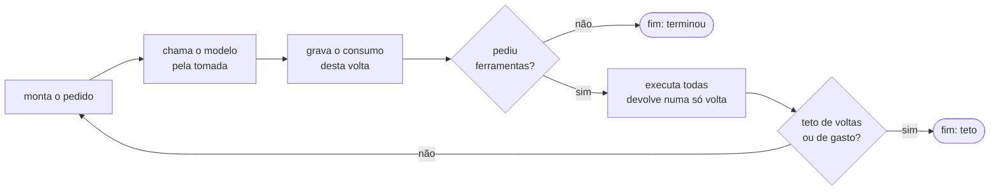
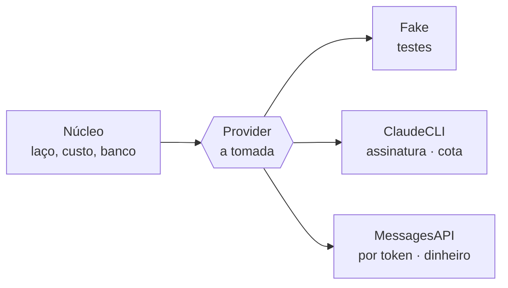
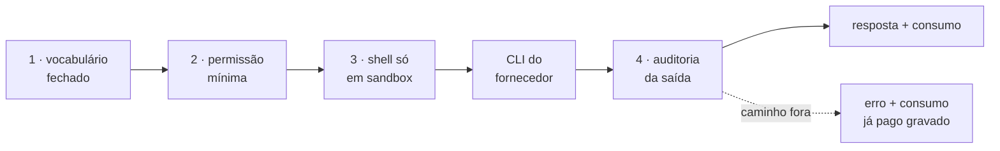
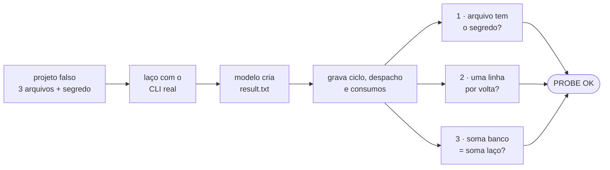

# E3 — O agente e as ferramentas

## Em 30 segundos

- A E3 pluga na fundação da E2 o **agente de verdade**: um agente real resolve uma tarefa real, com o custo gravado volta por volta, e o fornecedor do modelo é trocável sem mexer no núcleo.
- São cinco peças: **ferramentas** (as mãos do agente), **confinamento** (ele não sai do projeto), **resumo do projeto e prompt estável** (ele se orienta gastando pouco), **o laço do agente** (com tetos que ele não consegue ignorar) e **dois fornecedores reais** atrás da mesma tomada.
- A entrega combinada no plano era: *"um agente resolve uma tarefa real com o custo gravado, e trocar de fornecedor não mexe no núcleo"*.
- A prova é um script que chama o **modelo real**: o agente cria o arquivo pedido, e o banco fica com uma linha de custo por volta, com a soma batendo.



> [!FALA] "Na E2 eu preparei onde guardar estado e custo. Na E3 eu coloco o agente para trabalhar — mas com as regras dentro do código: ele só tem as ferramentas do papel dele, não sai da pasta do projeto e não passa dos limites."

## A ideia: que problema a E3 resolve

Um modelo de IA, sozinho, só **conversa**. Para resolver uma tarefa de software ele precisa **agir**: ler arquivos, escrever código, rodar os testes. E no momento em que ele age, aparecem riscos que não existiam numa conversa:

| Problema | Se não resolver agora… | O que a E3 constrói |
|---|---|---|
| O modelo só conversa | o agente não consegue fazer nada no projeto | **ferramentas** de arquivo e de comando |
| Com acesso ao disco, ele pode escrever onde não deve | um erro altera ou apaga arquivos fora do projeto (**R11**) | **confinamento** no código + shell em **sandbox** |
| O modelo decide sozinho quando parar | um agente em laço gasta sem limite | o **laço** como processo, com **tetos** no estado |
| Cada fornecedor é chamado de um jeito | o núcleo fica amarrado a um fornecedor (**R15**) | **dois adaptadores reais** atrás da mesma tomada |
| Ler o projeto inteiro em cada chamada é caro | contexto enorme a cada despacho | **índice** do projeto + **prompt estável** com cache |

> [!IDEIA] A regra da E3 é a mesma da tese inteira: **governança na estrutura, não no texto do prompt**. Em vez de pedir "não escreva fora do projeto", a ferramenta de escrita **recusa** o caminho. Em vez de pedir "não passe de 30 voltas", o laço **para** na 30ª.

## Conceitos em 1 minuto

| Termo | O que é, em uma frase |
|---|---|
| **Agente** | um modelo de IA trabalhando em laço: pede uma ação, o sistema executa, devolve o resultado, e ele decide o próximo passo. |
| **Ferramenta** (*tool*) | uma ação que o modelo pode **pedir** — ler arquivo, rodar comando. Quem **executa** é o sistema, nunca o modelo. |
| **Volta** (*turn*) | uma ida e vinda ao modelo. É a unidade em que o custo é gravado (tabela `usages`, da E2). |
| **Papel** | a função do agente na linha de produção: construtor, verificador, revisor, planejador, documentador, pesquisador. |
| **Árvore de processos** | um comando lança outros (`mix test` lança o `erl`, que lança outros). Matar só o primeiro deixa os filhos rodando. |
| **Confinamento** | a regra de que nenhuma ferramenta toca arquivo fora da pasta do projeto — conferida pelo destino **real** do caminho. |
| **Link / junção** | um "atalho" no sistema de arquivos: o caminho parece estar dentro da pasta, mas aponta para fora. |
| **Sandbox** | isolamento dado pelo sistema operacional: o shell roda numa caixa em que escrever fora da pasta é negado pelo próprio SO. |
| **GenServer (OTP)** | um processo leve do Elixir com estado próprio, que pode ser supervisionado e encerrado de fora. |
| **Cache de prompt** | o fornecedor cobra bem menos pelo trecho inicial do pedido que for **idêntico** ao de um pedido anterior. |
| **CLI × API** | CLI é o programa de linha de comando do fornecedor (roda na assinatura, gasta cota); API é o serviço HTTP (paga por token). |

Como o agente trabalha, numa linha do tempo:



## Peça 1 — As ferramentas do agente (FAB-301)

### A ideia
Dar ao agente as suas **mãos**: ler, listar, buscar, escrever e editar arquivos, e rodar comandos. E dar a cada **papel** só as ferramentas de que ele precisa.

### Por que
O modelo nunca toca o disco diretamente: ele **pede**, e o sistema executa. Isso é o que permite colocar regras no meio — e a regra mais importante é uma **ausência**.

### Quem recebe o quê

| papel | read | list | search | write | edit | run | report_result |
|---|---|---|---|---|---|---|---|
| construtor | ✓ | ✓ | ✓ | ✓ | ✓ | ✓ | ✓ |
| verificador | ✓ | ✓ | ✓ | — | — | ✓ | ✓ |
| revisor | ✓ | ✓ | ✓ | — | — | — | ✓ |
| planejador | ✓ | ✓ | ✓ | — | — | — | ✓ |
| documentador | ✓ | ✓ | ✓ | ✓ | ✓ | — | ✓ |
| pesquisador | ✓ | ✓ | ✓ | — | — | — | ✓ |

> [!IDEIA] **Não existe** ferramenta para mudar o estado ou as tentativas de uma tarefa — para nenhum papel. O agente só **relata** (`report_result`); quem muda o estado é o sistema. E verificador e revisor **não escrevem**: um portão que pode consertar o que reprova deixa de ser portão.

`lib/factory/tools/catalog.ex`
```elixir
@by_role %{
  "builder" => ~w[read list search write edit run report_result],
  "verifier" => ~w[read list search run report_result],
  "reviewer" => ~w[read list search report_result],
  "planner" => ~w[read list search report_result],
  "documenter" => ~w[read list search write edit report_result],
  "researcher" => ~w[read list search report_result]
}
```

### As ferramentas, uma a uma

- **`edit` é troca exata**: recebe o trecho antigo e o novo; recusa se o trecho aparece **zero** ou **mais de uma** vez (para não editar o lugar errado).
- **`report_result`** aceita só uma lista fixa de campos — resumo, arquivos, comandos, commit, bloqueio. Se o agente mandar `status: "done"`, o campo é **descartado com aviso** na mesma resposta (descartar em silêncio deixaria o agente achando que mudou o estado).
- **`run`** roda um comando na pasta do projeto, com prazo.

### Comando com prazo, sem processo órfão



- O comando roda por uma `Port` do Elixir com `:spawn_executable` — é o único jeito que expõe o número do processo no sistema operacional.
- No prazo, `Factory.Tools.ProcessTree.kill/1` derruba a **árvore**: `taskkill /T /F` no Windows; sinal para o **grupo** de processos no Linux.
- A resposta traz o motivo explícito (`:normal`, `:timeout`, `:cancelled`) e **stdout e stderr separados**. Um prazo estourado não é um "teste reprovado".

### Como se prova

- `test/factory/tools/command_test.exs` (29 testes): entre eles, um comando que lança um processo filho e trava — o teste confere que o **filho** também morreu no prazo.
- `test/factory/tools/report_result_test.exs` (21 testes): `status` e `attempts` enviados pelo agente são ignorados; e `refute :state in Catalog.powers()` — se alguém criar uma ferramenta com poder de mudar estado, o teste quebra.

## Peça 2 — Confinamento (FAB-302)

### A ideia
Nenhuma ferramenta lê ou escreve fora da pasta do projeto — e isso é **propriedade do código**, não pedido no prompt.

### Por que
É o requisito **R11**. E a checagem ingênua ("o caminho começa com a pasta do projeto?") é fácil de enganar:

| forma | por que engana a checagem ingênua |
|---|---|
| absoluto (`C:/Windows/...`) | a óbvia |
| `../../..` | só aparece depois de normalizar |
| link simbólico / junção | o caminho está dentro, o **destino** não |
| UNC (`\\servidor\pasta`) | não tem raiz local para comparar |
| dispositivo (`CON`, `NUL`, `COM1`) | não é arquivo: escrever nele fala com hardware |

### Como funciona — visão geral



`lib/factory/tools/confinement.ex`
```elixir
@spec resolve(Path.t(), Path.t()) :: {:ok, Path.t()} | {:error, reason()}
def resolve(root, path) when is_binary(root) and is_binary(path) do
  with :ok <- refuse_unc(path),
       :ok <- refuse_device(path),
       {:ok, absolute} <- join(root, path),
       :ok <- inside?(root, absolute) do
    {:ok, absolute}
  end
end
```

Detalhes que importam:

- A barra invertida é separador em **toda** plataforma (`lib\foo.ex` = `lib/foo.ex`).
- No Windows a comparação ignora maiúsculas/minúsculas; no Linux, não (lá `/x/PROJETO` e `/x/projeto` são pastas diferentes).
- Um ciclo de links (`a → b → a`) não tem destino real: é recusado.

### As guardas de comando
Além dos caminhos, dois "porteiros" julgam um comando **antes** de ele rodar (`Factory.Tools.Guards`):

| guarda | resultado | por quê |
|---|---|---|
| processo | **recusa** | matar processo por nome (ex.: `taskkill /IM erl.exe`) derrubaria a própria fábrica — irreversível |
| ferramental | só **avisa** | reinventar uma ferramenta é caro, mas recuperável; recusar travaria trabalho legítimo |

São funções **puras** (sem disco, rede ou relógio), testáveis exaustivamente.

### E o shell?
Ferramentas de arquivo são auditáveis pelo caminho; um comando de shell não. Por isso, quando o agente recebe shell, ele roda numa **sandbox do sistema operacional** — e onde ela não existe, o agente com shell **nem sobe** (peça 5).

### Como se prova
`test/factory/tools/confinement_test.exs` (43 testes): caminhos que voltam para dentro são aceitos; absoluto, `..`, link e junção para fora, UNC e dispositivos são recusados — com o motivo certo.

> [!FALA] "O agente pode pedir `../../etc/passwd` ou `CON`: a ferramenta recusa antes de tocar o disco. E se ele criar um link de dentro do projeto para fora, eu sigo o link até o destino real e recuso do mesmo jeito."

## Peça 3 — Resumo do projeto e prompt estável (FAB-303)

### A ideia
Dois cuidados com o que vai **dentro** do pedido ao modelo: (1) um **índice** do projeto, para o agente se orientar sem ler todo o código; (2) uma parte fixa do pedido montada **sempre igual**, para o cache do fornecedor funcionar.

### O índice: `mix factory.map`

- Gera `_management/MAP.md`: árvore de arquivos, cada módulo, cada função pública e o propósito de cada uma (tirado da documentação).
- Lê a **árvore sintática** do Elixir (`Code.string_to_quoted/2`), nunca expressão regular — regex erra `def` dentro de texto, cabeças em várias linhas, `defdelegate`. Um índice que mente sobre o que existe é pior que nenhum.
- **Sem data, hash ou contador**: gerar duas vezes sobre o mesmo código dá o mesmo arquivo, byte a byte.

### O prompt em faixas



Um byte mudado invalida o cache de **tudo depois dele**. Por isso o mais estável vem primeiro, e a tarefa (que muda sempre) vem por último.

> [!ATENCAO] Cada modelo tem um tamanho **mínimo** para cachear (512, 1024 ou 4096 tokens, e não em ordem de tamanho do modelo). Abaixo do mínimo, o cache simplesmente não acontece. `Factory.Prompt.Prefix.build/2` **avisa** — não recusa, porque prefixo curto é ineficiente, não inválido.

### Como se prova
`test/factory/index/code_map_test.exs` (18 testes): duas gerações seguidas dão bytes idênticos; nada volátil no arquivo; a ordem não depende do sistema de arquivos. `test/factory/prompt/prefix_test.exs` (24 testes): a ordem é sempre ferramentas → doutrina → índice → tarefa, qualquer que seja a ordem de entrada.

## Peça 4 — O laço do agente (FAB-304)

### A ideia
O coração do sistema: pedir ao modelo, executar as ferramentas pedidas, devolver os resultados — e repetir até o modelo terminar **ou bater num teto**.

### Como funciona — visão geral



### As quatro regras do laço (`Factory.Agents.Loop`)

1. **Todos** os resultados de ferramenta voltam numa única volta — assim o modelo continua pedindo ferramentas em paralelo.
2. Os **tetos** moram no estado do processo (`Factory.Agents.State`), não no texto do prompt.
3. Ferramenta que falha devolve um resultado com `error: true` — nunca some, senão o modelo ficaria cego.
4. O consumo de cada volta é gravado **antes** de decidir continuar — inclusive quando o fornecedor dá erro depois de já ter gastado.

`lib/factory/agents/state.ex`
```elixir
@spec check_continue(t()) :: :ok | {:stop, outcome()}
def check_continue(state) do
  cond do
    state.turns >= state.max_turns -> {:stop, :max_turns}
    spend_exceeded?(state) -> {:stop, :spend_cap}
    true -> :ok
  end
end
```

O teto padrão é de **30 voltas**; o teto de gasto é opcional. O modelo não tem como "pedir mais uma": a 31ª volta não acontece.

### Por que um processo (GenServer)?
O laço roda como um processo OTP. Isso permite **supervisioná-lo** e **encerrá-lo de fora** de forma limpa — é a base do paralelismo e da tolerância a falhas da E5.

### O orçamento de chamadas por papel
`Factory.Agents.ToolBudget` guarda, por papel, duas coisas diferentes: uma **meta** (conselho dado ao agente, para economizar) e um **limiar de anomalia** (acima dele, o agente provavelmente está andando em círculos). Ele **mede e nunca corta**: interromper um despacho no meio custa o mesmo e não entrega nada.

### Como se prova
`test/factory/agents/loop_test.exs` (35 testes), com o fornecedor falso da E2: três voltas terminam com `:end_turn` e gravam 3 linhas de consumo; três ferramentas na mesma volta viram **uma** resposta; o teto de voltas para o laço; um roteiro que acaba termina com `:error` em vez de travar.

## Peça 5 — Dois fornecedores, mesma tomada (FAB-305)

### A ideia
Na E2 nasceu a **tomada** (`Factory.Provider`) com um substituto falso. Agora ela ganha **dois fornecedores reais**. O núcleo continua conhecendo só a tomada.



| adaptador | como fala | quanto custa | família |
|---|---|---|---|
| `Fake` | roteiro escrito pelo teste | nada | só o modelo |
| `ClaudeCLI` | dirige o programa de linha de comando do fornecedor | **cota** da assinatura | **agente completo** |
| `MessagesAPI` | HTTP direto, com `Req` | **dinheiro** por token | **só o modelo** |

### Duas famílias

- **Agente completo** (`ClaudeCLI`): o próprio CLI roda as ferramentas dele, em várias voltas internas. O sistema manda **um** pedido e depois **audita** o que foi feito. Uma volta do laço = uma sessão inteira do CLI.
- **Só o modelo** (`MessagesAPI`): o modelo pede ferramentas e o **sistema** as executa, com o confinamento da peça 2.
- Um adaptador que não declara a família cai no caminho **estrito** (só o modelo): na dúvida, vale a regra mais segura.

### A governança do CLI, medida antes de decidir
Quando o fornecedor roda as próprias ferramentas, a governança vai para a **linha de comando** e para a **auditoria da saída**:



1. **Vocabulário fechado** (`--tools`): as ferramentas fora do papel nem são anunciadas ao modelo.
2. **Permissão mínima que ainda escreve** (`--permission-mode acceptEdits`), com a pasta de trabalho = raiz do projeto: o próprio CLI recusa escrever fora.
3. **Shell só em sandbox**: todo papel com shell recebe configuração de sandbox obrigatória; onde ela não existe, o CLI não sobe e o adaptador devolve `{:error, :sandbox_unavailable}`.
4. **Auditoria**: cada caminho que aparece nas ferramentas usadas passa por `Confinement.resolve/2`; fora da raiz, a resposta vira `{:error, {:outside_confinement, caminhos}}` — **com o consumo já gravado**, porque a sessão já rodou e já foi paga. A **parede de cota** também é reconhecida e devolvida como erro próprio, com a hora em que a cota reabre.

> [!IDEIA] Cada uma dessas regras foi **medida contra o programa real** por scripts de sondagem em `priv/probes/` (`cli_governance.exs`, `confinement_cli.exs`, `cli_real.exs`), e não deduzida da documentação. A regra desses scripts: nenhuma conclusão impressa é texto fixo — o comando que gerou a resposta roda na mesma passada.

### O adaptador da API e o cache
`Factory.Provider.MessagesAPI` existe por um motivo: **controlar o cache**. Ele põe o ponto de cache no **último bloco de cada faixa estável** (peça 3), com validade de **1 hora**, e trata três armadilhas (janela de 20 blocos, pedidos paralelos idênticos que não compartilham cache, instruções por tarefa sem mexer no topo do pedido).

> [!ATENCAO] O teste do marco da E2 mudou nesta etapa, de forma deliberada: antes, **nenhum** módulo podia ler variável de ambiente; agora, **exatamente um** pode — o `MessagesAPI`, que lê a chave de acesso. Exclusividade é a garantia. A suíte continua sem internet: toda chamada HTTP nos testes vai para o "porteiro que explode".

### Como se prova
`test/factory/provider/claude_cli_test.exs` aponta o adaptador para um **script falso** no lugar do CLI e confere as flags montadas, a auditoria de caminhos, a sandbox e a parede de cota — sem rede e sem cota. `test/factory/provider/messages_api_test.exs` (25 testes) confere o corpo do pedido, a posição dos pontos de cache e a validade de 1 hora.

## O marco da etapa (FAB-306)

### O que é `priv/probes/milestone_e3_agent.exs`?

> [!IDEIA] Diferente do marco da E2 (um teste automático), o marco da E3 **precisa** falar com o modelo real — é isso que ele prova. Como chamar o modelo consome cota, ele é um **script de sondagem** que se roda à mão. Ele **não** entra em `mix test`: a suíte continua sem internet, como a E2 exige.



### Passo a passo

1. Cria uma pasta temporária com `README.md`, `a.txt`, `b.txt` e gera um **segredo** na hora (`MILESTONE-E3-<número>`) — ninguém conhece o valor antes.
2. Roda `Factory.Agents.Loop` com `Provider.ClaudeCLI`, modelo `haiku`, **só a ferramenta de escrita** (assim o marco não depende de sandbox) e teto de 10 voltas. O pedido tem várias linhas, aspas e `&` — de propósito, para exercitar o envio pela entrada padrão.
3. **Afirmação 1 — a tarefa foi resolvida de verdade**: `result.txt` existe no disco e contém o segredo.
4. Grava **ciclo, despacho e uma linha de consumo por volta** numa única transação (`Ecto.Multi`). **Afirmação 2**: há exatamente uma linha em `usages` por volta, numeradas de 1 até o total.
5. **Afirmação 3**: a soma de tokens gravada no banco é igual à soma acumulada no estado do laço, e maior que zero.
6. As três passando, imprime `PROBE OK: milestone E3 confirmed against the real claude`.

`priv/probes/milestone_e3_agent.exs`
```elixir
{:ok, summary} =
  Loop.run(
    root: root,
    model: "haiku",
    vocabulary: ["write"],
    max_turns: 10,
    messages: [%{role: :user, content: prompt}],
    tools: %{}
  )
```

> [!ATENCAO] Sob o CLI (agente completo), **uma volta do laço é uma sessão inteira** do CLI, com quantas voltas internas o modelo precisar. O script imprime as duas contagens lado a lado para não confundir "uma linha por volta do laço" com "uma linha por volta interna".

### Como demonstrar ao vivo

```bash
mix run priv/probes/milestone_e3_agent.exs
```

Saída esperada (final): as três linhas `[ok] claim 1/2/3` e `PROBE OK`. Se o limite da assinatura tiver sido atingido, o adaptador devolve a parede de cota com a hora de reabertura — rode de novo depois.

> [!DICA] Se não quiser gastar cota na reunião, mostre os testes sem rede da etapa (`mix test test/factory/agents/loop_test.exs`) e explique que o marco usa exatamente o mesmo laço, só trocando o falso pelo CLI real — que é justamente a prova de R15.

> [!FALA] "O marco cria um projeto de mentira com um segredo gerado na hora. O agente real escreve o arquivo com esse segredo, e o script confere três coisas: o arquivo está lá, há uma linha de custo por volta no banco, e a soma do banco bate com a soma do laço."

## Planejado × entregue

| Pacote do plano | O plano pedia | Entregue | Tarefa | Situação |
|---|---|---|---|---|
| 3.1 Ferramentas | ferramentas de arquivo e comando | 6 ferramentas + `report_result`, catálogo por papel, prazo que mata a árvore | FAB-301 | ✅ |
| 3.1 Contexto | resumo do projeto para orientar o agente | `mix factory.map` determinístico + prefixo em faixas com cache | FAB-303 | ✅ |
| 3.2 Confinamento | nenhum agente escreve fora do projeto | resolução pelo destino real + guardas + sandbox do shell | FAB-302 | ✅ |
| 3.3 Laço | agente como processo supervisionado, com limite | GenServer com tetos no estado e orçamento de chamadas | FAB-304 | ✅ |
| 3.4 Fornecedores | adaptadores do fornecedor | ClaudeCLI (assinatura) e MessagesAPI (por token), governança medida | FAB-305 | ✅ |
| Entrega | agente real, tarefa real, custo gravado | script de sondagem com 3 afirmações contra o modelo real | FAB-306 | ✅ |

Requisitos: **R11** (nada escrito fora do projeto) e **R15** (fornecedor trocável) atendidos nesta etapa.

## Decisões técnicas e porquês

| Decisão | Alternativa | Por que esta |
|---|---|---|
| Regras como ausência de ferramenta | instrução no prompt | o modelo não consegue usar o que não existe |
| Confinamento pelo destino real | comparar o texto do caminho | links, junções e `..` enganam a comparação de texto |
| Guarda de processo recusa, de ferramental avisa | as duas recusam | só o irreversível merece parede; o resto vira aviso |
| Tetos no estado do processo | pedir ao modelo que pare | o modelo não decide se continua |
| Gravar o consumo antes de decidir | gravar no fim | um erro depois de gastar não pode apagar o custo |
| Medir e nunca cortar o orçamento de chamadas | cortar ao passar | despacho interrompido custa igual e não entrega nada |
| Índice pela árvore sintática | regex | regex mente sobre o que existe |
| CLI como padrão de operação | só a API | roda na assinatura; a governança vai para a linha de comando |
| API por HTTP puro (`Req`) | SDK do fornecedor | o SDK esconde o controle do cache, que é o motivo do adaptador |
| Shell só com sandbox do SO | auditar comandos por texto | comando de shell não é auditável pelo caminho |

## Números da etapa

| Medida | Valor |
|---|---|
| Tarefas | 6 de 6 concluídas |
| Commits na etapa | 13 |
| Testes automáticos | 558 (eram 152 na E2) |
| Módulos | 53 (eram 37) |
| Linhas de código (lib/) | 5.774 (eram 2.634) |

Medido na branch `etapa/e3-agente`: testes contando as linhas `test "` em `test/`, módulos contando `defmodule` em `lib/`, linhas com `wc -l` em `lib/**/*.ex`, commits com `git log etapa/e2-fundacao..etapa/e3-agente`.

> [!DICA] O salto de testes vem principalmente do adaptador do CLI e do confinamento: são as duas peças com mais casos de borda (formatos de caminho, eventos do CLI, parede de cota).

## Roteiro da apresentação (10 minutos)

| Tempo | O que falar | O que mostrar |
|---|---|---|
| 0:00–1:00 | O problema: o modelo só conversa; para agir precisa de ferramentas — e aí aparecem os riscos | capa do documento da E3; página "O problema" |
| 1:00–2:30 | Ferramentas por papel; a ausência como regra; `report_result` só relata | a tabela "quem recebe o quê" |
| 2:30–4:00 | Confinamento pelo destino real; guardas; sandbox | o diagrama do confinamento |
| 4:00–5:00 | O laço e seus tetos; por que é um processo | o diagrama do laço |
| 5:00–6:30 | Dois fornecedores, mesma tomada; as duas famílias; governança medida | os diagramas da tomada e da governança do CLI |
| 6:30–8:30 | **O marco**: projeto falso + segredo + 3 afirmações | terminal com `mix run priv/probes/milestone_e3_agent.exs` (ou a saída gravada) |
| 8:30–9:30 | Números e o quadro de tarefas | `docs/tasks/pt/README.md` na branch |
| 9:30–10:00 | Próxima etapa: a linha de produção (E4) | — |

> [!FALA] Abertura: "Na E3 o agente começa a trabalhar. A pergunta que guia a etapa é: como deixar um modelo agir no projeto sem confiar que ele obedeça ao prompt?"

> [!FALA] Fechamento: "Agora existe um agente real que resolve tarefa e grava o custo. A E4 coloca vários deles numa linha de produção: estados, fila, dois portões e o limite de retrabalho."

## Perguntas prováveis do orientador

1. **O que impede o agente de marcar a própria tarefa como concluída?** Não existe ferramenta para isso. Ele só relata por `report_result`, e campos como `status` são descartados com aviso. Quem muda o estado é o sistema.
2. **E se o agente criar um link para fora do projeto?** O confinamento segue o link até o destino real antes de tocar o disco e recusa.
3. **O shell não fura o confinamento?** Furaria, se não houvesse sandbox: por isso o shell só existe com a sandbox do sistema operacional, e onde ela não existe o agente com shell não sobe. A sandbox nega escrita fora da pasta; leitura fora ainda é possível — limitação declarada.
4. **Por que os tetos não ficam no prompt?** Porque o modelo pode ignorar um pedido; não pode ignorar um laço que simplesmente não faz a 31ª chamada.
5. **Se o fornecedor der erro no meio, o custo se perde?** Não: o consumo da volta é gravado antes de decidir, e erros que já gastaram tokens trazem o consumo junto.
6. **Por que dois adaptadores?** O CLI roda na assinatura (mais barato para operar), mas não deixa controlar o cache; a API deixa, mas cobra por token. Ter os dois atrás da mesma tomada é também a prova de R15.
7. **Trocar de fornecedor muda o quê, exatamente?** Uma linha de configuração (`config :factory, :provider`). O laço, os tetos, o confinamento e a contagem de custo são os mesmos.
8. **Por que o marco não roda em `mix test`?** Porque chama o modelo real e consome cota; a suíte tem de rodar sem internet (marco da E2).
9. **Como você sabe que as flags do CLI fazem o que você acha?** Medi contra o programa real com os scripts de `priv/probes/`, que imprimem o comando exato e a saída observada.
10. **Para que serve o índice do projeto?** Para o agente abrir só o que vai mudar. E como ele é gerado sempre igual, entra na parte cacheada do pedido.
11. **O custo em dólar do CLI é real?** É uma estimativa (o CLI roda na assinatura, consome cota); por isso o custo é gravado nas duas unidades desde a E2.

## Limitações conhecidas e o que vem depois

- A medição do ganho de cache com a API por token depende de uma chave de acesso e ficou para depois do marco final.
- Sob a sandbox, o shell do agente ainda consegue **ler** fora da pasta do projeto (escrever, não).
- Nomes curtos do Windows (`C:\Users\ABCDEF~1`) são tratados como diferentes da forma longa: um link legítimo pode ser recusado — o erro é para o lado seguro.
- O agente roda um de cada vez; a **linha de produção** (estados, fila, portões, retrabalho) é a E4, e o **paralelismo** é a E5.

## Glossário

- **Agente** — modelo de IA trabalhando em laço com ferramentas.
- **Ferramenta** — ação que o modelo pede e o sistema executa.
- **Volta** — uma ida e vinda ao modelo; unidade do custo.
- **Papel** — função do agente (construtor, verificador, revisor…), que define suas ferramentas.
- **Catálogo** — tabela de ferramentas por papel (`Factory.Tools.Catalog`).
- **Confinamento** — nenhuma ferramenta toca arquivo fora da raiz do projeto.
- **Junção** — tipo de link de pasta do Windows.
- **UNC** — caminho de rede (`\\servidor\pasta`).
- **Sandbox** — isolamento do sistema operacional para o shell.
- **Guarda** — função pura que julga um comando antes de ele rodar.
- **Laço** — `Factory.Agents.Loop`, o processo que conversa com o modelo.
- **Teto** — limite de voltas ou de gasto, no estado do processo.
- **Família** — agente completo (CLI) ou só o modelo (API).
- **Parede de cota** — o limite da assinatura foi atingido; o CLI informa quando reabre.
- **Prefixo estável** — parte do pedido que não muda entre despachos e pode ser cacheada.
- **Script de sondagem (probe)** — script em `priv/probes/` que mede o comportamento do programa real.

## Cola de comandos

```bash
mix factory.ci --fast                                  # verificação completa, sem a checagem de tipos
mix test test/factory/tools/confinement_test.exs       # os casos de confinamento
mix test test/factory/tools/command_test.exs           # prazo que mata a árvore de processos
mix test test/factory/agents/loop_test.exs             # o laço com o fornecedor falso
mix test test/factory/provider/claude_cli_test.exs     # o adaptador do CLI, com script falso
mix factory.map                                        # gera _management/MAP.md
mix run priv/probes/milestone_e3_agent.exs             # o marco, contra o modelo real (consome cota)
mix run priv/probes/cli_governance.exs                 # mede a governança do CLI real (consome cota)
```
