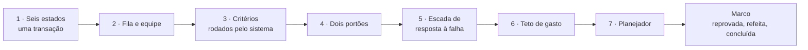
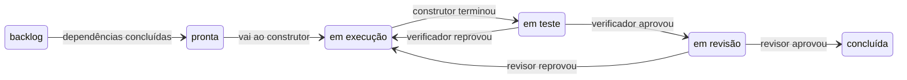
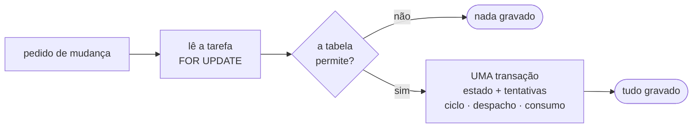
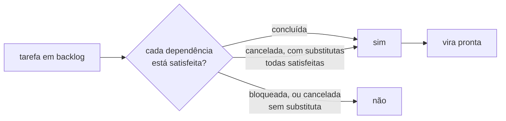
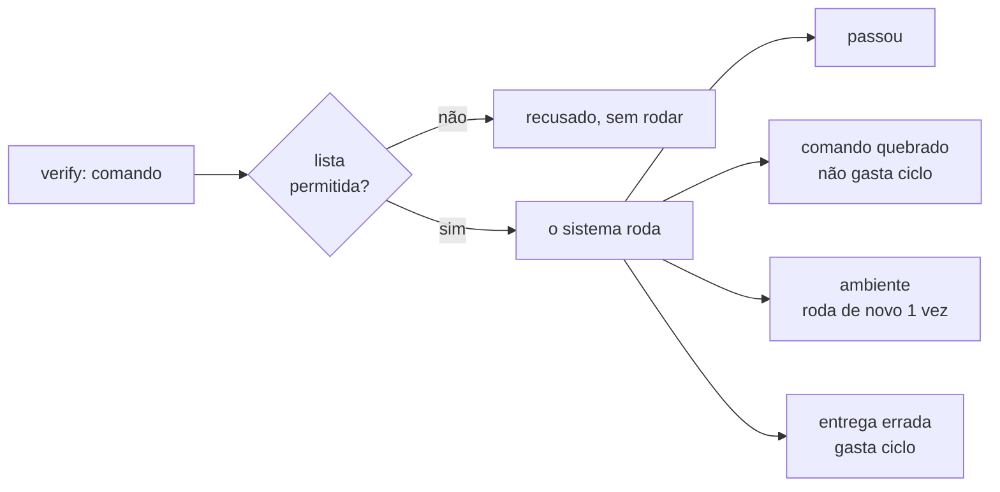
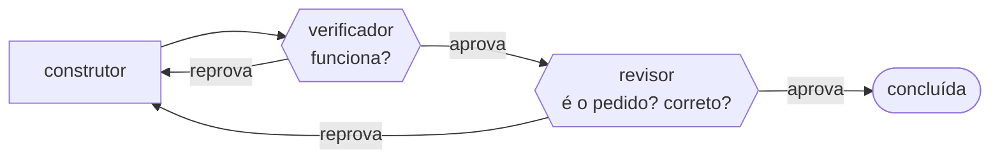
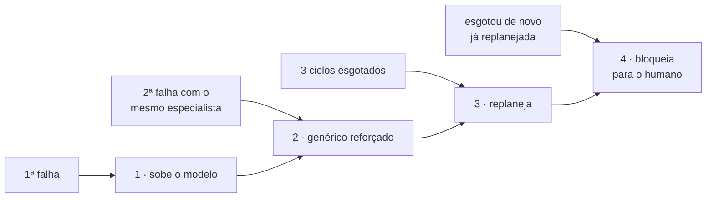
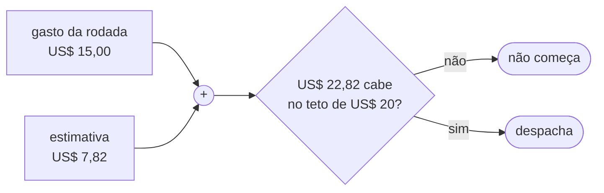
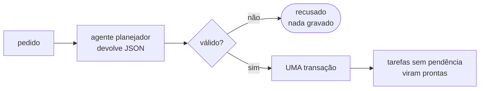
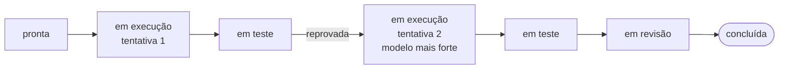

# E4 — Linha de produção de tarefas

## Em 30 segundos

- A E3 deixou um agente que **age** no projeto. A E4 constrói a **linha de produção** em volta dele: as regras que dizem quando uma tarefa avança, quem aprova, o que fazer quando ela falha e quanto se pode gastar.
- São sete peças: **seis estados** (com cada mudança numa transação), **fila por dependências** (e a equipe de especialistas), **critérios executados pelo sistema**, **dois portões**, **escada de resposta à falha**, **teto de gasto** e o **planejador** (do pedido às tarefas).
- A entrega combinada no plano era: *"uma tarefa percorre os seis estados, é reprovada de propósito, é refeita e conclui"*.
- A prova é um **teste automático permanente** (`test/factory/milestone_e4_test.exs`): a tarefa é reprovada por uma mensagem de erro errada, sobe de modelo, é refeita e conclui — e o histórico, os despachos e o custo de cada ciclo são conferidos no banco.



> [!FALA] "Na E3 eu tinha um agente. Na E4 eu tenho uma linha de produção: o agente não decide se terminou, não aprova o próprio trabalho e não escolhe como refazer — tudo isso é regra do sistema, escrita em código e provada por teste."

## A ideia: que problema a E4 resolve

Um agente sozinho resolve uma tarefa. Um **projeto** são dezenas de tarefas, que dependem umas das outras, falham, voltam, custam. Sem regras, cada uma dessas situações vira uma decisão tomada pelo próprio modelo — que é exatamente o que a tese quer evitar.

| Problema | Se não resolver agora… | O que a E4 constrói |
|---|---|---|
| Mudar o estado de uma tarefa envolve várias gravações | registro incoerente; o agente poderia se declarar pronto | **máquina de estados** + transição numa **única transação** (R2) |
| Um pedido vira muitas tarefas interdependentes | tarefa começa antes da base pronta | **planejador** que valida o grafo + **fila** que promove e ordena (R1) |
| Perguntar "funciona?" ao modelo gasta e confunde causas | o construtor é chamado para consertar um comando que nunca esteve errado | **critérios rodados pelo sistema** + **classe da falha** |
| Quem constrói não pode aprovar | entrega errada aprovada | **dois portões** sem ferramenta de escrita (R3) |
| Refazer do mesmo jeito repete o erro | ciclos queimados; tarefa impossível gira para sempre | **escada de resposta** + **diagnóstico** (R4, R5) |
| O gasto cresce a cada despacho | uma rodada estoura o orçamento | **teto** conferido antes de começar (R14) |

> [!IDEIA] A pergunta que guia a etapa: **o que cabe num teste vira código.** Promover uma tarefa, ordenar a fila, decidir se um critério passou, escolher o próximo degrau do retrabalho, decidir se a próxima tarefa cabe no orçamento — tudo isso são funções puras, testadas. O modelo fica só com o que é julgamento: construir, verificar o que não tem comando e revisar.

## Conceitos em 1 minuto

| Termo | O que é, em uma frase |
|---|---|
| **Máquina de estados** | uma lista fixa de estados e das mudanças permitidas entre eles; qualquer mudança fora da lista é recusada. |
| **Transação** | um grupo de gravações no banco que entra inteiro ou não entra (`Ecto.Multi`); não existe meio-termo. |
| **Tentativas** (*attempts*) | quantas vezes a tarefa foi entregue a um construtor; quem soma é o sistema, nunca o agente. |
| **Ciclo** | uma passagem construir → verificar → revisar; cada retrabalho abre um ciclo novo, com custo próprio (tabela `cycles`, da E2). |
| **Grafo de dependências** | tarefas são nós, "depende de" são setas; um ciclo (A espera B, que espera A) travaria tudo e é recusado. |
| **Critério executável** | uma linha `verify:` com um comando; o código de saída diz se passou. |
| **Lista permitida** (*allowlist*) | só roda o que está na lista; o que falta é recusado (falha fechada). O contrário, lista de proibidos, falha aberta. |
| **Conformidade** | a pergunta "é o que foi pedido?", separada de "tem defeito?". |
| **Especialista** | um texto de domínio (arquivos da área, armadilhas) que se **soma** ao papel genérico do construtor. |
| **Rodada** | uma execução da linha sobre as tarefas prontas, com um teto de gasto. |

A vida de uma tarefa, em uma figura:



## Peça 1 — Os seis estados, com a mudança gravada de uma vez só (FAB-401)

### A ideia
Toda tarefa percorre a mesma linha: **backlog → pronta → em execução → em teste → em revisão → concluída**, mais **bloqueada** e **cancelada** como saídas. E cada mudança grava **junto** o novo estado, o relatório do ciclo, o despacho e o consumo — ou nada.

### Por que
Se o estado fosse gravado num passo e o relatório em outro, uma queda no meio deixaria uma tarefa "em teste" sem relatório do construtor, ou um custo sem a mudança que o explica. E se o agente pudesse escrever o estado, ele poderia se declarar pronto.

### A regra: uma tabela pura

`lib/factory/tasks/state_machine.ex`
```elixir
@transitions %{
  backlog: [:ready, :blocked, :cancelled],
  ready: [:in_progress, :blocked, :cancelled],
  in_progress: [:in_testing, :blocked, :cancelled],
  in_testing: [:in_review, :in_progress, :blocked, :cancelled],
  in_review: [:done, :in_progress, :blocked, :cancelled],
  done: [],
  blocked: [:cancelled],
  cancelled: []
}
```

- `can?/2`, `check/2` e `targets/1` respondem só olhando a tabela — sem banco, sem efeito colateral.
- **Concluída não leva a lugar nenhum**: desfazer trabalho aprovado exige uma tarefa nova.
- As únicas portas de volta são os dois portões: teste ou revisão reprovam e a tarefa volta para **em execução**.

### A escrita: uma transação



`lib/factory/tasks/transition.ex`
```elixir
def append(multi, id, to, opts \\ []) do
  multi
  |> Multi.run(:current, fn repo, _done -> load(repo, id) end)
  |> Multi.run(:checked, fn _repo, done -> check(done, to) end)
  |> Multi.run(:task, fn repo, done -> move(repo, done, to) end)
  |> maybe_cycle(opts)
  |> maybe_dispatch(opts)
  |> usages(opts)
end
```

- `load/2` lê a tarefa **com trava** (`FOR UPDATE`): duas mudanças na mesma tarefa entram em fila, nunca se cruzam.
- Entrar em `in_progress` soma 1 em `attempts` **na mesma transação** (`StateMachine.hands_to_builder?/1`). É o único lugar do código de produção que escreve esse campo — e há um teste que varre o código para garantir isso.
- O número do ciclo é lido antes do incremento: a reprovação do verificador cai no ciclo que **falhou**, não no seguinte.

> [!IDEIA] O contador de tentativas é a peça de que todo o resto depende: a escada de retrabalho (Peça 5) decide pelo número de tentativas. Por ser do sistema, o agente não tem como zerá-lo nem esquecer de somá-lo.

### Como se prova
- `test/factory/tasks/state_machine_test.exs` (11 testes): varre **todas** as combinações de estado de origem e destino contra a tabela.
- `test/factory/tasks/transition_test.exs` (28 testes): uma transição ilegal não grava nem o ciclo que veio junto; um erro do **banco** (não só de validação) desfaz tudo; "existe UM ÚNICO lugar em produção que escreve `attempts`".

## Peça 2 — Fila por dependências e equipe especializada (FAB-402)

### A ideia
Uma tarefa só fica **pronta** quando o que ela precisa terminou; entre as prontas, vai primeiro a que **destrava mais trabalho**. E cada tarefa é construída pelo papel genérico **mais**, quando ela aponta para um, um especialista.

### Quando uma dependência está satisfeita



- **Cancelada com substitutas**: quando uma tarefa é replanejada, a original é cancelada e nascem substitutas. Quem dependia da original passa a depender delas — e só anda quando **todas** estiverem satisfeitas.
- **Bloqueada nunca conta**: trabalho bloqueado parou, não terminou.

### A ordem da fila
`Factory.Tasks.Scheduler.next_steps/2` ordena por **prioridade**, depois por **quantas tarefas ainda abertas cada uma destrava**, depois pelo código. Sem o critério do meio, a ordem cairia na ordem de criação — e uma tarefa que destrava três outras poderia ficar atrás delas.

### A equipe
- Especialistas são **dados versionados** (`Factory.Team`): mudar o texto de um especialista insere uma versão nova e desativa a antiga, numa transação. O banco garante, por um índice único parcial, que só há uma versão ativa.
- `Factory.Team.Resolution.resolve/3` tem dois resultados: **papel sozinho** ou **papel + especialista**. O especialista **soma** ao papel (num bloco próprio do prompt), nunca o substitui — a disciplina (commit, estado, confinamento) vem sempre do papel.
- Tarefa que aponta para um especialista inexistente roda no genérico e o **defeito é registrado**.

### Como se prova
- `test/factory/tasks/scheduler_test.exs` (34 testes): substitutas, linhagens de replanejamento, desempate, ciclo de dependência recusado.
- `test/factory/team/resolution_test.exs` (22 testes).

## Peça 3 — Critérios de aceite executados pelo sistema (FAB-403)

### A ideia
Todo critério que tem um comando (`verify:`) roda **antes** de gastar um agente. Só roda binário de uma **lista permitida**, e cada falha é **classificada**: o comando estava quebrado, a máquina atrapalhou, ou a entrega está errada.

### Por que
O construtor **não pode mudar critérios** (quem os escreve é o planejador). Se toda falha voltasse para ele, um critério com comando errado faria o construtor ser despachado de novo e de novo para consertar algo que já estava certo — queimando os três ciclos.



### A lista permitida

`lib/factory/criteria/allowlist.ex`
```elixir
@binaries ~w[
  mix elixir iex
  npm pnpm yarn node
  python python3 pytest ruff mypy
  go cargo dotnet mvn gradle
  tsc eslint prettier vitest jest
  ls cat grep rg find test
  git
]

@git_read_only ~w[status log show diff ls-files rev-parse describe cat-file]
```

- **Lista permitida, nunca lista de proibidos**: uma lista de proibidos incompleta deixa passar; uma lista permitida incompleta só recusa.
- `git` só em modo leitura (`push`, `reset`, `clean` recusados). `npx` fica de fora: ele baixa e roda código que não está no projeto.
- Encadear comandos (`;`, `|`, `&`, `$(...)`) é recusado: um critério é **um** comando.

### A classe da falha

`lib/factory/criteria/failure_class.ex`
```elixir
cond do
  unambiguous_environment?(context) -> :environment
  missing_binary?(context) -> :broken_tool
  misuse?(context) -> :broken_tool
  invalid_option?(context) -> :broken_tool
  target_exists_but_fails_to_load?(context) -> :broken_tool
  resource_exhausted?(context) -> :environment
  true -> :delivery
end
```

- O caso difícil é "alvo não encontrado". O desempate é **o disco**, não a mensagem: alvo que existe e não carrega é problema do comando; alvo que **não existe** é falha real (a tarefa deveria tê-lo criado).
- **Na dúvida, entrega errada**: errar para esse lado custa no máximo um ciclo; errar para o outro deixa defeito passar.

### Dois detalhes que economizam
- A **suíte de testes do projeto** entra sempre como critério implícito (lida de `_management/ci.json` ou detectada pelo ecossistema) — ninguém precisa escrever "a suíte continua passando".
- Dois critérios com o **mesmo comando** rodam uma vez só; o segundo vira espelho.

### Como se prova
- `test/factory/criteria_test.exs` (41), `test/factory/criteria/failure_class_test.exs` (36), `test/factory/criteria/suite_test.exs` (28).

## Peça 4 — Os dois portões (FAB-404)

### A ideia
Duas perguntas **independentes**, em dois portões que **não escrevem nada**:

1. **Verificador** — "funciona?", executando os critérios.
2. **Revisor** — "é o que foi pedido?" (**conformidade**) e "está correto?" (**revisão**), lendo o diff.



### O verificador

`lib/factory/gates/verifier.ex`
```elixir
def judge(results) do
  reason =
    cond do
      Criteria.failed?(results) -> :criterion_failed
      Criteria.inconclusive(results) != [] -> :no_proof
      true -> :approved
    end
  ...
end
```

Um critério **inconclusivo** também segura a aprovação: "não sei" nunca vira "sim".

### O revisor

`lib/factory/gates/reviewer.ex`
```elixir
def judge(conformance, findings \\ []) do
  reason =
    cond do
      match?({:nonconforming, _}, conformance) -> :nonconforming
      findings != [] -> :defects
      true -> :approved
    end
  ...
end
```

- **Conformidade vem primeiro e não precisa de defeito**: uma entrega que passa em todos os critérios mas implementa outra coisa sai "não conforme, zero achados".
- Achados seguem a linha canônica `[severidade] arquivo:linha — problema`, para que o diagnóstico (Peça 5) possa ler a severidade e o local.
- O módulo do revisor **não lê o disco**: recebe só o diff commitado. Um teste varre o próprio fonte do módulo para garantir isso.

> [!IDEIA] Nenhum dos dois portões recebe ferramenta de escrita (catálogo da E3): **um portão que pode consertar o que reprova deixa de ser portão.**

### Como se prova
- `test/factory/gates_test.exs` (30) e `test/factory/gates/reviewer_test.exs` (9): os dois portões reprovam por motivos diferentes; reprovação por conformidade sem achado nenhum.

## Peça 5 — Diagnóstico da reprovação e escada de resposta (FAB-405)

### A ideia
Quando uma tarefa é reprovada, decidir **como** refazê-la — não só **que** deve ser refeita. Duas metades: a **escada** (com quem refazer) e o **diagnóstico** (com quanto).

### A escada: quatro degraus



`lib/factory/rework/ladder.ex`
```elixir
def next_step(situation) do
  cond do
    round_cap_hit?(situation) -> {:stop, :max_dispatches}
    cycles_exhausted?(situation) -> end_of_line(situation)
    true -> {:ok, rework_step(situation)}
  end
end
```

1. **Sobe o modelo**: repetir o mesmo modelo pagaria construtor, verificador e revisor de novo e queimaria um dos três ciclos.
2. **Troca o especialista**: ele foi escolhido no planejamento, antes de se saber onde a tarefa ia falhar; duas falhas sob o mesmo texto de domínio sugerem um ataque enviesado.
3. **Replaneja**: três ciclos esgotados sugerem problema de **tamanho**, não de execução. A original vira `cancelada`, as substitutas nascem com referência a ela.
4. **Bloqueia**: a autocorreção acontece **uma vez por linhagem** — senão uma tarefa impossível geraria substitutas para sempre.

Por cima de tudo, um teto de **12 despachos por tarefa numa rodada** (o pior caso legítimo é 3 ciclos × 3 papéis = 9): defesa em profundidade, que não confia nem na escada nem no contador.

### O diagnóstico: o tamanho do retrabalho

| natureza | o que aconteceu | escopo | voltas |
|---|---|---|---|
| bloqueio | o construtor declarou que não consegue seguir | inteiro | 18 |
| conformidade | entregou outra coisa | **inteiro** | 30 |
| funcional | um critério executável falhou | inteiro | 18 |
| localizada | achado com arquivo e linha | **só esses arquivos** | 8 (18 se grave) |

`lib/factory/rework/policy.ex`
```elixir
@turns %{narrow: 8, medium: 18, wide: 30}
```

A ordem da tabela é a precedência: nenhuma quantidade de voltas resolve um bloqueio; e fazer passar os critérios da tarefa errada não adianta, por isso conformidade vem antes de funcional.

> [!DICA] Exemplo para a reunião: um achado `[minor] lib/a.ex:42 — ...` gera um retrabalho de **8 voltas, só em `lib/a.ex`**, com o achado no topo do foco — não uma reimplementação de 30 voltas.

### Como se prova
- `test/factory/rework/ladder_test.exs` (24) e `test/factory/rework/diagnosis_test.exs` (30).

## Peça 6 — Teto de gasto por rodada e por tarefa (FAB-406)

### A ideia
Antes de começar a próxima tarefa, o sistema confere se **gasto + estimativa** cabem no teto. Se não cabem, **não começa**. Trabalho em andamento **nunca** é cortado.



`lib/factory/budget.ex`
```elixir
def check_round(spent_so_far, round_cap, completed_task_costs \\ []) do
  estimate = estimate_next_task(completed_task_costs)

  if fits_round?(spent_so_far, estimate, round_cap) do
    :ok
  else
    {:stop, :budget}
  end
end
```

- A estimativa **se calibra**: é a média por tarefa **concluída** na própria rodada; sem medida ainda, usa um padrão declarado (US$ 7,82 por tarefa).
- **Teto por tarefa** = uma fração (30%) do teto da rodada: impede redespachar a mesma tarefa que já consumiu a sua parte, mesmo com orçamento sobrando na rodada.

> [!IDEIA] Por que nunca cortar no meio? Um agente interrompido no meio **já gastou** e **não entrega nada**. O controle certo é não **começar** o que não cabe — por isso nenhuma função do módulo sequer enxerga um despacho em andamento.

### Como se prova
- `test/factory/budget_test.exs` (12 testes), mais os exemplos executáveis na documentação do módulo.

## Peça 7 — Do pedido às tarefas: o planejador (FAB-407)

### A ideia
Um pedido em linguagem natural vira um **grafo de 8 a 12 tarefas** (áreas, critérios, dependências), gravado no banco numa **única transação** — ou nada é gravado.



`lib/factory/planner.ex`
```elixir
def plan(request, %Project{} = project, opts \\ []) when is_binary(request) do
  with {:ok, response} <- ask(request, project, opts),
       {:ok, raw} <- extract_json(response.blocks),
       {:ok, tasks} <- validate_plan(raw) do
    write(project, tasks)
  end
end
```

- O agente devolve o plano como um bloco JSON na última mensagem (formato em `priv/doctrine/planner.md`).
- **Recusado antes de tocar o banco**: sem JSON válido, contagem fora de 8..12, área que é uma pasta (termina em `/`) ou dependência circular.
- O código `T-NNN`, o estado e as tentativas são campos **do sistema**, nunca do agente.
- `mix factory.plan "<pedido>" --project <nome>` é a **única entrada humana**: cria (ou reaproveita) o projeto, planeja e promove a "pronta" as tarefas sem pendência.

### A publicação
Dois módulos à parte, prontos e testados:
- `Factory.Publishing.Markdown.generate/1` gera o arquivo de uma tarefa **idêntico byte a byte** para o mesmo estado (listas ordenadas, sem data de geração) — senão todo commit mostraria diferença onde nada mudou.
- `Factory.Publishing.Git.commit/3` commita **só as áreas da tarefa + o arquivo dela**, e **recusa** se houver mudança fora delas — nunca `git add -A`.

> [!ATENCAO] Nesta etapa, `mix factory.plan` grava no banco e promove; ele **não** chama a publicação. O markdown é exercitado pelo teste do marco, e o commit restrito às áreas passa a ser usado pela recuperação de trabalho interrompido na E5.

### Como se prova
- `test/factory/planner_test.exs` (13), `test/factory/publishing/markdown_test.exs` (16), `test/factory/publishing/git_test.exs` (8), `test/mix/plan_test.exs` (7) — todos com o fornecedor falso da E2.

## O marco da etapa (FAB-408)

### O que é `test/factory/milestone_e4_test.exs`?

> [!IDEIA] Como na E2, o marco é um **teste automático permanente**: roda em toda verificação, sem agente real e sem rede. Ele chama `Factory.Tasks.Transition` em sequência, fazendo o papel de cada agente — e a prova é **adversária**: a primeira entrega está errada de propósito.



### Passo a passo

1. A tarefa nasce em **pronta** (o backlog exigiria dependências, que são provadas nos testes do escalonador). Vai ao construtor: `attempts` vira 1. O construtor entrega (`→ in_testing`) sem gastar tentativa.
2. O verificador **reprova**: o critério exigia a mensagem exata `invalid message: required field` e o construtor escreveu `invalid`. Volta para execução; `attempts` vira 2.
3. `Ladder.next_step(%{attempts: 1})` responde `:escalate_model`: o ciclo 2 usa um modelo diferente do ciclo 1.
4. Ciclo 2: o teste aprova (`→ in_review`), o revisor aprova (`→ done`).
5. O teste confere três critérios no banco:

`test/factory/milestone_e4_test.exs`
```elixir
assert history == [
         :ready,
         :in_progress,
         :in_testing,
         :in_progress,
         :in_testing,
         :in_review,
         :done
       ]

assert length(builder_dispatches) == final_task.attempts
assert final_task.attempts == 2
assert Enum.map(builder_dispatches, & &1.model) == [model_cycle_1, model_cycle_2]
```

- **Critério 1** — o histórico completo, com a reprovação e o retrabalho.
- **Critério 2** — um despacho de construtor por tentativa, e o modelo **subiu** no 2º (o teste falha se o retrabalho repetir o modelo).
- **Critério 3** — o custo de cada ciclo é consultável **separadamente**, os dois são maiores que zero e diferentes, e a soma bate com o total.
- Por fim, o markdown da tarefa é gerado e confere `status: done`, `attempts: 2`, `### Cycle 1` e `### Cycle 2`.

### Como demonstrar ao vivo

```bash
mix test test/factory/milestone_e4_test.exs
```

Saída esperada: `1 test, 0 failures`. Não consome cota nem precisa de internet.

> [!FALA] "O marco reprova a tarefa de propósito: o critério pedia uma mensagem de erro exata e a primeira entrega não bate. O sistema volta a tarefa, soma uma tentativa, sobe o modelo, e na segunda vez ela passa pelos dois portões. No banco ficam o histórico inteiro e o custo de cada ciclo separado."

## Planejado × entregue

| Pacote do plano | O plano pedia | Entregue | Tarefa | Situação |
|---|---|---|---|---|
| 4.1 Estados | seis estados com relatório e custo | máquina de estados pura + transição transacional | FAB-401 | ✅ |
| 4.2 Fila | promoção por dependências e ordem | escalonador + equipe versionada | FAB-402 | ✅ |
| 4.3 Critérios | critérios de aceite executados | passada mecânica com lista permitida e classe da falha | FAB-403 | ✅ |
| 4.4 Portões | dois julgamentos independentes | verificador e revisor sem escrita; conformidade separada | FAB-404 | ✅ |
| 4.5 Retrabalho | decidir como refazer, com limite | escada de 4 degraus + diagnóstico | FAB-405 | ✅ (regra) |
| 4.5 Gasto | teto que nunca corta no meio | teto por rodada e por tarefa | FAB-406 | ✅ (regra) |
| R1 Planejador | do pedido às tarefas | `mix factory.plan` + publicação | FAB-407 | ✅ |
| Entrega | reprovada de propósito, refeita, concluída | teste permanente com 3 critérios | FAB-408 | ✅ |

Requisitos: **R2** (seis estados com relatório e custo) e **R3** (dois julgamentos independentes) atendidos. **R4**, **R5** e **R14** ficam **parciais**: as regras estão prontas e testadas, mas nesta etapa nenhum laço automático as chama. **R1** é parcial até o teste com um pedido real, na validação.

## Decisões técnicas e porquês

| Decisão | Alternativa | Por que esta |
|---|---|---|
| Transição numa transação única | gravar estado e relatório em passos | queda no meio deixaria registro incoerente |
| `attempts` escrito só pelo sistema | o agente informa a tentativa | o limite de ciclos depende desse número |
| Regras como funções puras | decisão do modelo | o que cabe num teste é código |
| Lista permitida de binários | lista de proibidos | lista incompleta de proibidos deixa passar |
| Classificar a falha do critério | toda falha volta ao construtor | ele não pode mudar critério; giraria em vão |
| Na dúvida, entrega errada | na dúvida, culpar o comando | custa no máximo um ciclo; o oposto deixa defeito passar |
| Portões sem ferramenta de escrita | portão que corrige | portão que conserta deixa de ser portão |
| Conformidade separada de defeito | só caçar bugs | passar nos testes não garante que é o pedido |
| Escada por fato gravado | palpite de dificuldade | o fato (tentativas) é verificável |
| Autocorreção uma vez por linhagem | replanejar sempre | tarefa impossível geraria substitutas para sempre |
| Teto só decide o que começa | cortar ao estourar | interromper custa igual e não entrega nada |
| Plano inteiro numa transação | gravar tarefa a tarefa | nunca existe plano parcial |

## Números da etapa

| Medida | Valor |
|---|---|
| Tarefas | 8 de 8 concluídas |
| Commits na etapa | 16 |
| Testes automáticos | 908 (eram 558 na E3) |
| Módulos | 76 (eram 53) |
| Linhas de código (lib/) | 9.197 (eram 5.774) |

Medido na branch `etapa/e4-linha-de-producao`: testes contando as linhas `test "` em `test/`, módulos contando `defmodule` em `lib/`, linhas com `wc -l` em `lib/**/*.ex`, commits de código com `git log etapa/e3-agente..etapa/e4-linha-de-producao` (sem o commit do relatório).

> [!DICA] Os 350 testes novos se concentram em três lugares: transição (28), escalonador (34) e critérios (105 somando os três arquivos) — exatamente as regras que saíram do modelo para o código.

## Roteiro da apresentação (10 minutos)

| Tempo | O que falar | O que mostrar |
|---|---|---|
| 0:00–1:00 | O problema: um agente resolve uma tarefa; um projeto são dezenas, com dependências, falhas e custo | capa do documento da E4; página "O problema" |
| 1:00–2:30 | Os seis estados e a transação única; o contador de tentativas é do sistema | diagramas dos estados e da transação |
| 2:30–3:30 | Fila por dependências; especialista soma ao papel | diagrama da fila |
| 3:30–5:00 | Critérios rodados pelo sistema; lista permitida; de quem é a culpa | diagrama dos critérios |
| 5:00–6:00 | Dois portões, conformidade separada de defeito | diagrama dos portões |
| 6:00–7:00 | Escada de resposta, tamanho do retrabalho, teto de gasto | diagramas da escada e do teto |
| 7:00–7:30 | Planejador: do pedido ao grafo, numa transação | diagrama do planejador |
| 7:30–9:00 | **O marco**: reprovada de propósito, refeita, concluída | terminal com `mix test test/factory/milestone_e4_test.exs` |
| 9:00–10:00 | Números, o que ficou parcial e a próxima etapa (E5) | página de requisitos |

> [!FALA] Abertura: "Na E4 a pergunta é: quem decide se uma tarefa terminou, se está certa e o que fazer quando ela falha? Resposta: regras do sistema, não o agente."

> [!FALA] Fechamento: "A linha de produção tem as regras prontas e provadas. A E5 coloca várias tarefas rodando ao mesmo tempo, com tolerância a falhas: fila durável, um processo por tarefa e retomada depois de queda ou de limite de uso."

## Perguntas prováveis do orientador

1. **O que impede o agente de marcar a tarefa como concluída?** Não existe ferramenta para isso (E3), e a única forma de mudar o estado é `Transition.apply/3`, que consulta a tabela de transições. "Pronta → concluída" nem existe na tabela.
2. **E se duas partes do sistema mudarem a mesma tarefa ao mesmo tempo?** A tarefa é lida com trava (`FOR UPDATE`) dentro da transação; a segunda espera a primeira terminar e enxerga o estado novo.
3. **Por que não deixar o modelo dizer se o teste passou?** Porque um comando tem resposta objetiva (código de saída) e custa zero despacho. O modelo fica com o que não tem comando.
4. **Como o sistema sabe se o critério estava errado ou a entrega?** Pela classe da falha: comando inexistente, opção inválida ou alvo que existe e não carrega são problema do comando; tempo esgotado ou sinal são ambiente; o resto é entrega. Na dúvida, entrega.
5. **Por que dois portões e não um?** Porque são perguntas diferentes: passar em todos os critérios não garante que é o que foi pedido. O revisor pode reprovar por conformidade sem achar defeito nenhum.
6. **Por que subir o modelo já na primeira falha?** Repetir a mesma aposta paga o ciclo inteiro de novo (construtor, verificador, revisor) e queima uma das três tentativas.
7. **E se a tarefa nunca passar?** Depois de 3 ciclos o planejador a quebra em tarefas menores; se a substituta também esgotar, ela é bloqueada para o humano. A autocorreção acontece uma vez por linhagem.
8. **O teto de gasto pode interromper um agente no meio?** Não, de propósito: interromper custa o mesmo e não entrega nada. O teto só impede de **começar** o que não cabe.
9. **O marco usa um agente de verdade?** Não: ele chama as transições em sequência, no papel de cada agente. O que ele prova são as **regras da linha** — o agente real já foi provado no marco da E3.
10. **A escada e o teto já funcionam sozinhos?** Nesta etapa são regras puras, prontas e testadas; nenhum laço automático as chama ainda. Por isso R4, R5 e R14 aparecem como parciais.
11. **O planejador pode gerar um plano pela metade?** Não: tudo entra numa transação. JSON inválido, contagem fora de 8 a 12, área que é pasta ou dependência circular são recusados antes de tocar o banco.

## Limitações conhecidas e o que vem depois

- A escada de resposta, o diagnóstico e o teto de gasto são **regras puras testadas**; nesta etapa nenhum laço automático as chama — quem as encadeia é o teste do marco.
- `mix factory.plan` grava as tarefas no banco, mas **não** publica o markdown nem faz o commit; os dois módulos existem e são testados à parte.
- O teste com um pedido real de ponta a ponta (R1) fica para a validação.
- As tarefas ainda rodam uma de cada vez: **paralelismo, fila durável e tolerância a falhas** são a E5.

## Glossário

- **Máquina de estados** — tabela de estados e mudanças permitidas (`Factory.Tasks.StateMachine`).
- **Transição** — a mudança de estado gravada numa transação (`Factory.Tasks.Transition`).
- **Tentativas** — quantas vezes a tarefa foi ao construtor; escrito só pelo sistema.
- **Ciclo** — uma passagem construir → verificar → revisar.
- **Despacho** — uma chamada a um agente, com fornecedor e modelo.
- **Escalonador** — decide quem vira pronta e a ordem da fila (`Factory.Tasks.Scheduler`).
- **Substituta** — tarefa nascida de um replanejamento, com referência à original.
- **Especialista** — texto de domínio que se soma ao papel do construtor.
- **Passada mecânica** — execução dos critérios com comando, antes do verificador.
- **Lista permitida** — binários autorizados a rodar sem supervisão.
- **Classe da falha** — comando quebrado, ambiente ou entrega errada.
- **Critério implícito** — a suíte de testes do projeto, rodada em toda verificação.
- **Conformidade** — "é o que foi pedido?".
- **Achado** — defeito apontado pelo revisor, com severidade, arquivo e linha.
- **Escada de resposta** — os quatro degraus do retrabalho (`Factory.Rework.Ladder`).
- **Linhagem** — a tarefa original e as que nasceram de seu replanejamento.
- **Teto da rodada** — limite de gasto conferido antes de cada nova tarefa.

## Cola de comandos

```bash
mix factory.ci --fast                                   # verificação completa, sem a checagem de tipos
mix test test/factory/milestone_e4_test.exs             # o marco: reprovada, refeita, concluída
mix test test/factory/tasks/transition_test.exs         # transição numa transação, contador de tentativas
mix test test/factory/tasks/scheduler_test.exs          # promoção por dependências e ordem da fila
mix test test/factory/criteria/failure_class_test.exs   # de quem é a culpa quando o critério falha
mix test test/factory/gates_test.exs                    # os dois portões
mix test test/factory/rework/ladder_test.exs            # a escada de resposta
mix test test/factory/budget_test.exs                   # o teto de gasto
mix factory.plan "<pedido>" --project <nome>            # do pedido às tarefas (consome cota com o CLI real)
```
