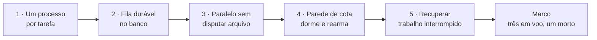
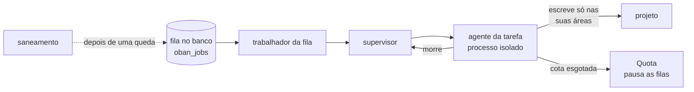
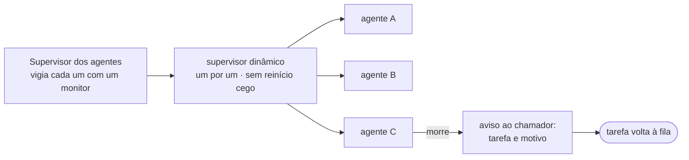
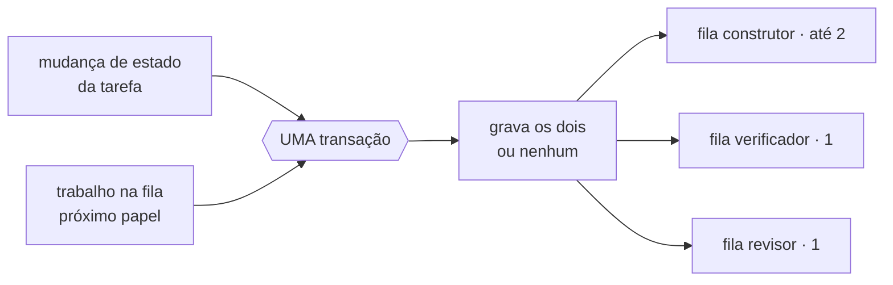
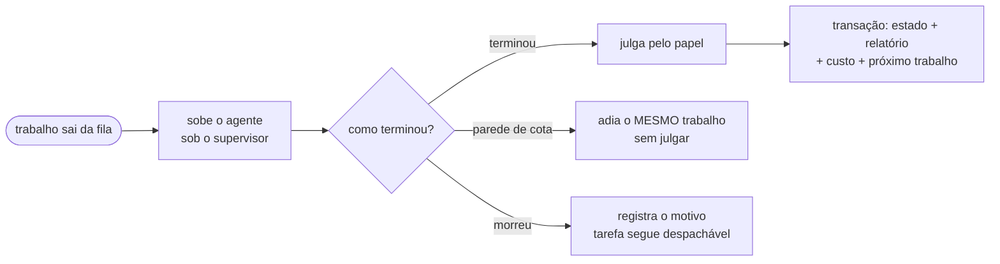
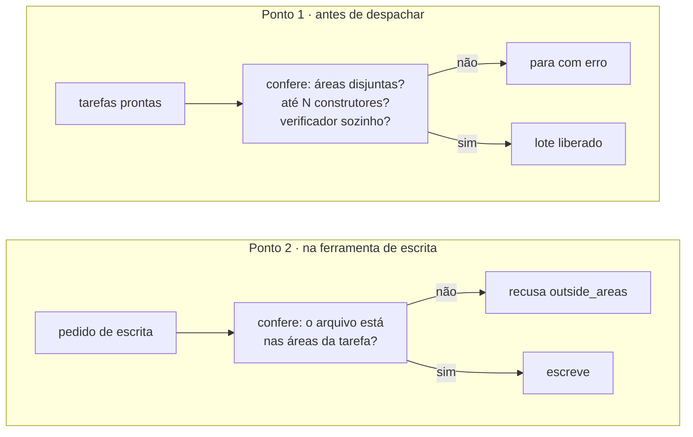
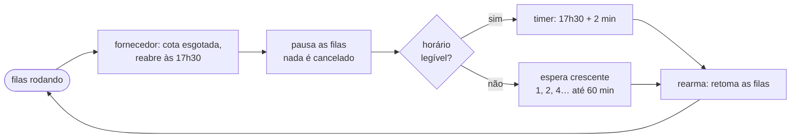
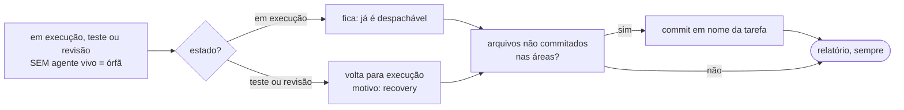
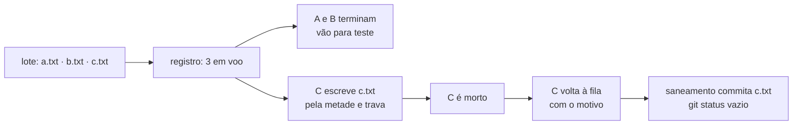

# E5 — Paralelismo e tolerância a falhas

## Em 30 segundos

- A E4 deixou a **linha de produção**: as regras que dizem quando uma tarefa avança, quem aprova e o que fazer quando falha. Mas as tarefas rodavam **uma de cada vez**, e tudo dependia de nada dar errado no meio.
- A E5 coloca **várias tarefas rodando ao mesmo tempo** e torna o sistema **tolerante a falhas**: um agente que cai não derruba os outros, nada guardado só na memória se perde, a falta de cota não vira reprovação e o trabalho deixado pela metade ganha dono.
- São cinco peças: **um processo supervisionado por tarefa**, **fila durável no banco**, **paralelo sem disputar arquivo**, **parede de cota** (dormir e rearmar sozinho) e **recuperar trabalho interrompido**.
- A entrega combinada no plano era: *"três tarefas em paralelo; encerrar uma no meio não afeta as outras, e ela volta à fila"*.
- A prova é um **teste automático permanente com processos de verdade** (`test/factory/milestone_e5_test.exs`): três agentes em voo, um é morto com `Process.exit`, os outros dois terminam, o morto volta à fila com o motivo, e o trabalho que ele deixou pela metade é commitado em nome dele.



> [!FALA] "Até a E4 eu tinha uma linha de produção que funcionava enquanto nada desse errado. Na E5 eu assumo que vai dar errado: um agente vai cair, a máquina vai reiniciar, a cota vai acabar no meio da tarde. Em todos esses casos o sistema não perde trabalho e não mistura uma tarefa com a outra."

## A ideia: que problema a E5 resolve

Rodar uma tarefa por vez é seguro e lento. Rodar várias ao mesmo tempo é rápido e abre cinco problemas novos — e cada um deles, sem solução, estraga trabalho em silêncio.

| Problema | Se não resolver agora… | O que a E5 constrói |
|---|---|---|
| Várias tarefas ao mesmo tempo podem editar o mesmo arquivo | o trabalho de uma estraga o da outra, sem ninguém perceber | **áreas como exclusão mútua** + limite de agentes pelo perfil da máquina (R6, R9) |
| Um agente pode travar ou cair no meio | uma queda derruba as outras tarefas | **um processo isolado e supervisionado** por tarefa (R13) |
| Trabalho guardado só na memória some numa queda | tarefa "em execução" sem ninguém executando | **fila no banco**, gravada na mesma transação da mudança de estado |
| Sob assinatura, a cota acaba no meio do dia | cada despacho vira reprovação e queima ciclos | **parede de cota** como estado do sistema: pausa, dorme, rearma |
| Um agente morto deixa arquivos escritos e não commitados | trabalho sem dono; tarefa presa em teste | **saneamento** que devolve o estado e commita o parcial (R13) |

> [!IDEIA] A regra que guia a etapa: **o estado do trabalho mora no banco, nunca no processo.** Um processo pode morrer a qualquer momento; se nada importante vive só nele, a morte não custa nada além do próprio despacho. Todas as cinco peças derivam disso.

## Conceitos em 1 minuto

| Termo | O que é, em uma frase |
|---|---|
| **Processo** (Elixir) | unidade de execução leve e isolada da máquina virtual do Elixir; não divide memória com os outros — se morre, só ele morre. |
| **Supervisor** | processo cuja função é ser dono de outros e saber quando eles morrem; aqui ele **não** reinicia o agente às cegas, só avisa. |
| **Monitor** | um "me avise se ele morrer": quem monitora recebe uma mensagem `:DOWN` com o motivo, qualquer que seja a causa da morte. |
| **Registro** (`Registry`) | catálogo de endereços: acha o agente de uma tarefa pelo nome `{:agent, task_id}`; quando o processo morre, o endereço some junto. |
| **Fila durável** (Oban) | fila de trabalhos guardada numa tabela (`oban_jobs`) do próprio PostgreSQL; sobrevive a reinício. |
| **Exclusão mútua** | regra que impede dois de mexerem na mesma coisa ao mesmo tempo; aqui, a "coisa" são os arquivos declarados em `areas`. |
| **Lote** | o conjunto de passos que podem rodar juntos agora, escolhido pelo escalonador da E4. |
| **Parede de cota** | o momento em que o fornecedor recusa pedidos até um horário de reabertura; não é erro do trabalho, é falta de recurso. |
| **Espera crescente** (*backoff*) | sem horário de reabertura, tentar de novo após 1, 2, 4, 8… minutos, com teto de 1 hora. |
| **Tarefa órfã** | tarefa em execução, teste ou revisão sem nenhum agente vivo trabalhando nela. |

Como as peças se encaixam em volta de um agente:



## Peça 1 — Um processo supervisionado por tarefa (FAB-501)

### A ideia
Cada agente roda num **processo próprio**, com um **endereço** no registro e um **supervisor** que percebe quando ele morre. Se um cai, os outros nem percebem.



### Por que não reiniciar o agente
O comportamento padrão de um supervisor Elixir é **reiniciar** o filho que morreu. Aqui isso seria um erro: o agente novo começaria **sem a conversa** e pagaria de novo tudo o que já tinha sido gasto. Por isso os filhos nascem com `restart: :temporary`, e o supervisor só **avisa** quem pediu o agente (`on_crash(task_id, reason)`). Quem decide o que fazer com a tarefa é o chamador — na prática, a fila.

### O detalhe que evita uma morte invisível
O monitor precisa existir **antes** de o agente começar a trabalhar. Se o trabalho fosse rápido e terminasse antes de o monitor ser instalado, a morte chegaria como `:noproc` e passaria em branco. A solução é um aperto de mão: o agente nasce, se registra e **espera** a mensagem `:may_run`, que só é enviada depois do monitor.

`lib/factory/agents/supervisor.ex`
```elixir
case DynamicSupervisor.start_child(state.sup, spec) do
  {:ok, pid} ->
    # The monitor must exist BEFORE the child runs `function`, otherwise a fast function
    # could finish first and `:DOWN` would arrive as `:noproc`. The runner waits for
    # `:may_run`, sent only after the monitor is in place.
    ref = Process.monitor(pid)
    send(pid, :may_run)
    on_crash = Keyword.get(opts, :on_crash, &log_death/2)
    monitors = Map.put(state.monitors, ref, {task_id, on_crash})
    {:reply, {:ok, pid}, %{state | monitors: monitors}}
```

A interface é pequena: `start_agent/4` (sobe), `list/0` (quem está em voo, lido do registro) e `stop_agent/1` (encerra pelo endereço).

### Como se prova
`test/factory/agents/supervisor_test.exs` (7 testes): matar um agente não altera os outros; a morte por `:kill` (que pula qualquer código de encerramento) também é detectada; um agente que termina normalmente **não** dispara o aviso; o registro deixa de listar o morto.

> [!DICA] Se o orientador perguntar "por que Elixir?", esta é a resposta concreta: isolamento de falha por processo é o modelo nativo da plataforma. Um agente travado num laço não trava o resto, e a morte é uma mensagem, não uma exceção que precisa ser capturada em todo lugar.

## Peça 2 — Fila durável no banco (FAB-502)

### A ideia
O trabalho a fazer fica numa **fila dentro do próprio PostgreSQL** (biblioteca Oban). E mudar o estado da tarefa e colocar o próximo trabalho na fila acontecem **na mesma transação**: os dois existem juntos, ou nenhum existe.



### Por que no mesmo banco
Uma fila separada (Redis, por exemplo) exigiria duas gravações em dois sistemas — e uma queda entre elas produziria o estado impossível: **"em execução" sem ninguém executando**, ou um trabalho na fila de uma tarefa que nunca mudou de estado. Com a fila numa tabela do mesmo banco, a transação da E4 simplesmente ganha mais um passo:

`lib/factory/queue/worker.ex`
```elixir
def build(id, to, opts \\ []) do
  {oban, opts} = Keyword.pop(opts, :oban, Oban)

  id
  |> Transition.build(to, opts)
  |> maybe_enqueue(oban, to)
end

defp maybe_enqueue(multi, oban, to) do
  case Map.get(Scheduler.role_by_status(), to) do
    nil ->
      multi

    role ->
      Oban.insert(oban, multi, :job, fn %{task: task} -> new_job(task.id, role) end)
  end
end
```

`Transition.build/3` é a transação da E4 (estado, relatório, despacho, consumo); `Scheduler.role_by_status/0` diz qual papel atende o estado de destino. Estados sem papel (`blocked`, `cancelled`) só gravam a transição.

### Três regras da fila
- **Três filas, uma por papel**: construtor com até 2 ao mesmo tempo, verificador com 1 (ele roda a bateria inteira, e bateria sobre árvore que outro está editando dá reprovação falsa) e revisor com 1.
- **Um trabalho por tarefa e papel** enquanto ele não terminar; depois que terminou, o mesmo passo pode ser enfileirado de novo (é o retrabalho).
- **Sem retentativa automática** (`max_attempts: 1`): quem decide refazer é a linha de produção, que conta `attempts`. Uma retentativa cega da fila giraria a tarefa sem o contador subir.

### O trabalhador da fila
Quem tira um trabalho da fila (`perform/1`) carrega a tarefa, sobe o agente **sob o supervisor da Peça 1**, espera o resultado e aplica o julgamento do papel:



- **Construtor**: não é julgado; a tarefa vai para teste.
- **Verificador**: o sistema roda os critérios (`Factory.Criteria`, da E4) e `Verifier.judge/1` decide.
- **Revisor**: conformidade e achados lidos dos relatórios estruturados que o agente enviou durante o laço (`report_result`), sem duplicar o mesmo achado.

### O resgate
Se o nó inteiro cai, um trabalho pode ficar preso no estado `executing`. O plugin padrão do Oban para isso **descartaria** o trabalho, porque com `max_attempts: 1` ele parece esgotado. Por isso existe `Factory.Queue.Rescue`: a cada minuto, um trabalho em `executing` há mais de 60 minutos volta a `available`.

### Como se prova
`test/factory/queue/worker_test.exs` (25 testes): a transição com papel grava tarefa **e** trabalho; uma transição ilegal não grava nenhum dos dois; um erro **depois** dos dois passos desfaz os dois; enfileirar o mesmo passo duas vezes não duplica; as filas sobem com 2/1/1; um trabalho preso volta a ser despachável.

## Peça 3 — Tarefas em paralelo sem disputar arquivo (FAB-503)

### A ideia
Cada tarefa declara as suas **áreas** (os arquivos que vai tocar). Essas áreas são a **exclusão mútua** do paralelismo, conferida em **dois pontos independentes**.



### Ponto 1: o lote
A regra de quem roda junto já existia na E4 (`Scheduler.next_steps/2`: até N construtores com áreas disjuntas, verificador só com projeto quieto, revisor junto de qualquer um). `Exclusion.batch/2` **não reescreve** essa regra — pede o lote ao escalonador e **confere de novo** as três garantias. Se um defeito futuro no escalonador quebrar alguma, o sistema para com erro em vez de deixar dois construtores editando o mesmo arquivo em silêncio.

Exemplo: A declara `lib/a.ex`, B declara `lib/b.ex`, C declara `lib/a.ex`. O lote sai com A e B; C espera a próxima rodada.

### Ponto 2: a ferramenta de escrita
A conferência no lote olha o que a tarefa **declarou**. Mas e se o agente tentar escrever em outro lugar? O segundo ponto fica dentro das ferramentas de escrita do sistema, que agora recebem as áreas como argumento **obrigatório** — não dá para esquecer de passar:

`lib/factory/queue/exclusion.ex`
```elixir
def allow?([], _path), do: :ok

def allow?(areas, path) do
  declared = MapSet.new(areas, &Confinement.normalize(&1.path))

  if MapSet.member?(declared, Confinement.normalize(path)) do
    :ok
  else
    {:error, :outside_areas}
  end
end
```

Os caminhos são comparados normalizados (o Windows não diferencia maiúsculas e aceita as duas barras). Uma tarefa **sem** áreas pode escrever em qualquer lugar — e por isso o escalonador a faz rodar sozinha.

### O limite N
Um único número na configuração dimensiona a fila **e** o escalonador:

`config/config.exs`
```elixir
max_builders = 2
config :factory, :max_builders, max_builders

config :factory, Oban,
  repo: Factory.Repo,
  notifier: Oban.Notifiers.PG,
  peer: Oban.Peers.Global,
  plugins: [Factory.Queue.Rescue],
  queues: [builder: max_builders, verifier: 1, reviewer: 1]
```

O padrão (2) é para a máquina-alvo de 8 GB; numa máquina maior, muda-se só esse número. Um teste confere que escalonador, exclusão e fila leem o mesmo valor.

### Como se prova
`test/factory/queue/exclusion_test.exs` (14 testes): tarefas com áreas sobrepostas nunca saem juntas; o verificador não sai com um construtor ativo; por padrão no máximo 2 construtores; conjuntos **idênticos** são pegos como sobrepostos; caminho fora das áreas é recusado com erro nomeado.

> [!ATENCAO] Nesta etapa quem chama `Exclusion.batch/2` para montar uma rodada é o teste do marco. A rodada automática — montar o lote e enfileirar sozinho — é o piloto automático da E7, que usa exatamente esta função.

## Peça 4 — Parede de cota: dormir e rearmar sozinho (FAB-504)

### A ideia
Sob assinatura, o recurso escasso não é dinheiro: é **cota de uso**, que acaba e reabre num horário anunciado. Quando ela acaba, o sistema **pausa as filas sem cancelar nada**, **dorme** até a reabertura e **retoma sozinho**.



### Três passos
1. **Reconhecer.** Os adaptadores da E3 já traduzem a resposta do fornecedor em `{:error, {:quota, reopens_at}}`. O laço do agente, ao ver isso, avisa `Factory.Quota.hit/2`. O horário pode vir estruturado ou como texto (`"5:30pm (America/Sao_Paulo)"`); `reopen_time/1` entende os dois e nunca levanta exceção.
2. **Dormir.** A primeira parede pausa as filas do Oban. Os trabalhos **continuam na tabela**, disponíveis — nada é cancelado.
3. **Rearmar.** Um timer dispara no horário + 2 minutos de margem (relógios diferem). Sem horário legível, espera crescente, nunca acima de 1 hora.

`lib/factory/quota.ex`
```elixir
def handle_call({:wall, signal}, _from, state) do
  at = reopen_time(signal)
  cancel_timer(state.timer)

  if not state.hit? do
    state.pause.()
  end

  new_state =
    case at do
      nil -> schedule_backoff(state)
      date -> schedule_at(state, date)
    end

  {:reply, :ok, %{new_state | hit?: true, reopens_at: at}}
end
```

### O que acontece com o despacho que bateu na parede
Ele **não é julgado**. O trabalhador da fila reconhece a parede e devolve `{:snooze, segundos}` ao Oban: o **mesmo** trabalho volta para a fila agendado para a reabertura, sem mudar o estado da tarefa e sem gastar tentativa. Só a parede tem esse tratamento; um erro do trabalho (prazo estourado, caminho fora do projeto) é julgado normalmente.

`lib/factory/queue/worker.ex`
```elixir
defp wall?(%{outcome: :error, error_reason: reason}), do: wall_reason?(reason)
defp wall?(_summary), do: false

defp wall_reason?({:quota, _reopens_at}), do: true
defp wall_reason?(:sandbox_unavailable), do: true
defp wall_reason?(_other), do: false
```

### Como se prova
`test/factory/quota_test.exs` (20 testes): leitura do horário nos vários formatos, a margem, a espera crescente com teto, a pausa só na primeira parede, o rearme. Em `worker_test.exs`, para cada papel: bater na parede **não** muda o estado nem soma tentativa.

> [!FALA] "Sem isso, cada vez que a cota acabasse o sistema acharia que o agente errou: reprovaria a tarefa, subiria o modelo e queimaria uma das três tentativas — por algo que não é defeito nenhum."

## Peça 5 — Recuperar trabalho interrompido (FAB-505)

### A ideia
Depois de uma queda, o **saneamento** cruza três fontes de verdade: o **banco** (quem estava em andamento), o **registro** (quem está vivo) e o **git** (o que foi escrito e não commitado).



### As regras
- **Órfã em execução fica como está**: o escalonador já mapeia `in_progress` para o papel construtor, então ela é despachável de novo sem gravar nada.
- **Órfã em teste ou revisão volta para execução**, pelas mesmas setas de uma reprovação, com motivo `recovery`. Um portão que morreu deixou um veredito **desconhecido** — e desconhecido nunca é favorável.
- **Arquivos não commitados nas áreas** da órfã são trabalho real: são commitados em nome dela, com mensagem marcada, nunca descartados.
- **O relatório sai sempre**, mesmo vazio. Uma limpeza que só fala quando acha algo não se distingue de uma limpeza quebrada.

`lib/factory/recovery.ex`
```elixir
defp restore_state(%Task{status: :in_progress} = task) do
  reason =
    "no live dispatch in the Registry; in_progress is already dispatchable as :builder " <>
      "(Factory.Tasks.Scheduler), no state transition needed"

  {task.status, reason}
end

defp restore_state(task) do
  previous = Map.fetch!(@previous_state, task.status)
  role = Map.fetch!(@orphan_role, task.status)
  reason = "no live dispatch in the Registry; moved back from #{task.status} to #{previous}"

  case Transition.apply(task, previous,
         role: role,
         outcome: "recovery",
         report: reason
       ) do
    {:ok, _moved} -> {previous, reason}
    {:error, error} -> {task.status, "#{reason} — failed: #{inspect(error)}"}
  end
end
```

A mensagem do commit de recuperação é `T-NNN: recovery after crash — partial work preserved`, e o commit inclui **só** as áreas da tarefa.

### Como se prova
`test/factory/recovery_test.exs` (11 testes): órfã em teste volta para execução; órfã com agente vivo não é tocada; trabalho parcial é commitado com a mensagem certa; sem nada a fazer, o relatório diz `nothing_to_do?`.

> [!ATENCAO] `Factory.Recovery.reconcile/1` é uma função chamada sob demanda: nesta etapa quem a chama é o teste do marco, simulando a subida depois da queda. Ela ainda não roda sozinha quando o sistema sobe; na E7 ela é usada pelo botão "Retomar" do painel, para uma tarefa.

## O marco da etapa (FAB-506)

### O que é `test/factory/milestone_e5_test.exs`?

> [!IDEIA] Como nas etapas anteriores, o marco é um **teste automático permanente**. A diferença: cada peça já tem a sua suíte; este teste prova a **composição** — três processos de verdade na mesma rodada, um deles morto com `Process.exit`, e o que sobra recuperado pelas mesmas peças que uma reinicialização usaria. Não chama o modelo e não usa rede nem cota.



### Passo a passo
1. Três tarefas com áreas disjuntas (`a.txt`, `b.txt`, `c.txt`). `Exclusion.batch/2` com `max_builders: 3` libera os três construtores — o marco prova que o mecanismo aguenta três, não qual é o padrão.
2. Os três agentes sobem pelo supervisor e ficam esperando um sinal; o registro confirma **os três em voo ao mesmo tempo**.
3. A e B recebem o sinal, gravam o ciclo (com um consumo cada) e vão para **em teste**. C escreve `c.txt` pela metade e trava.
4. C é morto com `stop_agent/1`. A e B continuam em teste; C volta à fila **com o motivo**, em `in_progress` (já despachável), e **nenhum consumo** foi gravado pela metade.
5. Simulando a subida: `Recovery.reconcile/1` sem agentes vivos acha C órfã e commita `c.txt` com uma mensagem que cita a tarefa e `recovery`. O `git status` fica vazio. Chamado sem nada a fazer, ele ainda devolve relatório.
6. Segundo teste: um erro de cota injetado pausa as filas; o trabalho enfileirado continua `available`; o rearme retoma sem cancelar nada.

`test/factory/milestone_e5_test.exs`
```elixir
# Killing C does not affect A and B.
assert Repo.get!(Task, t_a.id).status == :in_testing
assert Repo.get!(Task, t_b.id).status == :in_testing

# The dead one returns to the queue, with a reason.
assert_receive {:returned, dead_task_id, reason}, 1000
assert dead_task_id == t_c.id
assert reason != nil

# No usage row was lost; C never reported, so nothing half-written for it.
assert count_usages(t_a.id) == 1
assert count_usages(t_b.id) == 1
assert count_usages(t_c.id) == 0
```

### Como demonstrar ao vivo

```bash
mix test test/factory/milestone_e5_test.exs
```

Saída esperada: `2 tests, 0 failures`. Leva poucos segundos.

> [!FALA] "O teste sobe três agentes de verdade, cada um num processo. Eu mato um deles no meio do trabalho, depois de ele ter escrito metade de um arquivo. Os outros dois terminam normalmente, o morto volta para a fila com o motivo, nenhum custo fica pela metade, e o arquivo que ele deixou é commitado em nome dele. No fim, o repositório está limpo."

## Planejado × entregue

| Pacote do plano | O plano pedia | Entregue | Tarefa | Situação |
|---|---|---|---|---|
| 5.1 Processos | um processo supervisionado por tarefa | supervisor + registro, sem reinício cego | FAB-501 | ✅ |
| 5.2 Fila | fila durável, atômica com o estado | Oban no mesmo banco, 3 filas, resgate | FAB-502 | ✅ |
| 5.3 Exclusão | paralelo sem disputa de arquivo | áreas conferidas no lote e na escrita; limite pelo perfil | FAB-503 | ✅ |
| 5.4 Cota | reconhecer a parede e retomar | pausa, dorme, rearma; despacho adiado sem julgar | FAB-504 | ✅ |
| 5.5 Recuperação | trabalho interrompido não se perde | saneamento com relatório e commit do parcial | FAB-505 | ✅ (sob demanda) |
| Entrega | três em paralelo, matar um não derruba os outros | teste permanente com processos reais | FAB-506 | ✅ |

Requisitos: **R6** (paralelismo sem disputa) e **R13** (queda isolada, sem perda) atendidos e provados no marco. **R9** (cabe em 8 GB) fica **parcial**: o limite de 2 construtores vem do perfil da máquina, mas o pico de memória com agentes em paralelo ainda será medido.

## Decisões técnicas e porquês

| Decisão | Alternativa | Por que esta |
|---|---|---|
| Um processo por agente | tudo no mesmo processo | isolamento: a queda de um não derruba os outros |
| Sem reinício automático | supervisor reinicia o agente | o novo começaria sem a conversa e pagaria de novo |
| Monitor antes de rodar | monitorar depois de subir | um trabalho rápido poderia morrer sem ser notado |
| Fila no mesmo PostgreSQL | fila externa (Redis) | estado e trabalho na mesma transação |
| `max_attempts: 1` na fila | retentativa automática | refazer é decisão da escada, que conta tentativas |
| Resgate próprio | plugin padrão do Oban | o padrão descartaria o trabalho preso |
| Exclusão conferida em dois pontos | só no escalonador | o agente não consegue furar a regra escrevendo fora |
| Reconferir o lote e parar com erro | confiar no escalonador | defeito futuro aparece na hora, não como arquivo estragado |
| Limite em um único número | valor em cada módulo | fila e escalonador nunca divergem |
| Parede de cota adia sem julgar | tratar como falha | falta de cota não é defeito; não pode gastar tentativa |
| Margem de 2 min no rearme | rearmar no horário exato | relógios diferem; acordar cedo bateria na parede de novo |
| Portão órfão volta para execução | supor que aprovou | veredito desconhecido nunca é favorável |
| Relatório do saneamento sempre | só quando acha algo | silêncio não distingue "nada a fazer" de "quebrado" |

## Números da etapa

| Medida | Valor |
|---|---|
| Tarefas | 6 de 6 concluídas |
| Commits na etapa | 10 |
| Testes automáticos | 995 (eram 908 na E4) |
| Módulos | 83 (eram 76) |
| Linhas de código (lib/) | 10.482 (eram 9.197) |

Medido na branch `etapa/e5-paralelismo`: testes contando as linhas `test "` em `test/`, módulos contando `defmodule` em `lib/`, linhas somando `lib/**/*.ex`, commits com `git log etapa/e4-linha-de-producao..etapa/e5-paralelismo` sem o commit do relatório.

> [!DICA] Os testes novos se concentram onde mora o risco: o trabalhador da fila (25), a cota (20), a exclusão (14) e a recuperação (11). O marco tem só 2 testes, mas cada um compõe todas as peças.

## Roteiro da apresentação (10 minutos)

| Tempo | O que falar | O que mostrar |
|---|---|---|
| 0:00–1:00 | O problema: rodar várias ao mesmo tempo e sobreviver a falhas | capa do documento da E5; página "O problema" |
| 1:00–2:00 | A regra da etapa: o estado mora no banco, nunca no processo | página de conceitos |
| 2:00–3:00 | Um processo por tarefa; por que não reiniciar o agente | diagrama do supervisor |
| 3:00–4:30 | Fila no mesmo banco, na mesma transação; o trabalhador da fila | diagramas da fila e do trabalhador |
| 4:30–5:30 | Áreas como exclusão mútua, em dois pontos; o limite de 2 | diagrama da exclusão |
| 5:30–6:30 | Parede de cota: pausa, dorme, rearma; o despacho adiado sem julgar | diagrama da cota |
| 6:30–7:30 | Recuperação: órfãs, veredito desconhecido, commit do parcial | diagrama da recuperação |
| 7:30–9:00 | **O marco**: três em voo, um morto, nada perdido | terminal com `mix test test/factory/milestone_e5_test.exs` |
| 9:00–10:00 | Números, o que fica pendente e a próxima etapa (E6) | página de requisitos |

> [!FALA] Abertura: "Na E5 a pergunta é: o que acontece quando as coisas dão errado no meio? Um agente cai, a máquina reinicia, a cota acaba. A resposta é que nada se perde e nada se mistura."

> [!FALA] Fechamento: "Agora várias tarefas rodam juntas sem disputar arquivo, e o sistema sobrevive a quedas e à falta de cota. A E6 dá ao agente memória do projeto: buscar o que já foi decidido antes de decidir de novo."

## Perguntas prováveis do orientador

1. **Por que não reiniciar o agente que morreu, como é o padrão em Elixir?** Porque o agente novo começaria sem a conversa e pagaria de novo o que já foi gasto. O supervisor só avisa; a tarefa volta à fila e o próximo despacho começa limpo, com o estado gravado no banco.
2. **Se o processo morre, como nada se perde?** Porque nada importante vive no processo: estado, relatórios e consumos são gravados no banco numa transação ao fim do despacho. O que morre junto é só o despacho em andamento — e o marco confere que nenhum consumo fica gravado pela metade.
3. **Por que a fila no PostgreSQL e não numa ferramenta de filas?** Para que mudar o estado e enfileirar o próximo trabalho sejam uma única transação. Com dois sistemas, uma queda entre as duas gravações criaria uma tarefa "em execução" sem ninguém executando.
4. **O que impede dois agentes de editarem o mesmo arquivo?** Dois pontos: o lote só junta tarefas com áreas disjuntas (e para com erro se isso falhar), e a ferramenta de escrita recusa caminho fora das áreas da própria tarefa.
5. **Por que só 2 construtores?** É o perfil da máquina-alvo de 8 GB. É um único número na configuração; o marco prova que o mecanismo funciona com 3.
6. **E se a cota acabar no meio de uma tarefa?** O despacho é adiado sem ser julgado: a tarefa não muda de estado, não gasta tentativa, e o mesmo trabalho volta à fila agendado para a reabertura. As filas pausam e rearmam sozinhas.
7. **E se o fornecedor não disser quando a cota reabre?** Espera crescente: 1, 2, 4, 8 minutos, até no máximo 1 hora entre tentativas.
8. **Por que uma tarefa órfã em revisão volta para execução, e não para revisão?** Porque o revisor que morreu deixou um veredito desconhecido, e desconhecido nunca é favorável. Volta pelas mesmas setas de uma reprovação.
9. **O saneamento pode apagar trabalho?** Não: ele só commita o que encontrou nas áreas da tarefa órfã, com mensagem marcada. Nunca descarta.
10. **O marco usa agentes de verdade?** Usa processos de verdade sob o supervisor real, e a morte é real (`Process.exit`). O trabalho de cada agente é uma função controlada pelo teste, sem chamar o modelo — o que se prova aqui é a tolerância a falhas, não a qualidade do agente (provada na E3).
11. **Isso já roda sozinho?** As peças sim; quem monta a rodada (o lote) e chama o saneamento nesta etapa é o teste do marco. O piloto automático da E7 usa as mesmas funções para montar e enfileirar rodadas.

## Limitações conhecidas e o que vem depois

- O lote (`Exclusion.batch/2`) e o saneamento (`Recovery.reconcile/1`) são chamados pelo teste do marco; a rodada automática que monta o lote e enfileira é o piloto automático da **E7**.
- O saneamento roda quando chamado, **ainda não automaticamente** na subida do sistema.
- O pico de memória com agentes em paralelo na máquina de 8 GB ainda será medido (R9).
- O agente ainda não consulta o histórico do projeto antes de decidir: **memória do projeto** é a E6.

## Glossário

- **Processo** — unidade de execução isolada da máquina virtual do Elixir.
- **Supervisor dos agentes** — `Factory.Agents.Supervisor`; dono dos processos dos agentes, avisa quando um morre.
- **Monitor** — pedido de aviso (`:DOWN`) quando um processo morre, por qualquer motivo.
- **Registro** — `Registry`; acha o agente pelo endereço `{:agent, task_id}`.
- **`restart: :temporary`** — filho que não é reiniciado quando morre.
- **Oban** — biblioteca de fila durável sobre o PostgreSQL (tabela `oban_jobs`).
- **Trabalhador da fila** — `Factory.Queue.Worker`; sobe o agente, julga e aplica a transição.
- **Resgate** — `Factory.Queue.Rescue`; devolve à fila o trabalho preso em `executing`.
- **Áreas** — os arquivos que uma tarefa declara que vai tocar.
- **Exclusão** — `Factory.Queue.Exclusion`; confere as áreas no lote e na escrita.
- **`max_builders`** — o limite de construtores em paralelo (2).
- **Parede de cota** — recusa do fornecedor até um horário de reabertura.
- **`Factory.Quota`** — guarda o estado da parede; pausa e rearma as filas.
- **Snooze** — adiar o mesmo trabalho da fila sem julgá-lo.
- **Espera crescente** — intervalo que dobra a cada tentativa, com teto.
- **Tarefa órfã** — em andamento sem agente vivo.
- **Saneamento** — `Factory.Recovery.reconcile/1`; devolve o estado das órfãs e commita o parcial.

## Cola de comandos

```bash
# o marco da etapa: três em voo, um morto, nada perdido
mix test test/factory/milestone_e5_test.exs

# as suítes de cada peça
mix test test/factory/agents/supervisor_test.exs   # um processo por tarefa
mix test test/factory/queue/worker_test.exs        # fila durável e trabalhador
mix test test/factory/queue/exclusion_test.exs     # paralelo sem disputar arquivo
mix test test/factory/quota_test.exs               # parede de cota
mix test test/factory/recovery_test.exs            # recuperar trabalho interrompido

# a verificação completa (6 estágios)
mix factory.ci

# os commits da etapa
git log --oneline etapa/e4-linha-de-producao..etapa/e5-paralelismo
```
