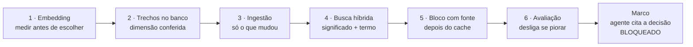
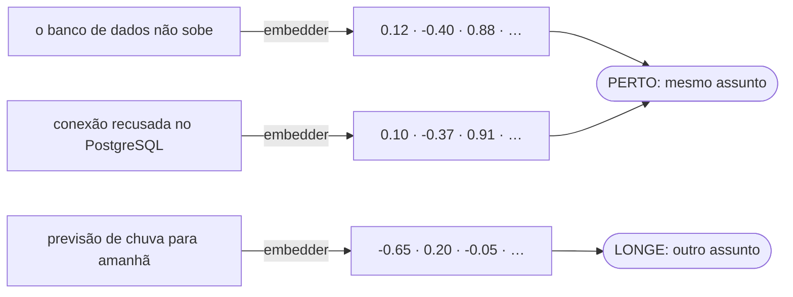
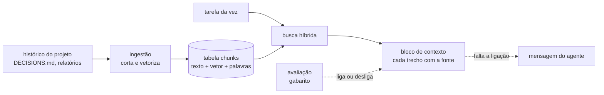
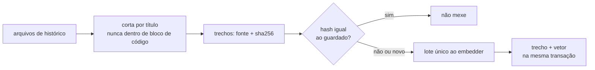
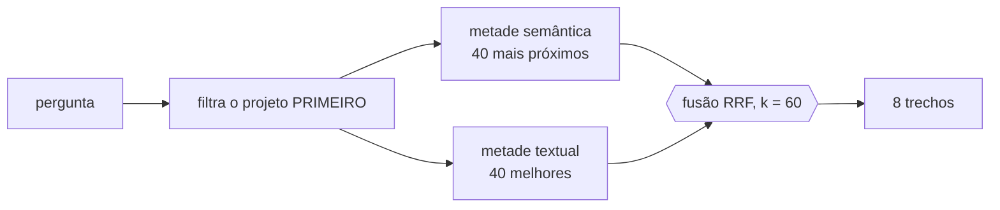
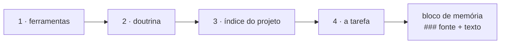
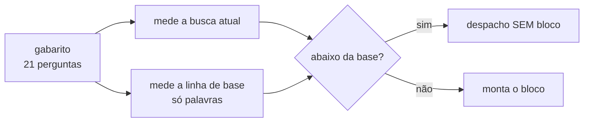

# E6 — Memória do projeto

## Em 30 segundos

- A E5 deixou várias tarefas rodando **ao mesmo tempo**, com tolerância a falhas. Mas cada agente ainda começava **do zero**: não sabia o que já tinha sido decidido no próprio projeto, e podia decidir de novo — às vezes diferente.
- A E6 constrói a **memória do projeto**: o histórico (decisões, relatórios, achados) vira trechos guardados no banco, uma **busca** acha os trechos relevantes para a tarefa da vez, e um **bloco de contexto** os entrega **citando a fonte** de cada um.
- São seis peças: **embedding** (texto vira vetor, escolhido por medição), **trechos no banco** com a dimensão conferida, **ingestão** incremental, **busca híbrida** (significado + termo exato), **bloco com fonte** depois do cache e **avaliação** que desliga o bloco se a busca piorar.
- A entrega combinada no plano era: *"o agente cita a decisão anterior, com a fonte certa, em vez de decidir de novo"*.
- **O marco ainda não foi atingido.** Todas as peças existem e estão testadas (85 testes novos), mas a memória ainda não chega à mensagem de um agente real. Esta etapa é apresentada com honestidade: o que está provado, e exatamente o que falta.



> [!FALA] "Até a E5 cada agente começava do zero. Na E6 eu dou ao sistema uma memória do projeto: o que já foi decidido fica guardado, e antes de trabalhar o agente recebe os trechos relevantes, cada um com a fonte. As peças estão prontas e medidas; o que ainda falta é o último elo — a memória chegar à mensagem do agente real — e eu vou mostrar exatamente onde ele está."

## A ideia: que problema a E6 resolve

Um projeto acumula decisões: por que tal biblioteca, por que tal regra, o que deu errado na tarefa passada. Sem memória, cada agente redescobre (ou contradiz) tudo isso.

| Problema | Se não resolver agora… | O que a E6 constrói |
|---|---|---|
| O histórico cresce a cada tarefa | o agente decide de novo o que já foi decidido — às vezes diferente | o histórico vira **trechos no banco**, prontos para busca |
| Mandar o histórico inteiro em todo despacho é caro e não cabe | custo cresce com o projeto; o essencial se perde no meio | **buscar só os trechos relevantes** para a tarefa da vez |
| A mesma ideia aparece com palavras diferentes; nomes próprios só batem pela palavra exata | busca só por palavra perde sinônimos; só por significado perde nomes | **busca híbrida**: significado + termo exato, fundidos por posição |
| Uma memória ruim atrapalha mais do que ajuda | o agente cita a fonte errada com confiança | **avaliação** contra um gabarito que **desliga o bloco** se a busca piorar |

> [!IDEIA] A regra que guia a etapa: **memória é histórico citável, não código.** O código já tem o índice denso da E3. A memória guarda o *porquê* — decisões e relatórios — e todo trecho entregue diz de onde veio, para que o agente possa citar e quem lê possa conferir.

## Conceitos em 1 minuto

Esta é a etapa com mais conceitos novos. Vale ler devagar: eles são a base de tudo o que vem a seguir.

| Termo | O que é, em uma frase |
|---|---|
| **Embedding** | uma lista de números (um **vetor**) que representa o *significado* de um texto; textos sobre o mesmo assunto viram vetores próximos, mesmo com palavras diferentes. |
| **Embedder** | o componente que transforma texto em embedding; aqui, uma interface com quatro adaptadores, como o `Provider` da E3. |
| **Dimensão** | quantos números tem cada vetor (384 ou 768); a coluna do banco e o embedder precisam ter a mesma, senão nada se compara. |
| **Distância de cosseno** | mede o ângulo entre dois vetores; perto de zero = mesmo assunto. É o que a busca por significado ordena. |
| **pgvector** | extensão do PostgreSQL que guarda vetores numa coluna e calcula distâncias. |
| **HNSW** | o índice que acha os vetores mais próximos rápido, de forma **aproximada** (troca um pouco de exatidão por velocidade). |
| **Busca textual** (`tsvector`) | a busca por palavra do próprio PostgreSQL: o texto vira uma lista de termos normalizados, com índice GIN. |
| **Trecho** (*chunk*) | um pedaço do histórico — uma seção de um arquivo markdown — com sua fonte (`arquivo#seção`). |
| **RRF** (fusão por posições) | junta duas listas ordenadas somando `1/(60 + posição)` de cada uma; usa só a posição, porque as notas das duas buscas não têm a mesma escala. |
| **recall@8** | em quantas perguntas a resposta certa apareceu entre os 8 primeiros resultados. |
| **MRR** | média de `1/posição` da resposta certa (1º lugar vale 1; 2º, 0,5; não achou, 0). |
| **Linha de base** | o desempenho da busca mais simples (só por palavra); a busca "esperta" tem de, no mínimo, empatar com ela. |

### O que é um embedding, num desenho



As duas primeiras frases não têm **nenhuma palavra em comum** — uma busca por palavra nunca as ligaria. Os vetores delas, porém, ficam perto. Esse é todo o motivo de existir um embedder.

### Como as peças se encaixam



## Peça 1 — Embedding: medir antes de escolher (FAB-601)

### A ideia

Para buscar por significado, cada texto precisa virar um vetor. A pergunta da peça é: **onde** esse vetor é gerado? Dentro do próprio sistema, num serviço local ou num serviço pago? A resposta veio de medição na máquina-alvo, não de preferência.

### A interface

`Factory.Embedder` é um *behaviour*, exatamente como o `Provider` da E3: o núcleo depende da interface, nunca de um fornecedor.

`lib/factory/embedder.ex`
```elixir
@callback embed(texts :: [String.t()]) :: {:ok, [[float()]]} | {:error, term()}

@doc "How many positions each vector of this adapter has."
@callback dimensions() :: pos_integer()

@callback embed_query(texts :: [String.t()]) :: {:ok, [[float()]]} | {:error, term()}

@optional_callbacks embed_query: 1

def embed_query(texts, embedder \\ configured()) do
  if Code.ensure_loaded?(embedder) and function_exported?(embedder, :embed_query, 1) do
    embedder.embed_query(texts)
  else
    embedder.embed(texts)
  end
end
```

Três detalhes:

- `embed/1` sempre recebe um **lote**: a ingestão vetoriza um histórico inteiro de uma vez, numa chamada só.
- **Documento e pergunta são vetorizados de formas diferentes.** O modelo escolhido foi treinado com prefixos distintos (`"title: none | text: "` para documentos, `"task: search result | query: "` para perguntas), e a qualidade da busca depende disso. Quem chama nunca vê os prefixos.
- Todo vetor devolvido tem o **tamanho conferido**: dimensão errada vira `{:error, {:invalid_dimension, ...}}`, nunca um vetor torto gravado no banco.

### Os quatro adaptadores

| Adaptador | Onde roda | Custo por chamada | Vetor | Situação |
|---|---|---|---|---|
| `Embedder.Fake` | dentro do sistema; vetor por hash, sem significado | zero | 384 | padrão dos testes |
| `Embedder.Ollama` (`embeddinggemma`) | serviço local, `127.0.0.1:11434`, sem chave | zero | 768 | **padrão em desenvolvimento** |
| `Embedder.Local` (Bumblebee) | dentro do Elixir | zero | 384 | só Linux/macOS |
| `Embedder.Service` | serviço externo por HTTP | pago | 384 | pronto, não configurado |

### Por que o Ollama, e não o modelo dentro do Elixir

O modelo dentro do Elixir (`all-MiniLM-L6-v2` via Bumblebee) foi medido: **~87 MB em disco, ~220 MB residentes e 15–30 s para carregar**. O problema não é o tamanho: no Windows a biblioteca de aceleração (EXLA) não tem binário pronto, e o caminho interpretado ficou lento demais para uso — uma ingestão de mil trechos foi abortada depois de mais de 9 minutos. Por isso:

- o padrão virou o **Ollama local**: zero custo, sem chave, e o peso do modelo fica **fora** do processo do sistema;
- o adaptador Local continua no código, mas só entra com `FACTORY_EMBEDDER_LOCAL=1` (as dependências passam de 1 GB e só são baixadas quando pedidas).

> [!DICA] Se perguntarem "por que não usar um serviço pago, que é melhor?": o recurso escasso aqui é a máquina de 8 GB e o custo zero por chamada. O serviço pago está implementado atrás da mesma interface — trocar é configuração, não código.

### Como se prova

- `test/factory/embedder/ollama_test.exs` (18 testes) e `service_test.exs` (13): o corpo das requisições HTTP com um *stub* — um único POST com o lote inteiro, o prefixo certo para documento e para pergunta, erro com nome para dimensão errada.
- `priv/probes/ollama_real.exs`: confere o serviço **real**, sem custo (é local). Verifica o ambiente, vetoriza pelos dois caminhos, prova que existe significado (a pergunta sobre banco fica mais perto do documento sobre banco do que de um sobre chuva) e mede a vazão (referência: 7,2 trechos/s).

> [!ATENCAO] O teste do marco da E2 ("nada sai da máquina nos testes") foi ajustado nesta etapa: os dois adaptadores HTTP novos entraram na lista dos únicos donos de rede permitidos. O teste continua garantindo que nenhum outro código abre conexão — e o embedder dos testes é o Fake, sem rede.

## Peça 2 — Os trechos no banco, com a dimensão conferida (FAB-601)

### A ideia

Cada trecho do histórico vira uma linha da tabela `chunks`, no mesmo PostgreSQL de todo o resto: o texto, a fonte, o hash, o vetor e as palavras.

| Coluna | Tipo | Para quê |
|---|---|---|
| `project_id` | `bigint` (chave estrangeira) | de qual projeto; apagou o projeto, apaga os trechos |
| `source` | `text` | `arquivo#seção` — única por projeto |
| `body` | `text` | o texto do trecho |
| `hash` | `text` | sha256 do texto — detecta o que mudou |
| `embedding` | `vector` (pgvector) | o vetor, com índice **HNSW** |
| `search` | `tsvector` gerado pelo banco | as palavras, com índice **GIN** |

A coluna `search` é **gerada pelo próprio banco** a partir de `body` (`GENERATED ALWAYS AS (to_tsvector('english', body)) STORED`): ninguém precisa lembrar de atualizá-la.

### A dimensão como fato, não como constante

Um vetor de 768 números não se compara com um de 384. Em vez de espalhar "768" pelo código, `Factory.Memory.Dimension` **lê a dimensão real da coluna** no catálogo do PostgreSQL e compara com a do embedder configurado.

`lib/factory/memory/dimension.ex`
```elixir
@spec check() :: :ok | {:error, {:dimension_mismatch, pos_integer(), pos_integer()}}
def check do
  column = current()
  embedder = configured()

  if column == embedder do
    :ok
  else
    {:error, {:dimension_mismatch, column, embedder}}
  end
end
```

- Trocar de modelo é `align!/0`: numa transação, remove o índice, **apaga os trechos**, muda o tipo da coluna e recria o índice. Apagar é seguro porque o histórico é **derivável** — a próxima ingestão reconstrói tudo.
- Por que não deixar o vetor vazio? Porque o hash do trecho continuaria "em dia", a ingestão nunca o vetorizaria de novo, e ele ficaria **invisível para sempre** na busca por significado.
- Dimensão fora de 1..2000 (o limite do índice HNSW) levanta um erro com nome **antes** de qualquer SQL.

> [!IDEIA] É o mesmo princípio da E2 ("modelo sem preço cadastrado gera erro, nunca um zero silencioso"): **descasamento vira erro na hora**, não uma busca que "funciona" e devolve lixo.

## Peça 3 — Ingestão: o histórico vira trechos (FAB-602)

### A ideia

Os arquivos de histórico do projeto (`DECISIONS.md`, `PROGRESS.md`, relatórios de tarefas) são cortados por seção, e **só o que é novo ou mudou paga embedding**.



### Como funciona

- `split/1` corta o markdown a cada título (`#` a `######`) e **nunca dentro de um bloco de código** (um `# comentário` num bloco de shell não é título). O texto antes do primeiro título vira o trecho `"(preamble)"`. Título repetido ganha sufixo (`Notes#1`, `Notes#2`) para a fonte continuar única.
- `process/3` compara o sha256 de cada trecho com o guardado e separa: novos, alterados, inalterados.

`lib/factory/memory/ingestion.ex`
```elixir
existing = load_hashes(project_id, Enum.map(candidates, & &1.source))

{to_write, unchanged} =
  Enum.split_with(candidates, &(Map.get(existing, &1.source) != &1.hash))

new_count = Enum.count(to_write, &(not Map.has_key?(existing, &1.source)))

embedder_calls = write_batch(project_id, to_write, embedder)

%{
  inserted: new_count,
  updated: length(to_write) - new_count,
  unchanged: length(unchanged),
  embedder_calls: embedder_calls
}
```

- Todos os trechos novos ou alterados de uma passada vão numa **única** chamada ao embedder.
- **Trecho e vetor na mesma transação**: se a gravação do vetor falhar, o trecho também não fica — nunca sobra um trecho com hash "em dia" e vetor vazio.
- Antes de qualquer lote, a ingestão confere a dimensão; se divergir, devolve o erro **sem chamar o embedder**.

### Como se prova

`test/factory/memory/ingestion_test.exs` (13 testes): a primeira passada indexa tudo numa chamada; a segunda, com o mesmo conteúdo, **não chama o embedder**; mudar um trecho reindexa só ele; uma falha na gravação não deixa hash guardado; e os índices HNSW e GIN existem **e são usados** (o teste lê o plano de execução do PostgreSQL).

> [!ATENCAO] A ingestão sabe **como** indexar, mas não **quando**: escolher quais arquivos entram (por exemplo, os tocados por um commit) é de quem chama, e o módulo não conhece git. Nesta etapa quem chama são os testes; nada dispara a ingestão sozinho a cada mudança do histórico.

## Peça 4 — Busca híbrida: significado + termo exato (FAB-603)

### A ideia

Duas buscas sobre o mesmo projeto, fundidas numa só lista:

- **por significado** (vetor): acha "conexão recusada" quando a pergunta é "o banco não sobe";
- **por termo exato** (texto): acha o nome de uma opção como `--require`, que não significa nada para um embedding.

Cada metade cobre o buraco da outra.



### A fusão por posições, num exemplo

A nota de cada busca está numa escala diferente (distância de vetor × nota de texto), então elas não podem ser somadas. A fusão usa **só a posição**: cada trecho soma `1/(60 + posição)` em cada lista onde aparece.

| Trecho | Posição na semântica | Posição na textual | Pontuação | Resultado |
|---|---|---|---|---|
| A — achado pelas duas | 2º | 1º | 1/62 + 1/61 = **0,0325** | 1º lugar |
| B — só pelo significado | 1º | — | 1/61 = **0,0164** | 2º lugar |
| C — só pelo termo exato | — | 2º | 1/62 = **0,0161** | 3º lugar |

Quem aparece nas duas sobe. A constante 60 é a usual da técnica: suaviza a diferença entre o 1º e o 2º lugar, para nenhuma lista sozinha dominar.

### Uma consulta só, e o projeto primeiro

`lib/factory/memory/search.ex`
```elixir
WITH candidates AS MATERIALIZED (
  SELECT id, embedding
    FROM chunks
   WHERE project_id = $1
),
semantic AS (
  SELECT id, RANK() OVER (ORDER BY embedding <=> '#{literal}'::vector) AS pos
    FROM candidates
   ORDER BY embedding <=> '#{literal}'::vector
   LIMIT #{@candidate_limit}
),
fused AS (
  SELECT id,
         COALESCE(1.0 / (#{k} + semantic.pos), 0)
           + COALESCE(1.0 / (#{k} + textual.pos), 0) AS score
    FROM semantic
    FULL OUTER JOIN textual USING (id)
)
```

- O `MATERIALIZED` força o banco a **filtrar pelo projeto antes** de ordenar por distância. Sem isso, o índice aproximado poderia percorrer os vizinhos em ordem de distância e filtrar depois — e devolver menos resultados (ou nenhum) quando trechos de **outros projetos** estão mais perto da pergunta.
- Três modos: `:hybrid` (padrão), `:vector` e `:text`. O modo texto **nunca** chama o embedder.
- A pergunta é vetorizada como **pergunta** (`embed_query`), não como documento.
- Embedder com erro vira `{:error, {:query_embedding, motivo}}`, nunca uma queda.

### Como se prova

`test/factory/memory/search_test.exs` (13 testes): o trecho achado pelas duas metades fica em 1º; um termo exato que o vetor não acha é recuperado pela metade textual; **um trecho de outro projeto nunca aparece**; a busca inteira é **uma** consulta SQL; a pergunta passa pelo caminho de pergunta.

## Peça 5 — O bloco de contexto, com a fonte citada (FAB-604)

### A ideia

Os melhores trechos viram um bloco de texto em que **cada um cita de onde veio**, colocado **depois** do prefixo que o cache reaproveita (a E3 dividiu o prompt em quatro faixas estáveis).



`lib/factory/memory/context.ex`
```elixir
@spec append(Prefix.t(), t()) :: String.t()
def append(%{text: prefix_text}, nil), do: prefix_text

def append(%{text: prefix_text}, block) when is_binary(block) do
  prefix_text <> @separator <> block
end

defp chunk_to_text(%Chunk{source: source, body: body}) do
  "### #{source}\n#{body}"
end
```

- Cada trecho entra como `### _management/DECISIONS.md#6.2 — ...` seguido do texto: o agente pode **citar** a fonte e quem lê pode **conferir**.
- No máximo **8 trechos e 6.000 bytes**. O corte é sempre de trechos inteiros, do fim da lista (os menos relevantes); o primeiro entra sempre, mesmo que sozinho passe do limite.
- **Sem trechos, não há bloco**: o texto final é byte a byte o prefixo. E o bloco **nunca altera** o prefixo — é isso que mantém o cache válido.

> [!IDEIA] Por que **depois** do cache? O bloco muda a cada tarefa. Se entrasse antes do último ponto de cache, invalidaria o cache em todo despacho e cada chamada pagaria o prompt inteiro de novo.

### Como se prova

`test/factory/memory/context_test.exs` (10 testes): o texto final **começa com os bytes exatos do prefixo**; montar o mesmo prefixo de novo dá bytes idênticos, com ou sem bloco; busca vazia devolve `nil`, não um bloco vazio; o limite de 8 trechos e o de bytes; o primeiro trecho sempre entra.

> [!ATENCAO] Nesta etapa o bloco é montado e testado, mas **nenhum despacho o chama ainda**: o montador do despacho que o anexa aparece na E7. Esse é o elo que falta ao marco.

## Peça 6 — Avaliar a busca e desligar se piorar (FAB-605)

### A ideia

Memória ruim é pior que memória nenhuma: um trecho errado leva o agente a decidir errado **com confiança**. Por isso a busca é medida contra um **gabarito** — e a medição não é só um relatório: ela **liga e desliga** o bloco.



### O gabarito

`Factory.Memory.Evaluation` (em `priv/evaluation/questions.exs`) guarda **21 pares** pergunta → frase-alvo, tirados do histórico real do sistema. A frase-alvo é um trecho **literal** que só aparece na resposta certa, e a pergunta é escrita **com outras palavras** — exatamente o caso em que a busca por palavra falha. Exemplos:

- "Quantos agentes cabem ao mesmo tempo numa máquina com 8 GB de RAM?" → a resposta certa contém `builder: 2, verifier: 1, reviewer: 1`.
- "Por que o modelo vetorial que roda dentro do Elixir não funciona nesta máquina Windows?" → `no precompiled XLA archive available for this target`.

### O atuador

`priv/evaluation/questions.exs`
```elixir
def build_safe_context(project_id, term, opts \\ []) do
  searcher = Keyword.get(opts, :searcher, &Search.search/2)
  current = measure(project_id, Keyword.put(opts, :searcher, searcher))
  floor = baseline(project_id, opts)

  if below_baseline?(current, floor) do
    nil
  else
    Context.build(project_id, term, searcher: shield(searcher))
  end
end
```

- A **linha de base** não é um número congelado: é a mesma medição com **só a busca por palavra**, no mesmo projeto, calculada na hora.
- Se a busca atual ficar abaixo dela no recall@8, o despacho segue **sem bloco**.
- Busca com erro conta como "não achou" e nunca derruba quem chama.

### O número que escolheu o modo padrão

Com o embedder real, o gabarito foi rodado nos três modos (`measure_all_modes/2`):

| Modo | recall@8 | Perguntas acertadas (de 21) |
|---|---|---|
| **híbrido** | **0,667** | **14** |
| só significado | 0,619 | 13 |
| só palavras | 0,048 | 1 |

Híbrido e só-significado **empatam no recall@1**. O híbrido virou o padrão, e a metade de palavras fica mesmo sendo a pior sozinha — é ela que acha nomes próprios. Esses números estão escritos no próprio código, ao lado da decisão (`search.ex`).

### Como se prova

`test/factory/memory/evaluation_test.exs` (12 testes), sobre um corpus de histórico de exemplo (`test/support/fixtures/evaluation_corpus/`) que contém todas as frases-alvo. Nos testes o embedder é o Fake — vetores **sem significado** —, então o híbrido fica **abaixo** da base. E é justamente isso que prova o atuador: o teste confere que, nessa situação, o bloco **é desligado**.

> [!FALA] "Eu não confio na memória por padrão. Ela é medida contra um gabarito de 21 perguntas com resposta conhecida, e se ficar pior do que uma busca simples por palavra, o sistema desliga o bloco e o agente trabalha sem ele."

## O marco da etapa (FAB-606) — bloqueado

### O que o marco pede

Ver um **agente real** receber o bloco de memória numa tarefa cuja resposta está numa decisão anterior, e **citá-la com a fonte certa** em vez de decidir de novo. Isso provaria R7 com o modelo real.

### O que já está provado

| Elo | Provado por |
|---|---|
| ingestão incremental | `ingestion_test.exs` |
| busca híbrida isolada por projeto | `search_test.exs` |
| bloco com a fonte de cada trecho, depois do cache | `context_test.exs` |
| desligamento do bloco abaixo da base | `evaluation_test.exs` |
| embedder real com significado | `priv/probes/ollama_real.exs` |

### O que falta, exatamente


1. **A ligação.** Na branch da E6, **nenhum código do despacho chama a memória** — e a ingestão também não é disparada sozinha. As peças funcionam, mas ninguém as usa no caminho real.
2. **Na E7** o montador do despacho (`Factory.Dispatch.build/4`) passa a anexar o bloco ao texto do prefixo. Mas a fila (`Factory.Queue.Worker`) monta a mensagem do agente **só com as faixas** do prefixo e descarta o texto que leva a memória. É um ajuste pequeno e já localizado.
3. **A observação.** Com a ligação feita, falta rodar um agente real e conferir que ele cita a decisão com a fonte certa.

> [!ATENCAO] Seja direto ao apresentar: a etapa entregou e testou a memória, mas **não demonstrou** a entrega combinada. O status da etapa é "bloqueada", R7 está "pendente", e o que falta é descrito acima com o nome do arquivo e da função.

> [!FALA] "Todos os elos da corrente existem e estão testados — 85 testes novos. O que falta é o último: a memória chegar à mensagem do agente real. Eu sei exatamente onde ele está: a fila monta a mensagem só com as faixas do prompt e descarta o texto que leva a memória. Até isso ser corrigido e observado com um agente real, eu não considero o marco atingido."

### Como demonstrar ao vivo

```bash
# as suítes da memória: ingestão, busca, bloco e avaliação
mix test test/factory/memory/

# o embedder real (precisa do Ollama rodando; local, sem custo)
mix run priv/probes/ollama_real.exs
```

Saída esperada do probe: as seções A a D com `[ok]`, as duas distâncias de cosseno (a do documento certo maior que a do assunto sem relação), a vazão em trechos/s e, no fim, `PROBE OK`. Se aparecer "Ollama did not answer", o serviço não está rodando: `ollama serve`.

## Planejado × entregue

| Pacote do plano | O plano pedia | Entregue | Tarefa | Situação |
|---|---|---|---|---|
| 6.1 Medição | medir antes de escolher onde a busca roda | 4 adaptadores; Ollama escolhido por medição; dimensão conferida | FAB-601 | ✅ |
| 6.2 Ingestão | guardar o histórico em trechos | corte por seção, incremental por hash, lote único | FAB-602 | ✅ (sem gatilho automático) |
| 6.3 Busca | significado e termo exato | híbrida com RRF, filtro por projeto primeiro, 3 modos | FAB-603 | ✅ |
| 6.4 Contexto | entregar o contexto com a fonte | bloco com fonte, limites, depois do cache | FAB-604 | ✅ (ainda não chamado pelo despacho) |
| 6.5 Avaliação | medir a qualidade da busca | gabarito de 21, recall@8/@1, MRR, desliga abaixo da base | FAB-605 | ✅ |
| Entrega | agente real cita a decisão anterior | — | FAB-606 | ⛔ bloqueado |

Requisitos: **R7** (histórico citado com fonte) fica **pendente** — as peças estão prontas e testadas, mas o bloco ainda não chega ao agente. **R9** (cabe em 8 GB) segue **parcial**: o embedding foi medido e escolhido para pesar fora do sistema, mas o pico com agentes em paralelo ainda será medido.

## Decisões técnicas e porquês

| Decisão | Alternativa | Por que esta |
|---|---|---|
| Indexar o histórico, não o código | indexar tudo | o código já tem o índice denso; o que falta ao agente é o *porquê* |
| Embedder como interface | chamar um fornecedor direto | trocar de modelo é configuração; testes usam o Fake |
| Ollama local como padrão | modelo dentro do Elixir | sem aceleração no Windows, o interpretado ficou lento demais; o peso fica fora do processo |
| Prefixos diferentes para documento e pergunta | o mesmo texto para os dois | o modelo foi treinado assim; a qualidade depende disso |
| Vetores no mesmo PostgreSQL (pgvector) | banco vetorial separado | estado, trechos e busca na mesma transação e no mesmo backup |
| Dimensão lida do catálogo | constante no código | descasamento vira erro, não busca que devolve lixo |
| Trocar de modelo apaga os trechos | deixar o vetor vazio | vetor vazio com hash "em dia" ficaria invisível para sempre |
| Corte por seção do markdown | pedaços de tamanho fixo | a seção é a unidade de sentido, e vira uma fonte citável |
| Incremental por sha256 | reindexar tudo | só o que mudou paga embedding |
| Busca híbrida | só vetor | vetor perde nomes próprios; medido: híbrido 0,667 × vetor 0,619 |
| RRF por posição | somar as notas | as notas têm escalas diferentes; a posição não |
| Filtro por projeto antes da distância | deixar o índice filtrar | o índice aproximado poderia devolver menos resultados |
| Bloco depois do cache | dentro do prefixo | o bloco muda sempre; dentro, invalidaria o cache em todo despacho |
| Avaliação que desliga o bloco | só reportar o número | memória ruim é pior que nenhuma; o sinal precisa de um atuador |
| Linha de base calculada na hora | número fixo | a base acompanha o corpus real do projeto |

## Números da etapa

| Medida | Valor |
|---|---|
| Tarefas | 5 de 6 concluídas (o marco está bloqueado) |
| Commits na etapa | 9 |
| Testes automáticos | 1.080 (eram 995 na E5) |
| Módulos | 92 (eram 83) |
| Linhas de código (lib/) | 11.468 (eram 10.482) |

Medido na branch `etapa/e6-memoria`: testes contando as linhas `test "` em `test/`, módulos contando `defmodule` em `lib/`, linhas somando `lib/**/*.ex`, commits com `git log etapa/e5-paralelismo..etapa/e6-memoria` sem o commit do relatório.

> [!DICA] Os 85 testes novos se distribuem pelas peças: adaptadores HTTP (31), ingestão (13), busca (13), avaliação (12), bloco (10) e dimensão (6).

## Roteiro da apresentação (10 minutos)

| Tempo | O que falar | O que mostrar |
|---|---|---|
| 0:00–1:00 | O problema: cada agente começa do zero e decide de novo | capa do documento da E6; página "O problema" |
| 1:00–2:30 | Conceitos: embedding (o desenho do "perto/longe"), dimensão, busca por palavra | página de conceitos; figura do embedding |
| 2:30–3:30 | Medir antes de escolher: os quatro adaptadores e por que o Ollama | tabela dos adaptadores |
| 3:30–4:30 | Os trechos no banco e a dimensão conferida; ingestão só do que mudou | tabela `chunks`; diagrama da ingestão |
| 4:30–6:00 | Busca híbrida e a fusão por posições, com o exemplo | diagrama da busca; tabela do RRF |
| 6:00–7:00 | O bloco com a fonte, depois do cache | diagrama do bloco |
| 7:00–8:00 | A avaliação que desliga o bloco; o número que escolheu o padrão | diagrama da avaliação; tabela da medição |
| 8:00–9:30 | **O marco**: o que está provado, o elo que falta e onde ele está | página "Como se prova"; terminal com `mix test test/factory/memory/` |
| 9:30–10:00 | Requisitos (R7 pendente) e a próxima etapa | página de requisitos |

> [!FALA] Abertura: "Na E6 a pergunta é: como o agente sabe o que já foi decidido neste projeto? A resposta é uma memória que busca por significado e por palavra, entrega cada trecho com a fonte, e é desligada se ficar pior que uma busca simples."

> [!FALA] Fechamento: "A memória está construída, medida e testada. O que falta é ligá-la à mensagem do agente real e observar a citação — e essa é a primeira pendência que a etapa seguinte herda."

## Perguntas prováveis do orientador

1. **O marco foi atingido?** Não. As peças estão prontas e testadas, mas a memória ainda não chega à mensagem do agente real: na E6 nenhum despacho a chama, e na E7 a fila descarta o texto que a leva. R7 está pendente.
2. **Por que não mandar o histórico inteiro ao agente?** Custo e foco: o histórico cresce a cada tarefa, e o essencial se perde no meio de um texto longo. A busca entrega no máximo 8 trechos e 6.000 bytes.
3. **O que é um embedding, em uma frase?** Uma lista de números que representa o significado de um texto; textos sobre o mesmo assunto viram listas próximas, mesmo sem palavras em comum.
4. **Por que híbrida e não só vetorial?** Porque o vetor perde nomes próprios e a palavra perde sinônimos. Medido no gabarito: híbrido 0,667 de recall@8 contra 0,619 do vetor sozinho.
5. **Por que somar posições e não as notas?** As notas das duas buscas estão em escalas diferentes (distância × relevância textual). A posição é comparável.
6. **Como garantir que um projeto não veja a memória de outro?** O filtro por projeto vem antes da ordenação por distância, numa CTE materializada, e há teste que confere que um trecho de outro projeto nunca aparece.
7. **Por que não um banco vetorial dedicado?** O pgvector no mesmo PostgreSQL mantém trechos, estado e backup juntos, na mesma transação. No tamanho de corpus esperado por projeto, isso basta.
8. **E se a busca for ruim?** A avaliação compara a busca com a linha de base (só palavras) contra um gabarito de 21 perguntas; se ficar abaixo, o bloco é desligado e o agente trabalha sem ele.
9. **O gabarito não é pequeno?** São 21 pares escolhidos para o caso difícil (pergunta e resposta com palavras diferentes). Ele serve para comparar modos e acionar o desligamento, não para afirmar uma taxa geral.
10. **Por que o Ollama e não o modelo dentro do Elixir?** O modelo dentro do Elixir foi medido (~220 MB residentes); no Windows ele não tem aceleração e o caminho interpretado ficou lento demais. O Ollama roda local, sem custo, fora do processo do sistema.
11. **Os testes dependem do Ollama?** Não. Os testes usam o embedder Fake (sem rede); o Ollama real é conferido por um probe separado, sem custo.
12. **Quanto trabalho falta para o marco?** Fazer a fila usar o texto completo do prefixo, disparar a ingestão do histórico e rodar um agente real numa tarefa cuja resposta está numa decisão anterior.

## Limitações conhecidas e o que vem depois

- **O marco não foi observado**: a memória ainda não chega à mensagem do agente real (R7 pendente). Na E7, o montador do despacho anexa o bloco, mas a fila ainda o descarta ao montar a mensagem.
- **A ingestão não tem gatilho automático**: nada a dispara a cada mudança do histórico; nesta etapa quem a chama são os testes.
- **O atuador da avaliação mora em `priv/evaluation/`**, fora de `lib/`: ele precisa ser carregado explicitamente por quem o usar, e roda o gabarito inteiro a cada chamada (quem usar por despacho deve guardar o veredito).
- O adaptador Local (Bumblebee) não é utilizável no Windows; o Service está pronto, mas sem configuração.
- O pico de memória com agentes em paralelo na máquina de 8 GB ainda será medido (R9).

## Glossário

- **Embedding** — vetor de números que representa o significado de um texto.
- **Embedder** — `Factory.Embedder`; a interface que gera embeddings.
- **`embed_query`** — o caminho de vetorização de perguntas, com prefixo próprio.
- **Ollama** — serviço local que roda modelos; aqui, o `embeddinggemma` (768 números).
- **Bumblebee / EXLA** — biblioteca de modelos dentro do Elixir e sua aceleração (sem binário no Windows).
- **Dimensão** — número de posições do vetor; conferida por `Factory.Memory.Dimension`.
- **pgvector** — extensão do PostgreSQL para vetores.
- **HNSW** — índice de vizinhos mais próximos, aproximado.
- **`tsvector` / GIN** — a busca por palavra do PostgreSQL e seu índice.
- **Trecho (chunk)** — seção do histórico guardada em `chunks`, com fonte e hash.
- **Ingestão** — `Factory.Memory.Ingestion`; corta, compara hashes e grava.
- **Busca híbrida** — `Factory.Memory.Search`; significado + termo exato.
- **RRF** — fusão de listas pela soma de `1/(k + posição)`, com k = 60.
- **CTE materializada** — subconsulta que o banco calcula antes do resto; aqui, o filtro por projeto.
- **Bloco de contexto** — `Factory.Memory.Context`; os trechos com fonte, depois do prefixo.
- **Gabarito** — as 21 perguntas com resposta conhecida de `Factory.Memory.Evaluation`.
- **recall@8 / recall@1 / MRR** — métricas de quão bem a busca acha a resposta certa.
- **Linha de base** — a mesma medição usando só a busca por palavra.
- **`build_safe_context/3`** — o atuador: monta o bloco só se a busca não ficar abaixo da base.

## Cola de comandos

```bash
# as suítes da memória
mix test test/factory/memory/

# cada peça
mix test test/factory/embedder/ollama_test.exs     # adaptador Ollama (HTTP com stub)
mix test test/factory/embedder/service_test.exs    # adaptador de serviço externo
mix test test/factory/memory/dimension_test.exs    # dimensão conferida
mix test test/factory/memory/ingestion_test.exs    # ingestão incremental
mix test test/factory/memory/search_test.exs       # busca híbrida
mix test test/factory/memory/context_test.exs      # bloco com fonte
mix test test/factory/memory/evaluation_test.exs   # avaliação e desligamento

# o embedder real (Ollama local, sem custo)
ollama serve
mix run priv/probes/ollama_real.exs

# a verificação completa (6 estágios)
mix factory.ci

# os commits da etapa
git log --oneline etapa/e5-paralelismo..etapa/e6-memoria
```
