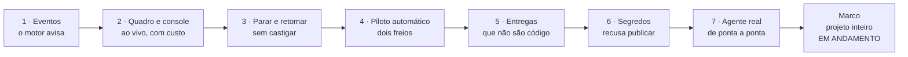
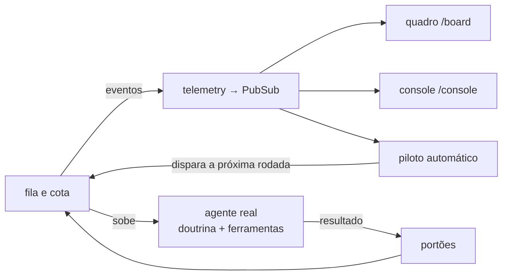
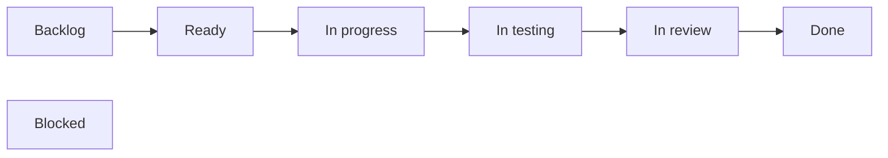
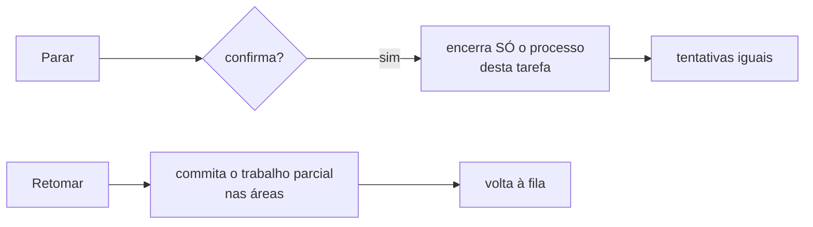
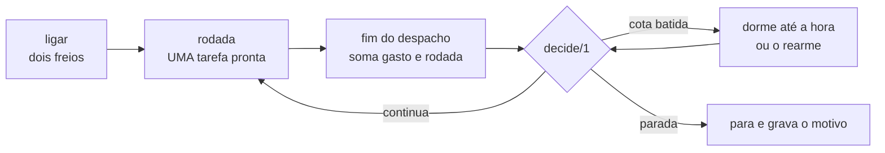
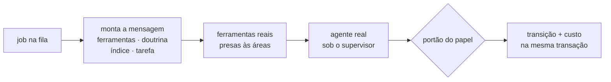
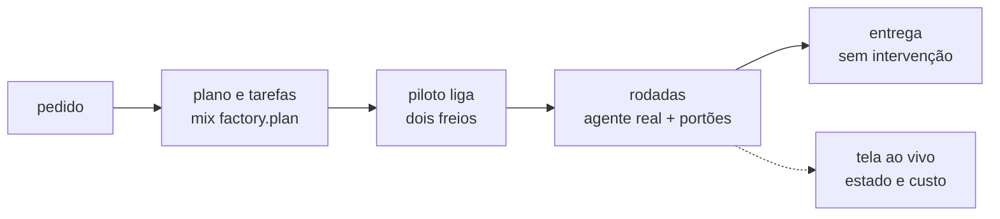

# E7 — Painel e automação

## Em 30 segundos

- Até a E6 o motor já tinha todas as peças: estados, portões, fila, paralelismo, memória. Mas o que ele fazia **só aparecia no banco e nos logs**, e cada rodada de trabalho ainda precisava de **alguém para disparar**.
- A E7 dá ao sistema **olhos e piloto**: o motor passa a **avisar o que faz por eventos**, duas **telas ao vivo** (quadro de tarefas e console) mostram o estado e o custo, botões **param e retomam** uma tarefa sem castigá-la, e um **piloto automático** encadeia rodadas sozinho, sempre com **dois freios obrigatórios** (teto de gasto e máximo de rodadas).
- Junto vêm três regras de governança — a **trilha para entregas que não são código** (com grau de prova obrigatório), a **busca de segredos** que recusa publicar — e a **integração**: o agente real passa a ser despachado pela fila, com a doutrina do papel, ferramentas presas às áreas e os portões.
- A entrega combinada no plano era: *"um projeto inteiro acompanhado na tela, do pedido à entrega, com o custo em tempo real"*.
- **O marco está em andamento.** Todas as peças estão prontas e testadas (140 testes novos), mas parte delas ainda não é chamada pelo sistema quando ele roda de verdade, e a execução completa de um projeto ainda não foi feita. Esta etapa é apresentada separando com precisão **"pronto"** de **"ligado"**.



> [!FALA] "Até a E6 o motor fazia tudo, mas no escuro: para saber o que estava acontecendo eu tinha de olhar o banco, e para cada rodada alguém tinha de apertar o botão. Na E7 o motor passa a avisar o que faz, a tela mostra o estado e o custo, e um piloto automático encadeia as rodadas sozinho — sempre com teto de gasto. Tudo está pronto e testado; vou mostrar com precisão o que já está ligado ao sistema em execução e o que ainda falta ligar."

## A ideia: que problema a E7 resolve

| Problema | Se não resolver agora… | O que a E7 constrói |
|---|---|---|
| O motor trabalha sozinho, mas o que ele faz só aparece no banco e nos logs | acompanhar exige consultar o banco; o custo só é visto depois | **eventos** emitidos pelo motor e **telas ao vivo** que os escutam |
| Às vezes é preciso interromper um agente no meio | matar o processo à mão pode perder trabalho ou gastar um ciclo | **parar e retomar** uma tarefa sem castigá-la |
| Cada rodada precisava de alguém apertando o botão | sem freio, rodar sozinho pode gastar sem limite | **piloto automático** com teto de gasto e de rodadas obrigatórios |
| Nem toda entrega é código, e o sistema commita sozinho | critério sem prova pulado em silêncio; chave de acesso vazada no histórico | **grau de prova** obrigatório e **busca de segredos** que recusa publicar |
| As peças existiam isoladas, cada uma provada no próprio teste | nenhum agente real passava por todas elas | o **despacho real**: doutrina do papel, ferramentas presas às áreas e portões |

> [!IDEIA] A regra que guia a etapa: **quem olha não mexe em quem trabalha.** O motor emite eventos e não sabe quem está ouvindo; a tela e o piloto escutam e não alteram o motor. E toda autonomia vem com freio: o piloto não liga sem teto de gasto e sem máximo de rodadas.

## Conceitos em 1 minuto

| Termo | O que é, em uma frase |
|---|---|
| **LiveView** | página web que o servidor mantém atualizada por uma conexão aberta: quando o dado muda, o servidor manda só a diferença, sem recarregar a página e sem JavaScript próprio. |
| **Evento** (*telemetry*) | aviso com nome, números e contexto ("despacho terminou", "cota batida"); quem emite não sabe quem escuta. |
| **Handler** | a função que o `:telemetry` chama quando um evento é emitido; aqui existe **um só**, que repassa tudo adiante. |
| **PubSub** | o "rádio" do Phoenix: uma mensagem publicada num tópico chega a todos os processos inscritos nele. |
| **GenServer** | um processo Elixir com estado próprio, que atende um pedido de cada vez; o piloto de cada projeto é um deles. |
| **Rodada** | um despacho de construtor para **uma** tarefa pronta; o piloto encadeia rodadas. |
| **Função pura** | mesma entrada, mesma saída, sem banco, relógio ou rede; por isso pode ser testada caso a caso. |
| **Freio** | limite obrigatório do piloto: teto de gasto acumulado e número máximo de rodadas. |
| **Trilha** | o caminho que um projeto segue conforme o seu domínio: software, ou genérica (apresentação, documento, dados…). |
| **Grau de prova** | como um critério foi provado: **executado** (um comando decide), **inspecionado** (alguém abre e constata) ou **julgado** (rubrica). |
| **Doutrina do papel** | texto fixo que diz ao agente qual é o papel dele — construtor, verificador ou revisor — e como deve reportar. |
| **Pronto × ligado** | "pronto" = a peça existe e a suíte dela passa; "ligado" = algum código do sistema em execução a chama. |

### Como as peças se encaixam



O motor (fila e cota) emite eventos; o mesmo canal alimenta as duas telas e o piloto. O piloto, ao ouvir que uma rodada terminou, decide se dispara a próxima — e é a fila que sobe o agente real e aplica os portões.

## Peça 1 — O motor avisa o que faz (FAB-701)

### A ideia

Em vez de a tela perguntar ao banco "mudou alguma coisa?" a cada segundo, o motor **avisa** quando algo acontece. Cada aviso é um evento com nome, e quem precisa saber escuta.

### Os seis eventos

`lib/factory/events.ex`
```elixir
@doc "A dispatch starts. `metadata` at least: `:task_id`, `:role`, `:model`."
@spec dispatch_start(map()) :: :ok
def dispatch_start(metadata), do: emit([:factory, :dispatch, :start], %{}, metadata)

@doc "The loop ended. `metadata` at least: `:task_id`, `:outcome`, `:turns`, `:spent_usd`."
@spec dispatch_stop(map()) :: :ok
def dispatch_stop(metadata), do: emit([:factory, :dispatch, :stop], %{}, metadata)

@doc "A task changed state. `metadata` at least: `:task_id`, `:from`, `:to`."
@spec task_transition(map()) :: :ok
def task_transition(metadata), do: emit([:factory, :task, :transition], %{}, metadata)

@doc "The subscription quota was hit. `metadata` at least: `:reopens_at`."
@spec quota_hit(map()) :: :ok
def quota_hit(metadata), do: emit([:factory, :quota, :hit], %{}, metadata)
```

Além desses, `dispatch_turn/2` (cada volta, com tokens e custo) e `quota_rearm/1`. Assinar é uma linha: `Factory.Events.subscribe/0`.

### Um handler só, ligado na subida

`lib/factory/telemetry.ex`
```elixir
def attach do
  case :telemetry.attach_many(@id, @events, &__MODULE__.forward/4, nil) do
    :ok -> :ok
    {:error, :already_exists} -> :ok
  end
end

def forward(name, measurements, metadata, _config) do
  Phoenix.PubSub.broadcast(
    Factory.PubSub,
    Events.topic(),
    {:factory, name, measurements, metadata}
  )
end
```

`Factory.Application` chama `attach/0` **antes** de subir qualquer processo, para nenhum evento da partida se perder.

### Quem emite hoje

| Evento | Emitido no sistema em execução? |
|---|---|
| início e fim de despacho | ✅ pela fila (`Factory.Queue.Worker`) |
| cota batida e rearme | ✅ por `Factory.Quota` |
| cada volta (tokens e custo) | ⏳ declarado; o laço do agente ainda não o chama |
| mudança de estado da tarefa | ⏳ declarado; `Transition` ainda não o emite — só o botão Parar e os testes |

### Como se prova

`test/factory/events_test.exs` (6 testes): cada evento chega ao assinante com nome, números e contexto; o handler é idempotente.

> [!ATENCAO] O comentário do módulo diz que `dispatch_turn/2` "dispara a cada volta". Na branch, **nenhum código chama essa função**: ela existe, é repassada e é escutada, mas ainda não é emitida. O mesmo vale para a mudança de estado. Isso é o que limita o "ao vivo" das telas (peça 2).

## Peça 2 — O quadro de tarefas ao vivo (FAB-702)

### A ideia

Uma página (`/board`) com uma coluna por estado do pipeline — os seis da E4 mais "bloqueada" — e um cartão por tarefa com as tentativas, o especialista e quanto ela já custou.



### Como funciona

`lib/factory_web/live/board_live.ex`
```elixir
def mount(_params, _session, socket) do
  _ = if connected?(socket), do: Events.subscribe()

  {:ok,
   assign(socket,
     page: :select,
     project: nil,
     projects: [],
     board: AsyncResult.loading()
   )}
end

def handle_info({:factory, [:factory, :task, :transition], _measurements, _metadata}, socket) do
  {:noreply, reload(socket)}
end

def handle_info({:factory, _name, _measurements, _metadata}, socket), do: {:noreply, socket}
```

- **Sem consulta periódica**: o quadro só recarrega quando chega o evento de mudança de estado; qualquer outro evento é ignorado.
- O **custo de cada cartão** é a soma das voltas gravadas em `usages` (E2), numa consulta agrupada por tarefa para o projeto inteiro.
- Sem `?project_id=`, a página lista os projetos; com um id inválido, mostra um erro legível em vez de cair.

### O console (`/console`)

A segunda página responde "o que está acontecendo **agora**?". Cada bloco tem a sua própria fonte de verdade:

| Bloco | Fonte | Atualiza como |
|---|---|---|
| agentes em voo | `Factory.Agents.Supervisor.list/0` (o registro real) | tique periódico ✅ |
| custo por tarefa | `usages` somada por tarefa, com entrada / escrita de cache / leitura de cache / saída | ao abrir, e a cada volta ou mudança de estado |
| parede de cota | eventos `quota hit` / `rearm` | ao vivo ✅ |
| voltas do agente escolhido | evento por volta | ⏳ depende do evento que ainda não é emitido |

### Como se prova

`board_live_test.exs` e `console_live_test.exs` (6 testes cada): o teste **emite** a mudança de estado e confere que o cartão troca de coluna sem recarregar; o console mostra agentes em voo, custo e cota.

> [!ATENCAO] No sistema em execução, hoje, o quadro e o custo se atualizam **ao abrir a página**; ao vivo estão a lista de agentes em voo e a parede de cota. Os testes provam que as telas reagem aos eventos — o que falta é o motor emitir a mudança de estado e a volta.

## Peça 3 — Parar e retomar sem castigar a tarefa (FAB-703)

### A ideia

Interromper um agente não pode custar trabalho nem uma das 3 tentativas da tarefa (E4). Por isso **parar** e **retomar** são coisas separadas, cada uma reaproveitando um mecanismo já testado.



`lib/factory_web/live/components/controls.ex`
```elixir
def handle_event("confirm_stop", _params, socket) do
  task = socket.assigns.task
  _ = AgentSupervisor.stop_agent(task.id)

  # Emitted as a task transition (only `Factory.Telemetry.events/0` reach PubSub). There is
  # no real state change, so `from` and `to` are the same status; `reason` carries the fact.
  Events.task_transition(%{
    task_id: task.id,
    from: task.status,
    to: task.status,
    reason: :stopped_by_operator
  })
  # (em seguida: mensagem "Task stopped — returned to the queue." e recarga da tarefa)
end

def handle_event("resume", _params, socket) do
  task = socket.assigns.task
  report = Recovery.reconcile(tasks: [task])
  # (em seguida: "Task re-queued — partial work committed (<hash>)." quando houve commit)
end
```

- **Parar** pede confirmação, encerra só o processo supervisionado daquela tarefa (E5) e **não passa por `Transition`** — as tentativas não mudam.
- **Retomar** é a recuperação da E5 restrita a **uma** tarefa: commita o trabalho parcial feito nas áreas dela e a devolve à fila. Retomar um verificador ou revisor conta como ciclo, como uma falha real.

### Como se prova

`test/factory_web/controls_test.exs` (6 testes): parar a tarefa 7 não toca nas tarefas 5 e 6, e as tentativas da 7 continuam iguais; retomar commita o trabalho parcial.

> [!ATENCAO] O componente está pronto e testado, mas **nenhuma página o coloca na tela ainda**: o quadro e o console não o incluem. Hoje só o teste o renderiza.

## Peça 4 — Piloto automático: a decisão é uma tabela (FAB-704)

### A ideia

O piloto encadeia rodadas sozinho. A parte difícil não é disparar — é **saber quando parar**. Por isso a decisão foi escrita como uma **função pura**, com regras em ordem fixa.

### Ligar exige os dois freios

`lib/factory/autopilot/decision.ex`
```elixir
def enable(spend_cap, max_rounds) do
  missing =
    [{spend_cap, :no_spend_cap}, {max_rounds, :no_max_rounds}]
    |> Enum.filter(fn {number, _reason} -> absent?(number) end)
    |> Enum.map(fn {_number, reason} -> reason end)

  case missing do
    [] -> {:ok, %{spend_cap: spend_cap, max_rounds: max_rounds}}
    reasons -> {:error, reasons}
  end
end
```

Sem teto, sem máximo, ou com zero: recusa, dizendo **qual** falta.

### A ordem é a regra

`lib/factory/autopilot/decision.ex`
```elixir
def decide(situation) do
  cond do
    not situation.enabled? -> {:stop, :disabled}
    situation.quota.hit? -> {:sleep, situation.quota.reopens_at}
    true -> check_stops(situation)
  end
end
```

| Ordem | Situação ao fim da rodada | Decisão |
|---|---|---|
| 1 | o usuário desligou | para |
| 2 | a cota está batida | **dorme** até reabrir |
| 3 | não há tarefa pendente | para (fim do trabalho) |
| 4 | pediram replanejamento | para |
| 5 | 2 rodadas seguidas sem concluir | para (girando sem produzir) |
| 6 | a rodada falhou | para |
| 7 | gasto acumulado ≥ teto | para (freio 1) |
| 8 | rodadas feitas ≥ máximo | para (freio 2) |
| — | nenhuma das anteriores | **continua** |

Por que a cota vem em 2º? Porque uma rodada barrada pela cota não conclui nada — se a regra 5 viesse antes, a cota faria o piloto parar como "sem progresso". A cota é a **única** situação que não para.

> [!IDEIA] A decisão só é consultada **entre** rodadas: não existe parâmetro para "rodada em andamento". É assim que o código garante que **desligar nunca corta trabalho no meio** — a mesma doutrina do teto da E4: nunca cortar, só não começar o que não cabe.

### O piloto em movimento

`Factory.Autopilot.Server` é um GenServer por projeto, em volta da função pura:



`lib/factory/autopilot/server.ex`
```elixir
def build_round(project_id) do
  case next_dispatch(project_id) do
    nil -> :no_work
    step -> Worker.dispatch(step.task.id, :in_progress)
  end
end

defp next_dispatch(project_id) do
  project_id
  |> load_tasks()
  |> Exclusion.batch()
  |> Enum.find(&(&1.role == :builder and &1.task.status == :ready))
end
```

- A rodada usa a **mesma regra de exclusão da E5** (áreas disjuntas, verificador só com projeto quieto): não há um segundo algoritmo de escalonamento.
- Ela termina no evento de **fim de despacho** da tarefa que o próprio piloto disparou; eventos de outras tarefas são ignorados. Esse evento **já é emitido** pela fila.
- Cota batida não conta como "sem progresso". Ao dormir, o piloto acorda pelo evento de rearme ou, como rede de segurança, num horário agendado — nunca com atraso zero (sem laço quente).
- O estado é gravado em JSON por projeto (`priv/autopilot/<id>.json`) e relido ao reiniciar.

### Como se prova

`decision_test.exs` (21 testes, cada regra e cada ordem) e `server_test.exs` (28 testes: rodadas encadeadas, parada por estagnação, cota que dorme e rearma, desligar com rodada em voo, reinício que recarrega o estado).

> [!ATENCAO] O componente de tela do piloto (`FactoryWeb.Components.Autopilot`) está pronto e testado, mas, como os controles da peça 3, **não está em nenhuma página**. Hoje o piloto é ligado chamando `Factory.Autopilot.Server.enable/3`.

## Peça 5 — Entregas que não são código (FAB-705)

### A ideia

Em software a prova vem de graça: o programa roda ou quebra. Numa apresentação ou num documento, não. A E7 cria a **trilha genérica** e torna obrigatório dizer **como** cada critério foi provado.

`lib/factory/tracks.ex`
```elixir
@agents %{
  software: %{builder: "executor", verifier: "tester", reviewer: "reviewer"},
  generic: %{builder: "builder", verifier: "checker", reviewer: "generic-reviewer"}
}

def for_domain(nil), do: :software
def for_domain(@software), do: :software
def for_domain(_other), do: :generic
```

Os papéis são os mesmos nas duas trilhas; muda só o agente que serve cada um.

`lib/factory/criteria/proof_level.ex`
```elixir
def close(evaluations, task_text) do
  with :ok <- require_label(evaluations),
       :ok <- require_rubric(evaluations, task_text) do
    {:ok, evaluations}
  end
end
```

- Sem rótulo em algum critério → `{:error, {:missing_label, [...]}}`, nomeando o critério.
- Critério **julgado** exige uma seção `## Rubric` com itens sim/não na tarefa, para o julgamento poder ser auditado.
- `judged_ratio/1` mede quanto do projeto depende de julgamento — muito julgado é sinal de critério mal planejado.

### Como se prova

`test/factory/tracks_test.exs` (21 testes): domínio vazio/software/outro, agente por papel, recusa sem rótulo, recusa de julgado sem rubrica.

> [!ATENCAO] Regras prontas e testadas, mas **a fila ainda não as consulta**: hoje todo projeto segue a trilha de software, e o verificador da fila julga pelos critérios executáveis (E4).

## Peça 6 — Busca de segredos antes de publicar (FAB-706)

### A ideia

O sistema commita sozinho, e um segredo que entra no histórico do git é praticamente irreversível. Por isso a varredura **recusa** — nunca só avisa.

`lib/factory/security.ex`
```elixir
@content_patterns [
  {:anthropic_key, Regex.compile!(@anthropic_key_prefix <> "[A-Za-z0-9_-]{20,}")},
  {:openai_key, ~r/sk-(?!ant-)[A-Za-z0-9]{20,}/},
  {:aws_key, ~r/AKIA[0-9A-Z]{16}/},
  {:google_key, ~r/AIza[0-9A-Za-z_-]{35}/},
  {:github_token, ~r/gh[pousr]_[A-Za-z0-9]{20,}/},
  {:private_key, ~r/-----BEGIN (?:RSA |EC |OPENSSH |DSA |ENCRYPTED )?PRIVATE KEY-----/},
  {:connection_string_password,
   ~r{\b(?:postgres(?:ql)?|mysql|mongodb(?:\+srv)?|redis|amqp)://[^:@/\s"']+:[^@/\s"']+@[^\s"']+}}
]

def scan(files) when is_list(files) do
  findings =
    files
    |> Enum.flat_map(fn {file, content} -> scan_text(file, content) end)

  if findings == [], do: :ok, else: {:refused, findings}
end
```

- Sete padrões no conteúdo e um no **nome**: arquivo `.env` commitado (`.env.example`, `.sample`, `.dist`, `.template` passam — são modelos).
- **Falso positivo** se resolve com uma exceção **exata** em `@allowed` — arquivo, padrão, trecho e motivo escritos — nunca desligando um padrão inteiro.
- Só duas respostas: `:ok` ou `{:refused, achados}`. Não existe "avisou mas publicou".
- Curiosidade: o prefixo da chave Anthropic é montado por concatenação, porque o teste do marco da E2 recusa qualquer fonte que o contenha por inteiro.

### Como se prova

`test/factory/security_test.exs` (15 testes): cada padrão detectado, `.env` recusado e `.env.example` aceito, exceção exata perdoada e só ela.

> [!ATENCAO] Pronto e testado, mas **o commit automático (`Factory.Publishing.Git`) ainda não chama `scan/1`**.

## Peça 7 — O agente real de ponta a ponta (FAB-707)

### A ideia

Até aqui cada mecanismo funcionava no próprio teste. A peça 7 **liga** tudo no caminho real: a fila pega a tarefa, monta a mensagem, entrega as ferramentas, sobe o agente e aplica o portão do papel.



### A mensagem: as quatro faixas da E3, da tarefa real

`lib/factory/dispatch.ex`
```elixir
prefix =
  Prefix.build(model,
    tools: tools,
    doctrine: doctrine(task, role, role_text),
    index: index(task),
    task: task_band(task)
  )

{:ok, with_memory(prefix, task, opts)}
```

A doutrina de cada papel é um arquivo versionado: `priv/doctrine/builder.md`, `verifier.md` e `reviewer.md` (44, 44 e 75 linhas). O construtor, por exemplo, abre assim: *"You are the BUILDER. Your one question: does what the Goal asks for now exist?"*, e aprende que `report_result` é o seu **único** canal de relatório.

### As ferramentas: as funções reais, presas às áreas

`lib/factory/agents/tools.ex`
```elixir
defp build_tool("write", root, areas, _collector) do
  fn args, _root ->
    Files.write(
      root,
      fetch(args, "path"),
      fetch(args, "content", ""),
      areas
    )
  end
end
```

A recusa de escrita fora das áreas (E5) agora vale para o agente da fila.

### O julgamento por papel

`lib/factory/queue/worker.ex`
```elixir
defp judge(:builder, _task, _summary), do: {:in_testing, :end_turn}

defp judge(:verifier, task, _summary) do
  verdict =
    task.criteria
    |> Enum.map(&%{text: &1.text, command: &1.command, checked: false, implicit: false})
    |> Criteria.run(task.project.path)
    |> Verifier.judge()

  {if_approved(verdict.approved, :in_review), verdict.reason}
end
```

- **Construtor** → vai para teste. **Verificador** → roda os critérios. **Revisor** → conformidade e achados (E4).
- A transição, o ciclo, o despacho e o custo de cada volta são gravados **na mesma transação**.
- Cota batida no meio de uma volta: o mesmo job volta à fila **sem** julgamento e **sem** gastar tentativa.
- `mix factory.syntax <arquivo>` confere a sintaxe de um arquivo Elixir **sem executá-lo** — útil para provar que um script que gastaria cota ao menos compila.

### Como se prova

`dispatch_test.exs` (13), `agents/tools_test.exs` (10), `queue/worker_test.exs` (+2), `mix/syntax_test.exs` (5) — todos com o fornecedor falso (E2).

> [!ATENCAO] Duas limitações declaradas: (1) o despacho anexa o **bloco de memória** (E6) ao texto do prefixo, mas a fila monta a mensagem **só com as faixas** (`prefix.blocks`) — o bloco não chega ao agente; (2) a ferramenta `run` pode chamar `git` direto, contornando o commit restrito às áreas.

## O que já está ligado ao sistema em execução

| Peça | Pronta e testada | Ligada ao sistema em execução |
|---|---|---|
| eventos de início/fim de despacho e de cota | ✅ | ✅ a fila e a cota os emitem |
| evento por volta e de mudança de estado | ✅ | ⏳ o laço e as transições não os emitem |
| quadro e console (`/board`, `/console`) | ✅ | ✅ com rota; ao vivo só agentes em voo e cota |
| piloto: decisão e rodadas | ✅ | ✅ reage ao fim de despacho da fila |
| componentes Parar/Retomar e do piloto | ✅ | ⏳ nenhuma página os coloca na tela |
| trilha genérica e graus de prova | ✅ | ⏳ a fila segue sempre a trilha de software |
| busca de segredos | ✅ | ⏳ o commit não a chama |
| agente real na fila, com doutrina e ferramentas | ✅ | ✅ |
| bloco de memória na mensagem | ✅ | ❌ a fila monta a mensagem sem ele |

> [!DICA] Esta tabela é a melhor resposta para "o que falta?". Cada linha em ⏳ é uma ligação pequena e localizada: um evento a emitir, um componente a montar, uma chamada a acrescentar.

## O marco da etapa (FAB-708) — em andamento

### O que o marco pede

Rodar um **projeto de teste inteiro**, do pedido à entrega, com **uma única intervenção humana** (o pedido), teto de gasto e o custo acompanhado ao vivo na tela. Isso provaria R8 e a tese como um todo.

### O caminho previsto



### O que já está provado

| Elo | Provado por |
|---|---|
| os dois freios e as oito regras em ordem | `decision_test.exs` |
| rodadas encadeadas, cota que dorme e rearma, reinício | `server_test.exs` |
| telas reagindo a eventos | `board_live_test.exs`, `console_live_test.exs`, `controls_test.exs` |
| fila subindo o agente com doutrina, ferramentas e portões | `worker_test.exs`, `dispatch_test.exs`, `tools_test.exs` |

### O que falta, exatamente

1. **Ligar os eventos** de mudança de estado e de volta, para a tela acompanhar ao vivo.
2. **Montar numa página** os componentes de Parar/Retomar e do piloto.
3. **A fila enviar o bloco de memória** (destrava também o marco da E6).
4. **Executar**: um projeto de teste inteiro conduzido pelo piloto, com teto de gasto — uma execução real, que consome cota e depende de autorização.

> [!ATENCAO] Seja direto: a etapa entregou e testou as peças, mas **não demonstrou** a entrega combinada. O status é "em andamento", R8 está "parcial", e o que falta está listado acima com o nome do módulo.

> [!FALA] "Tudo o que a E7 constrói está pronto e testado — são 140 testes novos. Mas eu separo 'pronto' de 'ligado': o piloto já reage ao fim de cada despacho e a fila já sobe o agente real; o que ainda falta ligar são dois eventos, os botões na tela e a memória na mensagem. Depois disso vem a execução de um projeto inteiro, que é o marco."

### Como demonstrar ao vivo

```bash
# o piloto: decisão e rodadas
mix test test/factory/autopilot/

# as telas e os controles
mix test test/factory_web/

# a fila com o agente real (fornecedor falso)
mix test test/factory/queue/ test/factory/dispatch_test.exs

# as telas no navegador
mix phx.server     # http://localhost:4000/board e /console
```

## Planejado × entregue

| Pacote do plano | O plano pedia | Entregue | Tarefa | Situação |
|---|---|---|---|---|
| 7.1 Medidas | eventos e telemetria por despacho | barramento de 6 eventos, um handler, PubSub | FAB-701 | ✅ (volta e estado ainda sem emissor) |
| 7.2 Tela | quadro e console ao vivo, com custo | `/board` por estado com custo; `/console` com agentes, custo e cota | FAB-702 | ✅ (ao vivo parcial) |
| 7.3 Controle | parar e retomar | componente com confirmação; parar não gasta tentativa | FAB-703 | ✅ (sem página que o monte) |
| 7.4 Automação | rodadas automáticas com teto | decisão pura com 8 regras; servidor por projeto; dois freios | FAB-704 | ✅ |
| 7.x Outras entregas | entregas que não são código | trilha genérica e graus de prova obrigatórios | FAB-705 | ✅ (sem chamador) |
| 7.5 Segurança | busca de segredos | 8 padrões, exceção exata, recusa | FAB-706 | ✅ (sem chamador) |
| Integração | o agente real de ponta a ponta | despacho real, doutrinas, ferramentas presas, portões | FAB-707 | ✅ |
| Entrega | projeto inteiro sem intervenção, na tela | — | FAB-708 | ⏳ em andamento |

Requisitos: **R8** (andamento e custo ao vivo) fica **parcial** — as telas existem e mostram o custo, mas ao vivo hoje só a lista de agentes e a cota, e o projeto inteiro não foi executado. **R14** (nunca passar do teto) ganha um uso real: o piloto para sozinho pelo gasto acumulado.

## Decisões técnicas e porquês

| Decisão | Alternativa | Por que esta |
|---|---|---|
| Eventos (`:telemetry`) + PubSub | a tela consultar o banco em laço | o motor não sabe quem olha; nada de consulta periódica |
| Um único handler ligado na subida | um handler por tela | um ponto só; idempotente; nenhum evento da partida se perde |
| LiveView | front-end próprio em JavaScript | a tela vive no mesmo código e lê o mesmo banco |
| Parar sem passar por `Transition` | tratar parada como falha | parada do operador não pode gastar tentativa |
| Retomar reaproveita a recuperação da E5 | código novo de retomada | um mecanismo já testado, restrito a uma tarefa |
| Decisão do piloto como função pura | lógica dentro do processo | testável caso a caso; a ordem das regras vira a regra |
| Dois freios obrigatórios | freio opcional | autonomia sem teto pode gastar sem limite |
| Cota dorme, não para | parar na cota | a cota reabre sozinha; parar exigiria alguém religar |
| Decidir só entre rodadas | poder cortar a rodada | trabalho cortado no meio custa igual e não entrega nada |
| Rodada usa a exclusão da E5 | um escalonador próprio do piloto | uma regra só para "o que pode rodar agora" |
| Estado do piloto em JSON por projeto | só em memória | sobrevive a reinício |
| Grau de prova obrigatório | verificador livre | impede pular em silêncio o critério difícil |
| Julgado exige rubrica | julgamento livre | o julgamento fica auditável |
| Segredo: recusar | avisar | segredo no histórico do git é praticamente irreversível |
| Exceção exata com motivo | desligar o padrão | perdoa um achado, não uma classe inteira |
| Doutrina por papel em arquivo | texto no código | versionada, legível e revisável como documento |

## Números da etapa

| Medida | Valor |
|---|---|
| Tarefas | 7 de 8 concluídas (o marco está em andamento) |
| Commits na etapa | 14 |
| Testes automáticos | 1.220 (eram 1.080 na E6) |
| Módulos | 106 (eram 92) |
| Linhas de código (lib/) | 13.769 (eram 11.468) |

Medido na branch `etapa/e7-painel`: testes contando as linhas `test "` em `test/`, módulos contando `defmodule` em `lib/`, linhas somando `lib/**/*.ex`, commits com `git log etapa/e6-memoria..etapa/e7-painel` sem o commit do relatório.

> [!DICA] Os 140 testes novos se distribuem pelas peças: piloto (49 — decisão 21, servidor 28), trilhas e graus de prova (21), segredos (15), despacho (13), ferramentas (10), eventos (6), quadro (6), console (6), controles (6), `factory.syntax` (5), fila (+2) e cota (+1).

## Roteiro da apresentação (10 minutos)

| Tempo | O que falar | O que mostrar |
|---|---|---|
| 0:00–1:00 | O problema: o motor trabalha no escuro e cada rodada precisa de alguém | capa; página "O problema" |
| 1:00–2:00 | Conceitos: evento, PubSub, LiveView, rodada, função pura | página de conceitos |
| 2:00–3:00 | O motor avisa o que faz: os eventos e o handler único | figura dos eventos |
| 3:00–4:00 | Quadro e console: o que mostram e de onde vem cada dado | esquema do quadro; figura do console |
| 4:00–4:45 | Parar e retomar sem gastar tentativa | figura dos controles |
| 4:45–6:30 | **O piloto**: dois freios, a tabela de decisão em ordem, a cota que dorme | tabela de decisão; figura do piloto |
| 6:30–7:15 | Trilha genérica e busca de segredos | figuras das trilhas e dos segredos |
| 7:15–8:00 | O agente real de ponta a ponta | figura da peça 7 |
| 8:00–9:30 | **Pronto × ligado** e o marco | tabela "O que já está ligado"; página "Como se prova" |
| 9:30–10:00 | R8 parcial e a próxima etapa | página de requisitos |

> [!FALA] Abertura: "Na E7 a pergunta é: dá para deixar o sistema trabalhando sozinho, vendo o que ele faz e com garantia de que ele não passa do teto de gasto? A resposta tem três partes: eventos, telas e um piloto com dois freios."

> [!FALA] Fechamento: "As peças estão prontas e testadas, e eu sei exatamente quais ainda não estão ligadas. Ligadas essas pontas, o próximo passo é rodar um projeto inteiro sozinho — e é isso que a validação da E8 vai medir."

## Perguntas prováveis do orientador

1. **O marco foi atingido?** Não. As peças estão prontas e testadas, mas a execução de um projeto inteiro sem intervenção ainda não foi feita, e parte das peças ainda não é chamada pelo sistema em execução. R8 está parcial.
2. **Por que eventos em vez de a tela consultar o banco?** Porque o motor não deve saber quem está olhando, e consulta periódica gasta banco à toa. Com eventos, a tela só recarrega quando algo muda.
3. **A tela é mesmo ao vivo?** Parcialmente. A lista de agentes em voo e a parede de cota são ao vivo; o quadro e o custo reagem ao evento de mudança de estado e de volta — provado nos testes —, mas o motor ainda não emite esses dois eventos. Hoje eles se atualizam ao abrir a página.
4. **O que impede o piloto de gastar demais?** Ele não liga sem os dois freios (teto de gasto acumulado e máximo de rodadas), e a decisão, consultada a cada fim de rodada, para ao atingir qualquer um deles.
5. **Desligar o piloto corta o agente no meio?** Não. A decisão só é consultada entre rodadas; desligar só impede a próxima. A rodada em voo termina normalmente.
6. **E se a cota acabar?** O piloto dorme até a hora anunciada (ou o evento de rearme) e retoma. A cota não conta como "rodada sem progresso", senão pararia por engano.
7. **Por que a decisão é uma função pura?** Para poder testar cada regra e cada ordem isoladamente (21 testes), sem banco nem relógio. O processo em volta só faz a entrada e a saída.
8. **Parar uma tarefa gasta uma das 3 tentativas?** Não: parar não passa por transição. Só retomar um verificador ou revisor conta como ciclo, como uma falha real.
9. **Para que a trilha genérica, se o TCC é sobre software?** O mesmo pipeline serve para entregas que não são código; o que muda é como se prova. O grau de prova obrigatório impede que um critério difícil seja pulado. Hoje a regra está pronta e testada, mas ainda não é consultada pela fila.
10. **A busca de segredos impede um vazamento hoje?** Ainda não: ela está pronta e testada, mas o commit automático ainda não a chama. Quando chamada, só responde "ok" ou "recuso" — nunca "avisei".
11. **O que significa "o agente real de ponta a ponta"?** A fila monta a mensagem a partir da tarefa e da doutrina do papel, entrega ferramentas presas às áreas, sobe o agente e aplica o portão do papel, gravando transição e custo juntos. Nos testes, com o fornecedor falso.
12. **Quanto falta para o marco?** Quatro coisas: emitir os dois eventos, montar os componentes numa página, a fila enviar o bloco de memória, e executar um projeto inteiro com teto de gasto autorizado.

## Limitações conhecidas e o que vem depois

- **Eventos sem emissor**: o evento por volta e o de mudança de estado estão declarados, repassados e escutados, mas o laço do agente e `Transition` ainda não os emitem (o comentário de `Factory.Events` afirma o contrário).
- **Componentes fora da tela**: Parar/Retomar e o controle do piloto não estão em nenhuma página; o piloto é ligado chamando `Factory.Autopilot.Server.enable/3`.
- **Regras sem chamador**: trilha genérica, graus de prova e busca de segredos estão prontos e testados, mas nada no caminho real os chama.
- **Memória fora da mensagem**: a fila descarta o bloco de memória ao montar a mensagem (herdado da E6).
- **Regras da E4 ainda sem uso no laço**: a escada de retrabalho, o diagnóstico e o teto por tarefa (`Factory.Budget`) continuam sem chamador; o modelo da fila é fixo e o piloto controla o gasto **acumulado**.
- **`run` pode chamar `git` direto**, contornando o commit restrito às áreas (risco declarado).
- **O projeto inteiro sem intervenção ainda não foi executado** — é o marco, e a próxima etapa (E8) é a validação com os cinco projetos de teste.

## Glossário

- **`Factory.Events`** — o barramento: seis eventos com nome e `subscribe/0`.
- **`Factory.Telemetry`** — o handler único que repassa cada evento ao PubSub.
- **`:telemetry`** — biblioteca padrão do ecossistema Elixir para emitir e escutar eventos.
- **PubSub** — `Phoenix.PubSub`; publica uma mensagem para todos os inscritos num tópico.
- **LiveView** — página mantida pelo servidor por uma conexão aberta.
- **`BoardLive` / `ConsoleLive`** — as telas `/board` e `/console`.
- **Componente (*live component*)** — pedaço de tela reutilizável com eventos próprios; aqui, os controles e o piloto.
- **`Controls`** — o componente de Parar e Retomar.
- **`Autopilot.Decision`** — a função pura que decide continuar, dormir ou parar.
- **`Autopilot.Server`** — o GenServer por projeto que encadeia as rodadas.
- **Rodada** — um despacho de construtor para uma tarefa pronta.
- **Freio** — teto de gasto acumulado ou máximo de rodadas.
- **Estagnação** — 2 rodadas seguidas sem concluir; para o piloto.
- **Trilha** — software ou genérica, escolhida pelo domínio (`Factory.Tracks`).
- **Grau de prova** — executado, inspecionado ou julgado (`Factory.Criteria.ProofLevel`).
- **Rubrica** — lista de itens sim/não que torna um julgamento auditável.
- **`Factory.Security`** — a busca de segredos; `:ok` ou `{:refused, achados}`.
- **Exceção exata** — entrada em `@allowed` com arquivo, padrão, trecho e motivo.
- **Doutrina** — `priv/doctrine/*.md`, o texto fixo de cada papel.
- **`Factory.Dispatch`** — monta a mensagem inicial do agente a partir da tarefa real.
- **`Factory.Agents.Tools`** — liga cada nome de ferramenta à função real, presa às áreas.
- **`mix factory.syntax`** — confere a sintaxe de um arquivo Elixir sem executá-lo.

## Cola de comandos

```bash
# o piloto
mix test test/factory/autopilot/decision_test.exs   # as 8 regras e os 2 freios
mix test test/factory/autopilot/server_test.exs     # rodadas, cota, reinício

# eventos e telas
mix test test/factory/events_test.exs
mix test test/factory_web/                          # quadro, console e controles

# trilhas e segredos
mix test test/factory/tracks_test.exs
mix test test/factory/security_test.exs

# o agente real na fila (fornecedor falso)
mix test test/factory/dispatch_test.exs test/factory/agents/tools_test.exs test/factory/queue/

# sintaxe sem executar
mix factory.syntax priv/probes/confinement_cli.exs

# as telas no navegador
mix phx.server                                      # /board e /console

# a verificação completa (6 estágios)
mix factory.ci

# os commits da etapa
git log --oneline etapa/e6-memoria..etapa/e7-painel
```
